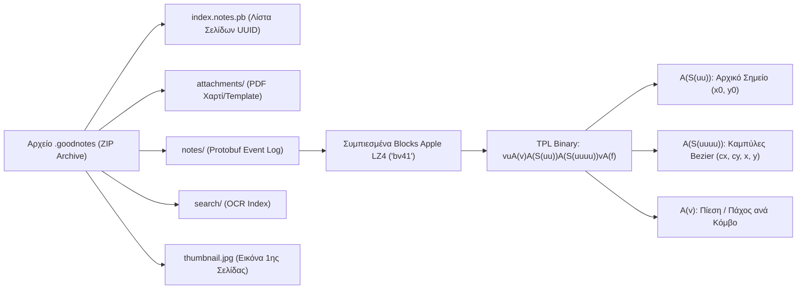
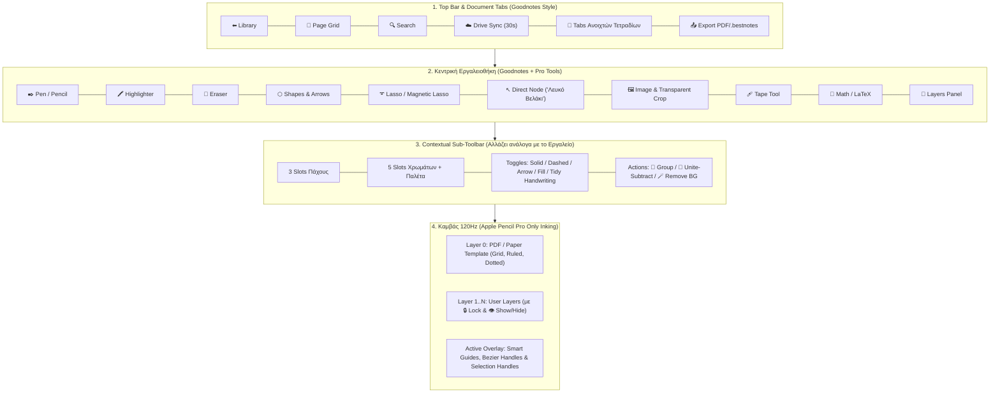
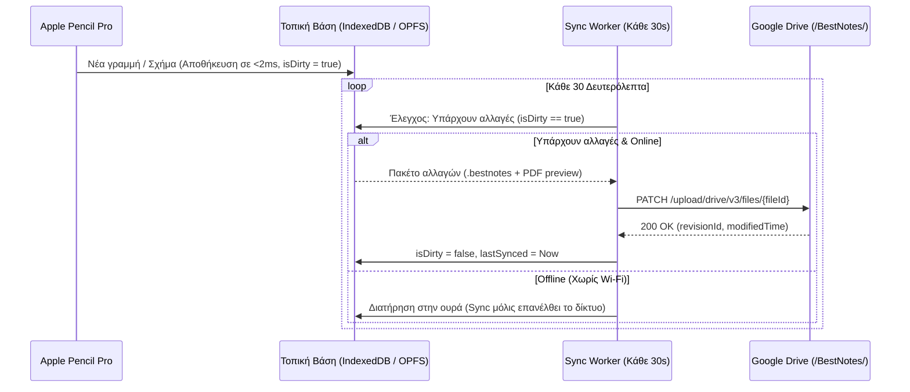

# 📘 BestNotes — Πλήρης Τεχνική Τεκμηρίωση, Αρχιτεκτονική & Roadmap Υλοποίησης

> [!IMPORTANT]
> **Κεντρική Φιλοσοφία του BestNotes:**
> Δημιουργούμε το απόλυτο εργαλείο χειρόγραφων σημειώσεων για **iPad (με Apple Pencil Pro)**, **Android Tablets** και **Web**, κρατώντας **100% το οικείο, γρήγορο UI και την αίσθηση γραφής του Goodnotes 6**, αφαιρώντας τα περιττά (ήχος/βίντεο) και ενσωματώνοντας **εγγενή γραφιστικά εργαλεία από τα Adobe Illustrator & Photoshop** καθώς και **εγγενή μαθηματικά εργαλεία & καλλωπισμό ελληνικού χειρογράφου**, με **αυτόματο συγχρονισμό στο Google Drive κάθε 30 δευτερόλεπτα**.

---

## 📑 Ευρετήριο Τεκμηρίωσης (Master Index)

1. **[1. Συγκριτικός Χάρτης Χαρακτηριστικών (Τι Κρατάμε, Τι Αφαιρούμε, Τι Προσθέτουμε)](#1-συγκριτικός-χάρτης-χαρακτηριστικών)**
   * 1.1 Τι κρατάμε 100% ίδιο με το Goodnotes 6 (UI & Core)
   * 1.2 Τι αφαιρούμε συνειδητά (Out of Scope)
   * 1.3 Τι προσθέτουμε: Γραφιστικές Υπερδυνάμεις (Illustrator + Photoshop)
   * 1.4 Τι προσθέτουμε: Μαθηματικές Υπερδυνάμεις & Καλλωπισμός Ελληνικού Χειρογράφου
2. **[2. Reverse Engineering του Goodnotes 6 (Εσωτερική Αρχιτεκτονική & Δομή Αρχείων)](#2-reverse-engineering-του-goodnotes-6)**
   * 2.1 Ακτινογραφία του Binary Format `.goodnotes`
   * 2.2 Αποκωδικοποίηση των Καμπυλών Bezier (`bv41` LZ4 + `tpl` Binary Structs)
   * 2.3 Δομή του δικού μας Format `.bestnotes` & Native `.goodnotes` Importer
3. **[3. Αρχιτεκτονική UI/UX (1:1 Κλώνος Goodnotes + Επεκτάσεις)](#3-αρχιτεκτονική-uiux)**
   * 3.1 Οθόνη Βιβλιοθήκης (Library & Folders View)
   * 3.2 Οθόνη Καμβά (Document Workspace & Εργαλειοθήκες)
   * 3.3 Τα Νέα Contextual Panels (Layers, Grouping, Bezier Nodes, Math)
4. **[4. Μηχανή Σχεδίασης Apple Pencil Pro & Εγγενείς Αλγόριθμοι (Zero-AI Core)](#4-μηχανή-σχεδίασης-apple-pencil-pro--εγγενείς-αλγόριθμοι)**
   * 4.1 Πλήρης Εκμετάλλευση του Apple Pencil Pro (Pressure, Tilt, Barrel Roll/Twist, Hover, Palm Rejection)
   * 4.2 Αλγόριθμος Μεταξένιων Καμπυλών Bezier & Καλλιγραφικού Στρωσίματος
   * 4.3 Ακαριαία Αναγνώριση & Διόρθωση Σχημάτων (Hold-to-Snap Geometric Engine)
   * 4.4 Αλγόριθμοι Photoshop: Magnetic Lasso (Sobel + Dijkstra), Freehand Alpha Crop & Transparent Background
   * 4.5 Αλγόριθμοι Illustrator: Scene Graph Groups, Direct Bezier Node Editing & Boolean Pathfinder
5. **[5. Μαθηματική Μηχανή, Καλλωπισμός Χειρογράφου & Δωρεάν LaTeX/CAS](#5-μαθηματική-μηχανή--καλλωπισμός-χειρογράφου)**
   * 5.1 Εγγενής Καλλωπισμός Ελληνικού Χειρογράφου & Μαθηματικών Συμβόλων (Χωρίς AI)
   * 5.2 Offline Συμβολική Άλγεβρα (CAS Equation Solver)
   * 5.3 Δωρεάν Μετατροπή σε Τυπωμένο $\LaTeX$ & Ελληνικό Κείμενο
6. **[6. Μηχανισμός Auto-Sync κάθε 30 Δευτερόλεπτα με Google Drive](#6-μηχανισμός-auto-sync-κάθε-30-δευτερόλεπτα-με-google-drive)**
   * 6.1 Local-First Αποθήκευση ($0\text{ms}$ Latency)
   * 6.2 Ο Κύκλος Συγχρονισμού των 30s (Delta Sync & Conflict Resolution)
7. **[7. Στρατηγική Multi-Platform: Από Web App (PWA) σε Native iPadOS & Android](#7-στρατηγική-multi-platform-από-web-app-σε-native-ipados--android)**
   * 7.1 Φάση Web/PWA στο iPad (Χωρίς Apple Developer Account)
   * 7.2 Άμεση Μετάβαση σε Native iPadOS & Android (Capacitor + Native Pencil Pro Plugin)
8. **[8. Αναλυτικό Roadmap Υλοποίησης (Βήμα-Βήμα)](#8-αναλυτικό-roadmap-υλοποίησης)**

---

## 1. Συγκριτικός Χάρτης Χαρακτηριστικών

### 1.1 Τι Κρατάμε 100% Ίδιο με το Goodnotes 6 (UI & Βασική Εμπειρία)
| Κατηγορία | Χαρακτηριστικό Goodnotes που διατηρούμε αυτούσιο |
| :--- | :--- |
| **Διάταξη UI** | **Top Document Tabs** (πολλαπλά ανοιχτά τετράδια), **Main Toolbar** στην κορυφή, **Contextual Sub-Toolbar** ακριβώς από κάτω (3 γρήγορα πάχη + παλέτα χρωμάτων + ρυθμίσεις εργαλείου). |
| **Εργαλεία Γραφής** | **Pen** (Fountain Pen, Ballpoint, Brush Pen), **Pencil** (με υφή), **Highlighter** (μπαίνει αυτόματα *κάτω* από το μελάνι με blend mode `multiply` για να μη θολώνει τα γράμματα). |
| **Εργαλεία Σβησίματος** | **Eraser** (Precision, Standard, **Stroke Eraser** που σβήνει ολόκληρη γραμμή με ένα άγγιγμα, και επιλογή *"Erase Highlighter Only"*). |
| **Gestures** | **Scribble-to-Erase** (μουτζούρωμα για άμεσο σβήσιμο χωρίς αλλαγή εργαλείου), **Hold-to-Snap** (κράτημα 0.3s στο τέλος της γραμμής για μετατροπή σε τέλειο σχήμα/ευθεία), **2-finger tap Undo / 3-finger tap Redo**. |
| **Βοηθήματα Μαθήματος** | **Tape Tool** (ταινία απόκρυψης απαντήσεων που αποκαλύπτεται με tap), **Laser Pointer** (με ουρά ή κουκκίδα για παράδοση μαθήματος), **Ruler (Χάρακας)**. |
| **Χαρτιά & PDF** | Εισαγωγή/Εξαγωγή **PDF**, **Templates Χαρτιού** (Τετραγωνισμένο/Grid, Γραμμές, Τελείες, Cornell, Μαύρο/Σκούρο χαρτί), **Page Thumbnails Grid** για αναδιάταξη/αντιγραφή σελίδων. |

### 1.2 Τι Αφαιρούμε Συνειδητά (Δεν μας ενδιαφέρουν)
* ❌ **Εγγραφή Ήχου (Audio Recording)** & Βίντεο.
* ❌ **Marketplace / Κατάστημα** με πληρωμένα αυτοκόλλητα και planners.
* ❌ **Βαριά Social / Community Feeds** που βαραίνουν το UI.

### 1.3 Τι Προσθέτουμε: Γραφιστικές Υπερδυνάμεις (Illustrator + Photoshop)
| Προέλευση | Νέο Εργαλείο στο BestNotes | Πώς λύνει τα χέρια στο μάθημα |
| :--- | :--- | :--- |
| **Illustrator** | **🔗 Group & Ungroup (Nested Groups)** | Ενώνεις σχήματα, γραμμές και βέλη (π.χ. έναν αγωγό με τα ηλεκτρόνια ή ένα κύκλωμα) σε **ένα αντικείμενο** που μετακινείται, αντιγράφεται και μεγαλώνει ενιαία. |
| **Illustrator** | **✒️ Direct Selection ("Λευκό Βελάκι" - Κόμβοι & Χερούλια Bezier)** | Πατάς πάνω σε οποιοδήποτε σχήμα ή καμπύλη και πειράζεις με το Apple Pencil τις γωνίες (Anchor Points) και τα χερούλια καμπυλότητας (Bezier Handles) χωρίς να το ξαναζωγραφίζεις. |
| **Illustrator** | **🧩 Shape Builder (Unite / Subtract / Intersect)** | Ενώνεις ή αφαιρείς γεωμετρικά σχήματα (π.χ. κύκλος μείον ορθογώνιο = κοίλος φακός ή μαγνήτης). |
| **Illustrator** | **📏 Smart Guides, Align & Distribute + Dashed/Arrow Toggles** | Αυτόματοι οδηγοί ευθυγράμμισης, 1-click **Διακεκομμένη Γραμμή (Dashed)**, 1-click **Διάνυσμα ($\vec{F}$)**, και γεμίσματα **Hatching (`///`)** για έδαφος/τοίχο. |
| **Photoshop** | **✂️ Ελεύθερο Lasso Crop σε Οποιοδήποτε Σχήμα** | Κόβεις μια εικόνα/screenshot σε **οποιοδήποτε κλειστό περίγραμμα** σχεδιάσεις με το Apple Pencil (πραγματική διαφάνεια `alpha = 0` έξω από τη γραμμή, όχι λευκό κουτί). |
| **Photoshop** | **🧲 Magnetic Lasso (Intelligent Scissors)** | Περνάς το Apple Pencil γύρω από ένα σχήμα σε εικόνα και η γραμμή κοπής **μαγνητίζεται αυτόματα πάνω στις ακμές** του αντικειμένου (Sobel + Dijkstra). |
| **Photoshop** | **🪄 1-Click Transparent BG & Magic Wand** | Αφαιρεί ακαριαία (χωρίς AI) το λευκό/γκρι φόντο από screenshots ασκήσεων/σχημάτων ώστε να φαίνονται από πίσω τα τετραγωνάκια του τετραδίου σου. |
| **Photoshop** | **📑 Layers Panel (Επίπεδα με 🔒 Lock & 👁️ Hide) + Απλές Μάσκες** | Κλειδώνεις (🔒) το Layer με το σχήμα της άσκησης για να μη σβήνεται όταν σβήνεις τις πράξεις! Κρύβεις (👁️) το Layer της λύσης και το εμφανίζεις με 1 tap στο μάθημα! |

### 1.4 Τι Προσθέτουμε: Μαθηματικές Υπερδυνάμεις & Καλλωπισμός Ελληνικού Χειρογράφου
* **✨ Εγγενές «Στρώσιμο Χειρογράφου» (Tidy Greek Handwriting — Χωρίς AI):** Κρατάει τα δικά σου ελληνικά χειρόγραφα, αλλά λειαίνει τις καμπύλες Bezier, ισιώνει τη νοητή γραμμή (baseline) ώστε οι λέξεις να μην κατηφορίζουν, και ομορφαίνει το πάχος της πένας.
* **📐 Αυτόματο Ίσιωμα Μαθηματικών Συμβόλων (Χωρίς AI):** Αναγνωρίζει γεωμετρικά τις **γραμμές κλασμάτων**, το **ίσον ($=$)**, το **συνεπάγεται ($\implies$)**, τις **παρενθέσεις** και τα **διανύσματα ($\vec{\upsilon}$)** και τα κάνει αυτόματα συμμετρικά και ευθυγραμμισμένα.
* **🧮 Μετατροπή σε $\LaTeX$ / Ελληνικό Κείμενο & Επίλυση Εξισώσεων (CAS):** Επιλογή με το Lasso για μετατροπή χειρόγραφης εξίσωσης σε τυπωμένο $\LaTeX$ (KaTeX) και άμεση επίλυση εξισώσεων μέσω ενσωματωμένης Offline Μηχανής Άλγεβρας (CAS) + Δωρεάν Gemini API.

---

## 2. Reverse Engineering του Goodnotes 6

Από την εργαστηριακή ανάλυση που κάναμε πάνω στα δικά σου αρχεία (`2026-10-22 Φυσικη Ενταση Ρευματος.goodnotes` και `2026-10-19 Φυσικη.goodnotes`), αποκωδικοποιήσαμε πλήρως την εσωτερική αρχιτεκτονική του Goodnotes:

### 2.1 Πώς Αποθηκεύονται οι Γραμμές (Το Binary Secret)
Κάθε σελίδα στον φάκελο `notes/<UUID>` είναι ένα Event-Sourcing Protobuf log που περιέχει συμπιεσμένα blocks με κεφαλίδα `bv41` (Apple Raw LZ4 compression). Όταν αποσυμπιεστεί ένα block, περιέχει ένα binary αντικείμενο `tpl` με format string:
$$\texttt{vuA(v)A(S(uu))A(S(uuuu))vA(f)}$$
* **`A(S(uu))`**: Περιέχει $2 \times \text{float32}$ — τις συντεταγμένες εκκίνησης $(x_0, y_0)$ της μύτης του Apple Pencil.
* **`A(S(uuuu))`**: Περιέχει τετράδες από $\text{float32}$ $(cx_i, cy_i, x_i, y_i)$, όπου $(cx_i, cy_i)$ είναι το σημείο ελέγχου (Control Point) και $(x_i, y_i)$ το τελικό σημείο μιας **Quadratic Bezier καμπύλης** (`Q cx cy x y`).
* **`A(v)`**: Πίνακας `uint16` με την πίεση/πάχος σε κάθε σημείο της καμπύλης.

### 2.2 Το Δικό μας Format (`.bestnotes`) & Εγγενής Εισαγωγή `.goodnotes`
1. **Native `.goodnotes` Importer:** Ενσωματώνουμε στο BestNotes τον αποκωδικοποιητή `ZIP -> Protobuf -> LZ4 (bv41) -> TPL Bezier` που ήδη κατασκευάσαμε, ώστε να μπορείς να ανοίγεις **όλα τα υπάρχοντα αρχεία `.goodnotes` σου** κατευθείαν μέσα στο BestNotes ως επεξεργάσιμα vectors!
2. **Το Format `.bestnotes`:** Θα είναι επίσης ένα συμπιεσμένο container (ή JSON/Binary bundle) που θα αποθηκεύει:
   * Τα `Pages[]` και το `Background/PDF Template`,
   * Τα `Layers[]` κάθε σελίδας (με `locked`, `visible`, `opacity`, `blendMode`),
   * Το `SceneGraph` κάθε Layer: `Strokes` (Bezier splines), `Shapes` (με παραμέτρους + κόμβους), `Groups` (λίστα παιδιών), `Images` (με `clipPath` Bezier μάσκα και `transparentBg` ρυθμίσεις), και `MathBlocks` ($\LaTeX$).

---

## 3. Αρχιτεκτονική UI/UX (1:1 Κλώνος Goodnotes + Επεκτάσεις)

---

### 3.4 Σύστημα Σχεδιασμού Warm Studio & Minimal Navy (`#0066ff`) — Υποχρεωτικό Σύνταγμα UI/UX

> [!IMPORTANT]
> **ΥΠΟΧΡΕΩΤΙΚΟΣ ΚΑΝΟΝΑΣ ΣΧΕΔΙΑΣΜΟΥ ΓΙΑ ΚΑΘΕ ΝΕΟ ΣΤΟΙΧΕΙΟ, ΜΕΝΟΥ, DASHBOARD Ή POPOVER:**
> Όλα τα νέα ή υπάρχοντα στοιχεία διεπαφής (toolbars, sub-bars, floating panels, simulation dashboards, modals, popovers) **πρέπει να εναρμονίζονται αυστηρά** με το σύστημα **Warm Studio & Minimal Navy**, αποτρέποντας κάθε πολύχρωμο "χτύπημα" (όπως neon μπλε `#0066ff`, έντονο πράσινο `#22c55e`, μοβ `#7c3aed`, ροζ `#ec4899`).

#### 🎨 Επίσημα Χρωματικά Tokens (Hex Codes)
| Κατηγορία | Hex Token | Χρήση & Περιγραφή |
| :--- | :--- | :--- |
| **Toolbars Background** | `#f7f5f0` | Κεντρική μπάρα εργαλείων & υπο-μπάρα (`bg-[#f7f5f0]`, απαλό θερμό φόντο στούντιο). |
| **Card / Surface Background** | `#fdfbf7` | Επιφάνεια dashboards, popovers, λευκών-θερμών κουμπιών και καρτών. |
| **Track / Group Background** | `#efebe3` / `#ece7dc` | Διαδρομές ομαδοποιημένων κουμπιών (font tracks, category tabs, button groups). |
| **Borders & Dividers** | `#dfd8cb` | Εξωτερικό περίγραμμα κουμπιών, panels και popovers (`border-[#dfd8cb]`). |
| **Hairline Dividers** | `#e8e2d6` | Εσωτερικοί διαχωριστές καρτών & ενοτήτων (`divide-[#e8e2d6]`, `border-t border-[#e8e2d6]`). |
| **Primary Navy Active** | `#0066ff` | **Το κυρίαρχο χρώμα ενεργής κατάστασης.** Χρησιμοποιείται σε ενεργά εργαλεία, ενεργές καρτέλες, sliders, ενεργούς διακόπτες και active rings (`bg-[#0066ff] text-white`). |
| **Inactive Text / Icons** | `#475569` / `#2c3e50` | Σκούρο γκρι/μπλε για ξεκούραστη ανάγνωση χωρίς έντονη αντίθεση. |
| **Muted Labels & Drag Grips**| `#64748b` / `#a8a29e` | Ετικέτες υποκατηγοριών, κουκκίδες λαβών μετακίνησης (`⠿`). |
| **Danger / Delete State** | `#fdf6f6` / `#b91c1c` | Απαλό ροζέ φόντο (`#fdf6f6`), λεπτό περίγραμμα (`#f3d4d4`) και διακριτικό κόκκινο κείμενο (`#b91c1c`). |
| **Toggle Switches** | `WarmStudioToggle` | Ενιαίος iOS-style διακόπτης: ενεργός `#0066ff`, ανενεργός `#dfd8cb` με λευκό slider thumb. |

#### 🔘 Ενοποίηση των OCR Εργαλείων σε Ακριβώς 3 Κουμπιά
Αντί για τον παλιό υπερκορεσμό 7 διάσπαρτων κουμπιών (`Πολύγωνο`, `textOCR`, `MathOCR`, `ChemOCR`, `3D.OCR`, `Διάγραμμα`, `Άτομο`), η υπο-μπάρα Λάσο περιλαμβάνει **ακριβώς 3 εργονομικά κουμπιά**:
1. **`T textOCR` (1 άμεσο πάτημα):** Μετατροπή χειρόγραφου ελληνικού κειμένου με επιλεγμένη γραμματοσειρά (`Πένα`, `Καλλιγραφική`, κλπ.).
2. **`Σ Math ▾` (Dropdown Popover):**
   * `Εξίσωση` (MathOCR / LaTeX)
   * `Διάγραμμα` (Αναγνώριση συναρτήσεων & χάραξη σε άξονες)
   * `Πολύγωνο` (Ένωση διακριτών ευθειών σε κλειστό πολύγωνο)
3. **`⚗ Chem ▾` (Dropdown Popover):**
   * `Αντιδράσεις` (ChemOCR με αυτόματη ισοστάθμιση)
   * `3D Μόριο` (3D.OCR με περιστρεφόμενο μόριο & νέφη φορτίου)
   * `2D (Άτομο)` (Προσομοίωση μοντέλου Bohr & Περιοδικός Πίνακας)

---

## 4. Μηχανή Σχεδίασης Apple Pencil Pro & Εγγενείς Αλγόριθμοι

### 4.1 Πλήρης Εκμετάλλευση του Apple Pencil Pro
| Δυνατότητα Apple Pencil Pro | Πώς την αξιοποιούμε στο BestNotes |
| :--- | :--- |
| **Pressure (`event.pressure`)** | Δυναμική αυξομείωση πάχους γραμμής (Fountain Pen / Brush) και αδιαφάνειας (Pencil). |
| **Tilt (`tiltX`, `tiltY`, `altitudeAngle`)** | Πλαγίασμα μύτης για φυσική σκίαση με το Μολύβι ή πλατιά γραμμή στον Μαρκαδόρο. |
| **Barrel Roll (`event.twist`)** | Το **Apple Pencil Pro** διαθέτει γυροσκόπιο περιστροφής (`twist` 0°–359°)! Καθώς περιστρέφεις το Pencil γύρω από τον άξονά του, περιστρέφεται η πλατιά μύτη της Καλλιγραφικής Πένας και ο κέρσορας! |
| **Hover (`pointermove` με `pressure = 0`)** | Πριν καν ακουμπήσει η μύτη στην οθόνη (έως 12mm απόσταση), εμφανίζεται **ακριβής προεπισκόπηση του πάχους/χρώματος** ή του μεγέθους της Γόμας! |
| **Squeeze & Haptics** | Στη Native iPadOS έκδοση (μέσω Capacitor plugin), το **ζούληγμα (Squeeze)** του Apple Pencil Pro ανοίγει ακαριαία την κυκλική παλέτα εργαλείων (Pen/Eraser/Lasso/Group) ακριβώς κάτω από τη μύτη με απτική δόνηση (Haptic click). Στη Web έκδοση ενεργοποιούμε εναλλακτικά το **Scribble-to-Erase** + **Floating Quick-Switch**. |
| **Palm Rejection (`pointerType === 'pen'`)** | Όταν γράφεις, η παλάμη αγνοείται 100%. Το 1 δάχτυλο κάνει Pan, τα 2 δάχτυλα Pinch-to-Zoom & Tap-to-Undo. |

### 4.2 Αλγόριθμος Μεταξένιων Καμπυλών Bezier & StreamLine
Για να μην εμφανίζονται ποτέ «σπαστές» γωνίες όταν γράφεις γρήγορα εξισώσεις:
1. Συλλέγουμε όλα τα υπο-γεγονότα στα $120\text{Hz}-240\text{Hz}$ μέσω `event.getCoalescedEvents()`.
2. Εφαρμόζουμε **One-Euro Filter (Adaptive Low-Pass Filter)**: όταν κινείς αργά το Pencil φιλτράρει το τρέμουλο του χεριού, ενώ όταν κινείς γρήγορα μηδενίζει το lag.
3. Μετατρέπουμε τα σημεία $P_0, P_1, \dots, P_n$ σε **Quadratic Bezier Splines** χρησιμοποιώντας τα μέσα των τμημάτων $M_i = \frac{P_i + P_{i+1}}{2}$ ως σημεία σύνδεσης ($C^1$ συνέχεια):
   $$\mathbf{B}_i(t) = (1-t)^2 M_{i-1} + 2(1-t)t P_i + t^2 M_i, \quad t \in [0, 1]$$

### 4.3 Ακαριαία Αναγνώριση & Διόρθωση Σχημάτων (Hold-to-Snap)
Όταν η ταχύτητα της μύτης του Apple Pencil πέσει κοντά στο μηδέν ($v < \epsilon$) για $300\text{ms}$ στο τέλος μιας γραμμής:
1. **Έλεγχος Ευθείας:** Υπολογίζουμε τον λόγο ευθύτητας $R = \frac{\|P_n - P_0\|}{\sum_{i=1}^n \|P_i - P_{i-1}\|}$. Αν $R > 0.91$, η γραμμή αντικαθίσταται από τέλειο ευθύγραμμο τμήμα (και αν η γωνία είναι $\pm 4^\circ$ από $0^\circ, 45^\circ, 90^\circ$, κάνει snap).
2. **Έλεγχος Κλειστού Σχήματος:** Αν $\|P_n - P_0\| < 0.18 \cdot L_{\text{total}}$:
   * Τρέχουμε τον αλγόριθμο **Ramer-Douglas-Peucker (RDP)** + ανίχνευση τοπικών μεγίστων καμπυλότητας για εύρεση κορυφών $V$:
   * **3 Κορυφές $\rightarrow$ Τρίγωνο** (με αυτόματο snap σε ορθογώνιο/ισοσκελές αν είναι κοντά).
   * **4 Κορυφές $\rightarrow$ Ορθογώνιο ή Παραλληλόγραμμο** (έλεγχος παραλληλίας απέναντι πλευρών και γωνιών $\approx 90^\circ$), με επιλογή αυτόματου ημιδιαφανούς γεμίσματος (`Fill`).
   * **0 Γωνίες (Ομαλή κλειστή καμπύλη) $\rightarrow$ Κύκλος ή Έλλειψη** μέσω **Least-Squares Ellipse Fitting (Fitzgibbon)**, που παράγει 4 τέλεια Bezier τόξα.

### 4.4 Αλγόριθμοι Photoshop (100% Εγγενείς — Χωρίς AI)
* **🧲 Magnetic Lasso (Intelligent Scissors / Live-Wire):**
  1. Υπολογισμός **Sobel Gradient** $G = \sqrt{G_x^2 + G_y^2}$ στην περιοχή της εικόνας.
  2. Ορισμός συνάρτησης κόστους ακμής $C(p, q) = \frac{1}{1 + \alpha G(q)}$.
  3. Καθώς σέρνεις το Apple Pencil, ο αλγόριθμος **Dijkstra Shortest Path** σε παράθυρο ακτίνας $20\text{px}$ βρίσκει σε πραγματικό χρόνο το μονοπάτι που «κολλάει» πάνω στο περίγραμμα υψηλής αντίθεσης του σχήματος!
* **✂️ Freehand Lasso Crop:**
  Η κλειστή καμπύλη Bezier που σχεδιάζεις αποθηκεύεται ως `clipPath` της εικόνας. Κατά το rendering εκτελείται `ctx.clip(path2D)` ώστε όλο το εξωτερικό μέρος να είναι **100% διαφανές**.
* **🪄 1-Click Transparent Background & Magic Wand:**
  * **Color-to-Alpha (Luminance Smooth Thresholding):** Για κάθε pixel $(R, G, B)$ υπολογίζεται η χρωματική απόσταση $d = \|C_{\text{pixel}} - C_{\text{bg}}\|$ από το φόντο (λευκό/γκρι) και αποδίδεται ομαλό κανάλι διαφάνειας $\alpha = \text{smoothstep}(T_1, T_2, d)$ ώστε να μην υπάρχουν «λευκά δοντάκια» γύρω από τα γράμματα.
  * **Magic Wand (Flood-Fill BFS):** Αφαιρεί μόνο το εξωτερικό συνεχόμενο φόντο, κρατώντας τα εσωτερικά λευκά γεμίσματα του σχήματος ανέπαφα.

### 4.5 Αλγόριθμοι Illustrator (100% Εγγενείς — Χωρίς AI)
* **🔗 Scene Graph Grouping:** Κάθε αντικείμενο έχει `parentId` / `GroupNode`. Ο πίνακας μετασχηματισμού ενός Group $\mathbf{M}_{\text{group}}$ (μετακίνηση, κλίμακα, περιστροφή) πολλαπλασιάζεται αυτόματα με όλα τα παιδιά του ($\mathbf{M}_{\text{world}} = \mathbf{M}_{\text{group}} \cdot \mathbf{M}_{\text{child}}$).
* **✒️ Direct Node Editing ("Λευκό Βελάκι"):** Επιλέγοντας ένα σχήμα ή καμπύλη, εμφανίζονται στην οθόνη τα σημεία $P_i$ (τετράγωνα κουτάκια) και τα σημεία ελέγχου $C_i$ (κυκλικά χερούλια), επιτρέποντας άμεση μετακίνηση με το Apple Pencil.

---

## 5. Μαθηματική Μηχανή & Καλλωπισμός Χειρογράφου

### 5.1 Εγγενής Καλλωπισμός Ελληνικού Χειρογράφου (Χωρίς AI)
1. **Ομαδοποίηση σε Γραμμές & Λέξεις:** Τα strokes που γράφεις ομαδοποιούνται χωρικά (μέσω προβολής στον άξονα $Y$ και $X$).
2. **Baseline Straightening (Ίσιωμα Γραμμής):** Βρίσκεται η κάτω βάση (lower envelope) κάθε λέξης και μετατοπίζεται κάθετα ($\Delta y$) ώστε όλη η ελληνική πρόταση να πατάει τέλεια πάνω στην οριζόντια γραμμή του χαρτιού.
3. **Laplacian Bezier Smoothing:** Εξομαλύνει τις απότομες ακμές των γραμμάτων διατηρώντας 100% τον δικό σου ελληνικό γραφικό χαρακτήρα.
4. **Γεωμετρική Αναγνώριση Μαθηματικών Συμβόλων:**
   * Δύο παράλληλες μικρές οριζόντιες γραμμές σε απόσταση $\Delta y < 25\text{px} \rightarrow$ **Τέλειο Ίσον ($=$)**.
   * Οριζόντια γραμμή που έχει strokes ακριβώς από πάνω και ακριβώς από κάτω $\rightarrow$ **Τέλεια Οριζόντια Γραμμή Κλάσματος**.

### 5.2 Δωρεάν Μετατροπή σε $\LaTeX$ & Offline Επίλυση Εξισώσεων (CAS)
* **Offline CAS Solver:** Ενσωμάτωση της ανοιχτής μαθηματικής μηχανής **Nerdamer / CortexJS Compute Engine** (100% offline & δωρεάν) για άμεσο υπολογισμό παραστάσεων, απλοποίηση κλασμάτων και επίλυση εξισώσεων (π.χ. $15 \cdot t = 90 \implies t = 6$).
* **Δωρεάν OCR ($\LaTeX$ + Ελληνικά):** Σύνδεση με το **Δωρεάν Gemini API (Google AI Studio Free Tier — 1.500 δωρεάν κλήσεις/ημέρα χωρίς κάρτα)** + απόδοση πάνω στον καμβά μέσω **KaTeX** σε μορφή υψηλής ευκρίνειας (SVG/Vector).

---

## 6. Μηχανισμός Auto-Sync κάθε 30 Δευτερόλεπτα με Google Drive

* **Μηδενική Απώλεια Δεδομένων (Local-First):** Κάθε φορά που σηκώνεις τη μύτη του Apple Pencil από την οθόνη, η αλλαγή γράφεται ακαριαία ($<2\text{ms}$) στην τοπική βάση του iPad (`IndexedDB`).
* **Αυτόματος Συγχρονισμός 30s:** Ένας background timer τρέχει κάθε **30 δευτερόλεπτα**. Αν το τετράδιο έχει αλλάξει (`isDirty === true`), ανεβάζει αθόρυβα τη νέα έκδοση στον φάκελο `/BestNotes/` του **Google Drive** σου (μέσω Google Drive API v3 OAuth2) χωρίς να «παγώνει» καθόλου η γραφή σου!

---

## 7. Στρατηγική Multi-Platform: Από Web App σε Native iPadOS & Android

1. **Στάδιο 1 — Web App / PWA (Τρέχει ΣΗΜΕΡΑ στο iPad σου χωρίς Developer Account):**
   * Τεχνολογία: **React 19 + TypeScript + Vite + HTML5 Low-Latency Canvas (`desynchronized: true`) + Tailwind CSS**.
   * Εγκατάσταση στο iPad: Το ανοίγεις στο Safari $\rightarrow$ *Add to Home Screen* $\rightarrow$ τρέχει σε **100% Full Screen** σαν native app, χωρίς το όριο των 7 ημερών της Apple.
2. **Στάδιο 2 — Native iPadOS & Android Tablet App (Μηδενικό Ξαναγράψιμο Κώδικα):**
   * Ενσωματώνουμε το **Capacitor (Ionic/CapacitorJS)** πάνω στο ίδιο ακριβώς project.
   * Με μία εντολή (`npx cap add ios` & `npx cap add android`) παράγονται έτοιμα native projects για **Xcode (iPadOS)** και **Android Studio (Android Tablets)**.
   * Στο iPadOS προσθέτουμε ένα μικρό native Swift bridge (`PencilProPlugin.swift`) που δίνει στο UI μας πρόσβαση και στο **Squeeze gesture** και στο **Haptic Engine** του Apple Pencil Pro!

---

## 8. Αναλυτικό Roadmap Υλοποίησης (Βήμα-Βήμα)

| Φάση | Τίτλος Φάσης | Τι παραδίδουμε και δοκιμάζεις στο iPad σου |
| :--- | :--- | :--- |
| **Φάση 1** | **Core Canvas, Goodnotes UI & Apple Pencil Pro Inking** | • Πλήρες UI Goodnotes (Top Tabs, Main Toolbar, Contextual Sub-Toolbar, Τετραγωνισμένο/Ruled χαρτί). • Μηχανή Apple Pencil Pro (Pressure, Tilt, Barrel Roll, Hover, Palm Rejection, 120Hz Bezier). • Εργαλεία: Pen (3 τύποι), Pencil, Highlighter (κάτω από το μελάνι), Eraser (Stroke & Precision + Scribble-to-Erase), Tape Tool, Laser, Dashed Lines & Vector Arrows ($\vec{F}$). • **Hold-to-Snap Shapes:** Ακαριαία διόρθωση σε Ευθείες, Ορθογώνια (με Fill), Παραλληλόγραμμα, Κύκλους/Ελλείψεις, Τρίγωνα. |
| **Φάση 2** | **Εργαλεία Illustrator (Groups, Nodes, Layers, Smart Guides)** | • **Lasso Selection** & κουμπί **🔗 Group / Ungroup**. • **Direct Selection Tool ("Λευκό Βελάκι")** για επεξεργασία γωνιών και χερουλιών Bezier. • **Layers Panel** με 🔒 Lock Layer, 👁️ Show/Hide, Opacity. • **Shape Builder** (Unite / Subtract) & Hatching fills (`///`). |
| **Φάση 3** | **Εργαλεία Photoshop (Lasso Crop, Magnetic Lasso, Transparent BG)** | • Εισαγωγή εικόνων/screenshots στον καμβά. • **Ελεύθερο Lasso Crop** σε οποιοδήποτε σχήμα με πραγματική διαφάνεια. • **🧲 Magnetic Lasso** (Sobel Edge Detection + Dijkstra Live-Wire). • **🪄 1-Click Transparent Background** & **Magic Wand** (Flood-Fill). |
| **Φάση 4** | **Καλλωπισμός Ελληνικού Χειρογράφου, Μαθηματικά & $\LaTeX$** | • Εγγενές κουμπί **✨ Στρώσιμο Χειρογράφου** (Baseline straightening + Curve smoothing) & αυτόματο ίσιωμα σε $=$, κλάσματα, $\implies$. • Offline **CAS Equation Solver** + Δωρεάν μετατροπή σε τυπωμένο **$\LaTeX$ (KaTeX) / Ελληνικό Κείμενο** μέσω Google AI Studio Free Tier. |
| **Φάση 5** | **Library, `.goodnotes` / PDF Importer & Google Drive 30s Sync** | • Οθόνη Βιβλιοθήκης (Φάκελοι, Τετράδια, Αναζήτηση). • **Native `.goodnotes` File Importer** (για να ανοίγεις τα υπάρχοντα αρχεία Φυσικής σου!) + PDF Import/Export. • **Google Drive Auto-Sync κάθε 30 δευτερόλεπτα** + Local IndexedDB persistence. |
| **Φάση 6** | **PWA Packaging & Native iPadOS / Android Wrapper** | • Πλήρες Offline PWA manifest για iPad Home Screen. • Ρύθμιση Capacitor για εξαγωγή σε Native iPadOS & Android Tablet apps. |

---

## 9. Κατάσταση Έργου — Έκδοση `v0.99 (pendulumSimFullyFunctional)`: Τι Κάναμε (`✅`) & Τι Χρωστάμε (`⏳`)

> [!NOTE]
> **Τρέχουσα Έκδοση:** **`v0.99 — pendulumSimFullyFunctional`** (14 Νοεμβρίου 2026)
> **Live Web App (Primary):** [https://explainboards.web.app](https://explainboards.web.app) & [https://mybestnotes.web.app](https://mybestnotes.web.app) (και [https://bestnotes-2026.web.app](https://bestnotes-2026.web.app))
> **GitHub Repository:** [https://github.com/kfrei/bestNotes](https://github.com/kfrei/bestNotes)

> [!IMPORTANT]
> **🎨 Κανόνας Σχεδίασης UI & Εικονιδίων (Premium Minimalist Monochrome UI & Unified Top Bar Standard):**
> * **Διακριτικές Μπάρες & Κουμπιά Λευκά-Μπεζ:** Όλες οι αιωρούμενες μπάρες εργαλείων και τα κουμπιά σχεδιάζονται σε ήρεμους, ζεστούς τόνους **λευκού-μπεζ (`#fdfbf7`, hover `#efeadd`)** πάνω σε διακριτική μπεζ/stone επιφάνεια (`#f5f3ee/95`) με λεπτό περίγραμμα (`border-stone-300/80`), αποφεύγοντας τα έντονα πολύχρωμα κουμπιά.
> * **Ενιαία Τεχνοτροπία Πάνω Σκούρας Μπάρας (`#263961`):** Όλα τα κουμπιά της επάνω μπάρας (`16:9`, `1/2`, `Synced`, `Λήψη`, `Live TV`, `Live PDF`, `Share`) ακολουθούν την ίδια σκούρα τεχνοτροπία (`bg-[#263961] hover:bg-[#31487a] text-sky-200 font-semibold text-[11px] rounded-lg`).
> * **Τυπογραφία Γκρι 80% (`#333333`):** Τα γράμματα και τα σύμβολα των κουμπιών χρησιμοποιούν **σκούρο γκρι 80% (`#333333`)** (και `#1f1f1f` με `bg-stone-200/95` όταν ένα κουμπί είναι ενεργό).
> * **Μονόχρωμα, Απλά & Καθαρά Εικονίδια (`Monochrome Vector Icons`):** Κάθε φορά που προστίθεται ή ενημερώνεται εικονίδιο στο UI, πρέπει να είναι **μονόχρωμο μαύρο/σκούρο γκρι (`stroke="currentColor"`), απλό, καθαρό διανυσματικό SVG** που θυμίζει σύγχρονο premium UI (χωρίς πολύχρωμα emojis).

### 9.1 ✅ Τι Έχουμε Ολοκληρώσει Πλήρως έως την `v0.99 (pendulumSimFullyFunctional)`

#### Α00000000. Πλήρης Προσομοίωση Απλού Εκκρεμούς, Χρονόμετρο Διπλής Γωνίας & Αρθρωτοί Πυρήνες Προσομοιώσεων & STEM/OCR (`v0.99 — pendulumSimFullyFunctional + Modular Architecture`)
* **🧩 Αρθρωτός Πυρήνας Προσομοιώσεων (`src/simulations/` — Βήμα 1):**
  * Δημιουργία της νέας plug-and-play αρχιτεκτονικής προσομοιώσεων: `ISimulationModule`, `SimulationRegistry`, `PhysicsMath` (2D vector utilities), `UniversalStopwatchBridge` (pub/sub) και `VirtualPencilAnimator` (κινούμενο μολυβάκι).
  * Απομόνωση του `StopwatchWidget` και του `FullscreenLaserCanvas` σε ανεξάρτητα επαναχρησιμοποιήσιμα components, ελαφρύνοντας το `App.tsx` κατά εκατοντάδες γραμμές κώδικα με 100% διατήρηση λειτουργικότητας.
* **🔬 Αρθρωτός Πυρήνας STEM & Vision OCR (`src/stem-engines/` — Βήμα 2):**
  * Δημιουργία ενιαίας δομής και facade index για Μαθηματικά (Τυπολόγιο, Συναρτήσεις), Χημεία (Περιοδικός Πίνακας, Αντιδράσεις, 3D Μόρια) και Vision OCR prompts.
  * Απομόνωση των 3 ενοποιημένων popover κουμπιών Λάσο (`textOCR`, `Σ Math ▾`, `⚗ Chem ▾`) στο αυτόνομο component `LassoOcrButtons.tsx`, μειώνοντας δραστικά την πολυπλοκότητα του κεντρικού καμβά.
* **🕰️ Φυσικά Ακριβές Απλό Εκκρεμές (Simple Pendulum):**
  * Εύρος μήκους $0.3\text{m} \le L \le 2.0\text{m}$ με διαδραστική ρύθμιση μέσω slider αλλά και απευθείας με κατακόρυφη σύρση του σφαιριδίου στο χαρτί ($23\text{px} = 0.1\text{m}$).
  * Αυστηρός υπολογισμός δυναμικής τάσης νήματος $T = mg(3\cos\theta - 2\cos\theta_{\max})$ με αποτροπή διάτρησης του ταβανιού.
  * Αυτόματη βηματική σύνθεση συνισταμένης $\Sigma\vec{F}$ σε 3 βήματα με κινούμενο μολύβι (κανόνας παραλληλογράμμου).
  * Διαδραστική ανάλυση σε άξονες $x, y$ (κεντραρισμένους στη σφαίρα, $y$ στο μισό της ακτίνας, $x$ επιμηκυμένος) και ελεύθερη σύρση σε παύση χωρίς αυτόματη εκκίνηση.
  * Δυναμική εμφάνιση κάρτας πλάτους $\theta_{\max}$ μόνο εφόσον ξεκινήσει η ταλάντωση ή υπάρξει εκτροπή.
* **⏱️ Ψηφιακό Χρονόμετρο Ακριβείας (Precision Stopwatch):**
  * Αλλαγή μεγέθους και από τις δύο κάτω γωνίες (Dual-Corner Resize: κάτω-δεξιά & κάτω-αριστερά με σταθερό δεξί άκρο).
  * Έξυπνη αρχική τοποθέτηση ακριβώς κάτω από τον πίνακα προσομοίωσης με ίδιο πλάτος ($304\text{px}$).
  * Μνήμη θέσης και μεγέθους στο `localStorage`.
  * Προσαρμοστικά κουμπιά: `▶ Έναρξη` στο $0$, `❚❚ Παύση` σε κίνηση, `▶ Συνέχεια` σε παύση με $t > 0$, `↺ Μηδεν.` για ταυτόχρονο μηδενισμό και επαναφορά του εκκρεμούς.
* **🔴 Καθολικό Κόκκινο Laser & Presentation Lock:**
  * Καθολική κάλυψη viewport (`z-[100000]`), σχεδίαση πάνω από όλα τα dashboards, modals και χρονόμετρο.
  * Presentation Lock: αποτροπή κατά λάθος ενεργοποίησης κουμπιών κατά την παρουσίαση.
  * Ζωντανή αναμετάδοση στο Live TV ($16:9$).

#### Α0000000. Πλήρης Εναρμόνιση Warm Studio & Minimal Navy (`#0066ff`), 3 Κουμπιά OCR & Option B Dashboards (`v0.99 — WarmStudio`)
* **🏛️ Ενιαία Χρωματική Παλέτα Warm Studio & Minimal Navy (`#0066ff`):**
  * Πλήρης κατάργηση των έντονων "χτυπητών" χρωμάτων (neon μπλε `#0066ff`, σμαραγδί `#22c55e`, μωβ `#7c3aed`, κλπ.) από όλες τις εργαλειοθήκες, υπο-μπάρες, popovers, αιωρούμενα pills και dashboards προσομοιώσεων.
  * Κεντρική μπάρα εργαλείων & υπο-μπάρες σε θερμό φόντο `#f7f5f0` με λεπτό περίγραμμα `#dfd8cb`.
  * Όλα τα κουμπιά εργαλείων, μνήμης πάχους, διακεκομμένης γραμμής, στρωσίματος και ενεργών επιλογών έχουν κοινό **ενεργό φόντο Navy `#0066ff`** με λευκό κείμενο/εικονίδιο (`text-white`) και **ανενεργό φόντο `#fdfbf7`** με περίγραμμα `#dfd8cb`.
* **🔘 Ενοποίηση των Εργαλείων OCR σε Ακριβώς 3 Εργονομικά Κουμπιά:**
  * **`T textOCR` (Άμεσο πάτημα):** Μετατροπή χειρόγραφου κειμένου στην επιλεγμένη γραμματοσειρά (`Πένα`, `Καλλιγραφική`, κλπ.).
  * **`Σ Math ▾` (Dropdown Popover):** Συγκεντρώνει `Εξίσωση` (MathOCR / LaTeX), `Διάγραμμα` (Συναρτήσεις / Άξονες) και `Πολύγωνο` (Ένωση ευθειών).
  * **`⚗ Chem ▾` (Dropdown Popover):** Συγκεντρώνει `Αντιδράσεις` (ChemOCR με στοιχειομετρική ισοστάθμιση), `3D Μόριο` (3D.OCR περιστρεφόμενο με νέφη) και `2D (Άτομο)` (Μοντέλο Bohr & Περιοδικός Πίνακας).
  * Αυτόματο κλείσιμο των dropdowns με κλικ οπουδήποτε εκτός (`data-popover-panel="lasso-ocr"`) ή με πλήκτρο `Escape`.
* **⚙️ Ανασχεδιασμός Dashboards Προσομοίωσης (Option B Warm Studio):**
  * Ενιαίο συμπαγές παράθυρο σε `#fdfbf7` με λεπτό περίγραμμα `#dfd8cb` και διακριτική ένδειξη ενεργής προσομοίωσης (Navy/Green dot).
  * Διαδρομή επιλογής κατηγορίας (`Κυκλώματα`, `Ελατήρια`, `Δυνάμεις`, `Άτομο`) σε `#efebe3` με ενεργό tab `#0066ff`.
  * Ενιαίος διακόπτης **`WarmStudioToggle`** (iOS-style switch με ενεργό `#0066ff` και ανενεργό `#dfd8cb`) που αντικατέστησε όλα τα ετερόκλητα native browser checkboxes σε όλες τις καρτέλες.
  * Καθαρά μονόχρωμα διανυσματικά εικονίδια (`currentColor`) στη θέση παλιών emojis μέσα στο UI.
* **🏷️ Ανασχεδιασμός Βιβλιοθήκης (Screens 1 & 2):**
  * Navy Blue `#0066ff` & Dot-Grid `#f8f7f4`, μεγαλύτερες portrait μικρογραφίες (`76×102px`) στα `Πρόσφατα Ανοιγμένα`, δυναμικά chips φίλτρων με όριο `count >= 3`, και ακαριαίο desktop hover preview 1ης σελίδας.

#### Α000000. Δελταϊκός Συγχρονισμός Φακέλων Google Drive με Auto-Resume, Πραγματικό `KaTeX` στο PDF, Κόκκινες Γραμμές Ευθυγράμμισης Κειμένου, Μικρο-Κινήσεις Πληκτρολογίου & Επέκταση Βιβλιοθήκης STEM (`v0.98 — mainFixes`)
* **🔄 Αναδρομικός Δελταϊκός Συγχρονισμός Φακέλων με Google Drive (`handleSyncFolderTreeToGoogleDrive`):**
  * Κουμπί συγχρονισμού (`RefreshCw`) δεξιά από το Αστέρι (`⭐`) στις κάρτες και γραμμές φακέλων (Grid & List view), το οποίο εμφανίζεται **αποκλειστικά** όταν υπάρχει ενεργή σύνδεση Google Drive (`driveAccessToken || driveEmail`).
  * **Έξυπνη Οπτική Ένδειξη Κατάστασης & Badge Πλήθους:** Κόκκινα βελάκια (`text-red-500`) με **κόκκινο κυκλικό badge (`pendingDriveCount`)** όταν υπάρχουν τροποποιημένα/νέα αρχεία ή υποφάκελοι προς συγχρονισμό, περιστρεφόμενα κόκκινα βελάκια (`bn-drive-sync-spin`) κατά τη διάρκεια του συγχρονισμού, και γκρι/μαύρη εμφάνιση χωρίς badge (όμοια με το μολύβι επεξεργασίας) όταν όλα τα περιεχόμενα είναι συγχρονισμένα.
  * **Delta Sync, Persistent Auto-Resume & Multi-Device State (`drive_sync_meta_v1`):** Μεταφορτώνει μόνο τα τετράδια που έχουν αλλαγές (`isNotebookDriveSynced` / `driveSyncedRecords`) με επί τόπου `PATCH` ενημέρωση του ίδιου Drive αρχείου (`uploadOrUpdateDriveFile`, διατηρώντας link & ιστορικό εκδόσεων), αποθηκεύει την πρόοδο στο `localStorage` για auto-resume μετά από `Refresh`, και συγχωνεύει τα timestamps/records συγχρονισμού στο Firestore (`pushDriveSyncMetaToCloud` & `mergeAndApplyRemoteDriveSyncMeta`) ώστε όλες οι συσκευές του λογαριασμού (Mac mini ↔ iPad) να βλέπουν άμεσα τι έχει ήδη συγχρονιστεί.
* **🧮 Αυθεντική Απόδοση `MathOCR` (`KaTeX`) στην Εξαγωγή & Συγχρονισμό PDF (`drawKatexMathObjectForPdf`):**
  * Απόδοση όλων των μαθηματικών παραστάσεων `MathOCR` (`\simeq`, `\,`, κλάσματα `\frac`, ρίζες `\sqrt` με διανυσματικό `Path2D`, διανύσματα `\vec`, εκθέτες/δείκτες, ελληνικά σύμβολα) απευθείας στον 2D PDF Canvas με πραγματική διάταξη και γραμματοσειρές `KaTeX` (viewport-safe DOM measurement με `opacity: 0` χωρίς `visibility: hidden` culling & automatic canvas fallback, 100% Safari/iPadOS/Chrome συμβατό) και έκδοση `mathPdfVer: 3` για στοχευμένη ενημέρωση μόνο των PDF με `MathOCR`.
* **📏 Έξυπνες Κόκκινες Γραμμές Ευθυγράμμισης σε Πλαίσια Κειμένου & Μικρο-Κινήσεις Πληκτρολογίου:**
  * Λεπτές κόκκινες γραμμές ευθυγράμμισης (`#ef4444`) **πάνω, κάτω, αριστερά, δεξιά και στο κέντρο** με μαγνητικό κούμπωμα κατά τη μετακίνηση πλαισίων κειμένου (`applyTextDragMove` & `Lasso Move`).
  * Μικρο-μετακίνηση (`1.5px` ή `5px` με `Shift`) με τα βελάκια πληκτρολογίου (`↑ ↓ ← →`) για οποιοδήποτε επιλεγμένο αντικείμενο στον καμβά.
* **⚡ Θωράκιση Αναγνώρισης Κυκλωμάτων, Δυναμική Προσαρμογή Βρόχου Καλωδίων, `title-box` Σκιάς & Επέκταση Βιβλιοθήκης STEM:**
  * Απενεργοποίηση αυτόματης μαντεψιάς στοιχείων κυκλώματος εκτός ενεργής προσομοίωσης `⚡ Κυκλώματα` (ώστε γράμματα όπως `η` ή `π` να μη μετατρέπονται σε πηγή/μπαταρία) και αποκλεισμός τους από άσχετα magnets (`classifyCircuitStrokeKind`).
  * **Ενιαία Προσαρμογή Βρόχου Κυκλώματος (`adaptCircuitWiresOnComponentMove`, `adaptCircuitWiresOnScaleTransform`, `getCircuitWireRailSnapDelta`):** Κατά τη μετακίνηση εξαρτήματος ή το stretch/μετακίνηση καλωδίου (`scale-x`/`scale-y`/`move`), όλα τα συνδεδεμένα καλώδια & εξαρτήματα του κλάδου προσαρμόζονται ανά ακριβή δείκτη κορυφής (`p0Idx`/`p1Idx`), με διατήρηση ευθειών χωρίς S-curve παραμόρφωση κατά τη συγκόλληση/μετασχηματισμό (`upgradeQuadraticSegmentIfCurved`, `updateEditedLineWireHandles`), ενώ η αλλαγή χρώματος του λαμπτήρα ενημερώνει και το εσωτερικό του νήμα (`bulb-coil`, `bulb-lead-l`, `bulb-lead-r`) σε Editor & PDF (`googleDrivePdfSync.ts`).
  * Προεπιλογή γραμματοσειράς **`Πένα`** (χωρίς Bold) στο `textOCR`, σταθερό γέμισμα με **διαφάνεια `90%`** στο πλαίσιο τίτλου με σκιά (`title-box`) και χειρονομία εξωτερικής γωνίας σκιάς κάτω-δεξιά (`tryMatchShadowCornerOnBox`) για μετατροπή ορθογωνίου σε στρογγυλεμένο `title-box`.
  * Εμπλουτισμός βιβλιοθήκης (`mindMapsCatalog.ts` & `stickersCatalog.ts`) με transparent σκίτσα **Πλανήτη Γη** (3D έγχρωμο ανάγλυφο & μονόχρωμο bronze σκίτσο με tags `γη`, `πλανήτης`), εκατοντάδες σχεδιαγράμματα **Φυσικής, Χημείας, Βιολογίας & Γεωγραφίας** και νέες διαδραστικές σημειώσεις επιστημών.

#### Α00000. Ιεραρχικοί Φάκελοι (`customFolders`), Ζωντανή Μετάδοση `Live TV` (`16:9`) στον Διαδραστικό Πίνακα & Native PDF Reader Mode (`v0.95 — customFoldersLiveTransmit`)
* **📁 Ιεραρχικοί Φάκελοι & Υποφάκελοι Πολλαπλών Επιπέδων (`customFolders`), Δίχρωμες Κάρτες & Θωρακισμένος Πολυ-Συσκευαστικός Συγχρονισμός:**
  * **Δίχρωμες Σιλουέτες Φακέλων (`Two-Tone Folder Silhouettes`):** Κάρτες φακέλων με γλωττίδα (tab) σε 10 επιλεγμένα χρώματα, 20 διανυσματικά εικονίδια χωρίς περίγραμμα, κουμπί Αγαπημένων (`⭐`), Επεξεργασίας (`✎`) και Διαγραφής (`🗑️`), διαδραστικό Breadcrumb (`🏠 Βιβλιοθήκη > Γυμνάσιο Αρναίας > Α1`), φίλτρο **`⭐ Αγαπημένα`**, live **Δέντρο Μετακίνησης Φακέλων (`├─` / `└─`)** στο modal επεξεργασίας, και προβολή **`Εικονίδια` vs `Λίστα`** (με οριζόντια εξώφυλλα για Landscape σημειώσεις).
  * **Multi-Device Cloud Sync Anti-Overwrite (`userEditedFoldersInSessionRef` & `mergeFolderListsByPath`):** Αποτρέπει αυστηρά μια δεύτερη συσκευή (π.χ. iPad που ξυπνάει από αναμονή) από το να στείλει παλιό `localStorage` state στο Cloud αν ο χρήστης δεν έχει κάνει ρητή επεξεργασία στη συνεδρία αυτή. Αποθηκεύει τα `folderStyles` τόσο στο `users/{uid}` όσο και ενσωματωμένα στις σημειώσεις και συγχωνεύει ανά φάκελο με βάση το νεότερο `updatedAt`, ώστε κανένας υποφάκελος (ακόμα και κενός, π.χ. `Β1`, `Γ2`) ή χρώμα/εικονίδιο να μη χάνεται ποτέ.
  * **Αυτόματος Συγχρονισμός Υποφακέλων σε PDF στο Google Drive (`performDrivePdfSync`):** Δημιουργεί αυτόματα τους υποφακέλους (`Α1, Β1, Β2, Γ1, Γ2`) μέσα στον φάκελο προορισμού του Google Drive.
* **📡 Ζωντανή Μετάδοση `Live TV` (`src/utils/liveTvSync.ts`) από το iPad στον Διαδραστικό Πίνακα (`16:9`):**
  * **Dual-Transport `WebRTC P2P DataChannel` + `Firestore Real-Time` + `BroadcastChannel`:** Σύνδεση 1-κλικ μεταξύ iPad (`Live TV`) και Διαδραστικού Πίνακα (`📺 Live 16:9` στην Αρχική Σελίδα χωρίς Login), με αυτόματη P2P σύνδεση WebRTC (`~5–15ms`) και ταυτόχρονο Cloud Firestore fallback (`live_tv/global_board`) για σχολικά δίκτυα.
  * **Πλήρης Ζωντανή Μετάδοση Γραφής (`Wet-Ink`), `Laser`, `Pan/Zoom` & Προσομοιώσεων:** Μεταδίδει σε πραγματικό χρόνο κάθε κίνηση της μύτης του Apple Pencil, το Laser Pointer, το Pan/Zoom (με αναγωγή κλίμακας στην ανάλυση `16:9` του πίνακα), τις σελίδες και τις προσομοιώσεις (`Sim`).
* **📕 Native Διαχείριση Μεγάλων Βιβλίων `.pdf` & Εικόνων + «Κόφτης» (`📖 Απλή Ανάγνωση & Υπογράμμιση`) + Auto Multi-Page Grid (`< 50%` Zoom):**
  * **Native Αποθήκευση PDF στο IndexedDB (`saveRawPdfToIndexedDB` & `ensurePdfPageDataUrl`):** Τα αρχεία `.pdf` (π.χ. βιβλίο Φυσικής 170 σελίδων, `13.1 MB`) αποθηκεύονται αυτούσια ως binary `ArrayBuffer` στο IndexedDB (παραμένοντας **`13.1 MB`** αντί για `127 MB`, με σήμανση **`.pdf`** ή **`.jpg / .png`**) και γίνονται render **on-demand** μόνο για τις ορατές σελίδες, με διάφανο `staticCanvas` πάνω από το `` για ακαριαία γραφή $120\text{Hz}$.
  * **«Κόφτης» — Λειτουργία Απλής Ανάγνωσης & Υπογράμμισης (`isLightweightDocMode`):** Ενεργοποιείται **μόνο** σε εισαγόμενα αρχεία `.pdf` και `.image` (χωρίς να επηρεάζει ποτέ τα δικά μας αρχεία `.bestNotes`), απενεργοποιώντας τα βαριά συστήματα (AI Auto-Tags, Sim, OCR, Κόμβους, Layers, κουμπιά `+ Πριν / Διαγραφή / + Σελίδα Μετά`) και κρατώντας καθαρή μπάρα με **Μολύβι** (με αυτόματο Πλαίσιο/Κύκλο στο κράτημα), **Highlighter**, **Γόμα**, **Επιλογή** και **Laser**.
  * **Αυτόματο Multi-Page Grid στον Editor όταν `Σελίδες > 5` και `Zoom < 50%`:** Εμφανίζει αυτόματα πλέγμα 4 σελίδων ανά σειρά για ταχύτατο scroll σε μεγάλα βιβλία, και με κλικ σε οποιαδήποτε σελίδα μεταβαίνει ακαριαία σε αυτήν.
  * **Ενιαίος Κάδος Ανακύκλωσης (Cloud + IndexedDB `${uid}__recycle_bin`):** Διασφαλίζει ότι ακόμα και μεγάλα τοπικά PDF πηγαίνουν πάντα στον `Κάδο` κατά τη διαγραφή.
* **👆 2-Finger Swipe Back/Forward (`← / →`) & Εργονομία Editor:**
  * Οριζόντιο swipe με 2 δάχτυλα στην επάνω μπάρα ή στη Βιβλιοθήκη για άμεση επιστροφή (`Back / Forward`) στην προηγούμενη σημείωση ή στη Βιβλιοθήκη, κουμπιά περιστροφής σελίδας `↺ / ↻` πάνω δεξιά στη σελίδα (μετά το `+ Πριν`) με fade-in/fade-out, και πιο ευδιάκριτο διακεκομμένο πλαίσιο επιλογής (`1.45px`, `[6, 4]`).

#### Α0000. Premium Minimalist Monochrome UI, Αυστηρή Επιλογή Πάνω σε Γραμμή/Γράμμα, Χειρόγραφα Βέλη & Παρενθέσεις, 6 Ελληνικές Γραμματοσειρές & Αδιάλειπτη Ροή Φορτίων (`v0.93 — PremiumMinimalUI`)
* **🎨 Premium Minimalist Monochrome UI & Κανόνας Μονόχρωμων Εικονιδίων:**
  * **Λευκά-Μπεζ Κουμπιά & Γράμματα Γκρι 80% (`#333333`):** Ανασχεδιασμός της αιωρούμενης μπάρας Κειμένου/Μαθηματικών (`bg-[#f5f3ee]/95`) ώστε όλα τα κουμπιά (`Καλλιγρ./Πένα/...`, `B`, `A-`, `A+`, Στοίχιση, `xⁿ`, `xᵢ`, `Math`, `Γράφ.`, `Chem`, `3D`, Μολύβι Επεξεργασίας, Κάδος Διαγραφής) να έχουν ενιαίο **λευκό-μπεζ φόντο (`#fdfbf7`)** και **γράμματα/εικονίδια σε γκρι 80% (`#333333`)**, καταργώντας τα πολύχρωμα φόντα.
  * **Μονόχρωμα Διανυσματικά Εικονίδια Κυκλωμάτων & Εργαλείων:** Στο κουμπί **`Σχήματα`** τοποθετήθηκε η **μονόχρωμη Μπαταρία** μας (με το σώμα, τον θετικό πόλο και τα `+ / -`) και στο κουμπί **`Σύμβολα`** η **μονόχρωμη Αντίσταση** (κλασικό ζιγκ-ζαγκ `resistor`), ενώ η έναρξη/διακοπή κυκλώματος έγινε **μικρό τετράγωνο κουμπί Play/Pause** (πράσινο/κόκκινο εικονίδιο χωρίς κείμενο) στην ίδια γραμμή δίπλα στα γκρι κουμπιά **`Ένωση`** και **`Ολοκλήρωση`**.
* **🎯 Διακριτικά Πλαίσια Επιλογής & Αυστηρή Επιλογή Μόνο Πάνω σε Γραμμή/Γράμμα (`Strict Ink/Glyph Hit-Testing`):**
  * **Ενιαίο Λεπτό Γκρι Διακεκομμένο Πλαίσιο (`#94a3b8`, `1px`, `[4, 3]`):** Τόσο τα πλαίσια Κειμένου/Μαθηματικών όσο και τα Σχήματα/Γραμμές εμφανίζουν το ίδιο διακριτικό γκρι διακεκομμένο πλαίσιο επιλογής.
  * **Νέα Χερούλια Σχημάτων:** Γκρι γωνιακές τελείες (`#94a3b8`), πορτοκαλί μεσαίες τελείες stretch (`#f97316`) χωρίς εξωτερικά βελάκια, και συμπαγές γκρι κουμπί περιστροφής πάνω από το άνω χερούλι.
  * **Επιλογή Μόνο Πάνω σε Μελάνι ή Γράμμα:** Τα πλαίσια κειμένου επιλέγονται **μόνο** όταν κάνουμε κλικ πάνω σε πραγματικό γράμμα (`isPagePointOnTextGlyphs` σε offscreen canvas) και τα κούφια σχήματα/γραμμές **μόνο** πάνω στη γραμμή τους (`allowHollowInterior = false`), ώστε τα κλικ στο κενό εσωτερικό να μην ενεργοποιούν ποτέ κατά λάθος αντικείμενα.
* **🏹 Αυτόματη Συγχώνευση Χειρόγραφης Μύτης Βέλους & Κράτημα Παρένθεσης (`Hold-to-Snap`):**
  * **Χειροκίνητη Μύτη Βέλους → Ενιαίο Βέλος (`tryMatchManualArrowheadOnLine`):** Όταν μετά από μια αυτόματη ευθεία γραμμή σχεδιάζουμε κοντά στην άκρη της μια μικρή μυτούλα (`>` ή τριγωνάκι), ενώνεται αυτόματα σε **1 ενιαίο διανυσματικό βέλος (`arrow` ή `double-arrow`)** με γεμάτη τριγωνική μύτη.
  * **Κράτημα Παρένθεσης `(` ή `)` (`recognizeAndSnapShape`):** Όταν σχεδιάζουμε παρένθεση και κρατάμε πατημένο το μολύβι, αναγνωρίζεται ως **καθαρή, κατακόρυφα ευθυγραμμισμένη συμμετρική παρένθεση (`arc`)** χωρίς να μετατρέπεται ποτέ σε ευθεία ή έλλειψη.
* **🔤 6 Ελληνικές Γραμματοσειρές & Μορφοποίηση Επιλεγμένου Κειμένου Πολλαπλών Γραμμών:**
  * Κύκλος 6 ελληνικών γραμματοσειρών: **`Καλλιγρ.`** (`ExplainBoardsHand`), **`Πένα`** (`Comfortaa`), **`Μαρκ.`** (`Mansalva`), **`Χειρ.`** (`ExplainBoardsPen`), **`Ρέουσα`** (`GFS Neohellenic`), **`Τυπωμ.`** (`Inter`).
  * Μορφοποίηση επιλεγμένου τμήματος κειμένου (`applyStyleToTextRange` για μέγεθος, χρώμα, γραμματοσειρά, Bold) ακόμα και σε πλαίσια πολλαπλών γραμμών, και `Shift+Enter` για σφιχτή αλλαγή γραμμής (`\u200B\n`).
* **⚡ Αδιάλειπτη Ροή Φορτίων Κυκλώματος, Βαθμιδωτός Λαμπτήρας, Καρτέλες & Προβολή `16:9`:**
  * **Μηδενικό Κόμπιασμα Φορτίων (`simAnimOriginMsRef`):** Χρήση ενιαίου μονοτονικού ρολογιού χωρίς reset της φάσης όταν ενημερώνεται η σελίδα (π.χ. στη συγχώνευση βέλους 2s μετά), και δυναμικό πλήθος φορτίων ανάλογα με την περίμετρο του κυκλώματος (`round(loopLen / 38)`).
  * **Βαθμιδωτή Ευθυγράμμιση Δεξιάς Επαφής Λαμπτήρα (`bulb.rightTerm.y`):** Κατά τη μετατροπή `Σχήματα ↔ Σύμβολα` και την `Ολοκλήρωση`, το δεξί οριζόντιο καλώδιο προς τον λαμπτήρα κατεβαίνει αυτόματα πιο χαμηλά ώστε να πατάει στη δεξιά/κάτω επαφή της βιδωτής βάσης.
  * **Καρτέλες Τετραδίων & 1-Click `16:9`:** Δυναμικό πλάτος καρτελών (`w-fit`) με λιγότερο στρογγυλεμένες πάνω γωνίες (`rounded-t-lg`), αξιόπιστη επιστροφή στη Βιβλιοθήκη όταν κλείνει η τελευταία καρτέλα (`explicitlyClosedAllTabsRef`), και άμεση ενεργοποίηση **100% Πλάτους & Πλήρους Οθόνης** με 1 κλικ στο κουμπί **`16:9`**.

#### Α000. Προσομοίωση Ατόμων (Bohr), Περιοδικός Πίνακας, `ChemOCR`, 3D Μόρια, Δυνάμεις, Νόμος Hooke, Βιβλιοθήκη Φυσικής & Live PDF (`v0.92 — AtomSimReady`)
* **⚛️ Διαδραστική Προσομοίωση Ατόμων (Μοντέλο Bohr), Περιοδικός Πίνακας (`H–Rn`), Χημικοί Δεσμοί, `ChemOCR` & 3D Μόρια (`3D.OCR`):**
  * **Μοντέλο Bohr & Περιοδικός Πίνακας (`H` έως `Rn`, $Z = 1\dots 86$):** Δημιουργία ατόμου από ομόκεντρους κύκλους με κουκκίδες ηλεκτρονίων (`Άτομο` στο Λάσο) ή από τον συρόμενο, γωνιακά κλιμακούμενο **Περιοδικό Πίνακα**, με επιτόπιο μετασχηματισμό επιλεγμένου ατόμου, ισοτοπικό badge κάτω από τον πυρήνα (${}^{12}_{6}\text{C}, \text{Άνθρακας}$), αληθινούς εκθέτες ιοντικού φορτίου ($\text{Ca}^{2+}, \text{O}^{2-}$) και αναλογική λαβή resize (`↘`).
  * **Κανόνες Ηλεκτρονίων Σθένους κατά Lewis / Hund σε Όλα τα Στοιχεία:** Στην εξωτερική στιβάδα ($L, M, N, \dots$), για **1–4 ηλεκτρόνια σθένους** ($\text{Na}=1, \text{Mg/Ca}=2, \text{B/Al}=3, \text{C/Si}=4$) όλα τα ηλεκτρόνια τοποθετούνται **μονήρη** ($90^\circ$ συμμετρικά), ενώ για **5–8 ηλεκτρόνια σθένους** σχηματίζονται $(n-4)$ **ασύζευκτα ζεύγη (lone pairs)** και $(8-n)$ **μονήρη ηλεκτρόνια** ($\text{N}=1\text{ ζεύγος}+3\text{ μονήρη}, \text{O}=2\text{ ζεύγη}+2\text{ μονήρη}, \text{F/Cl}=3\text{ ζεύγη}+1\text{ μονήρες}, \text{Ne/Ar}=4\text{ ζεύγη}$), διατηρώντας τα ασύζευκτα ζεύγη και κατά τους ομοιοπολικούς δεσμούς.
  * **Ζωντανός Ιοντικός & Ομοιοπολικός Δεσμός (`2D`) & `ChemOCR`:** Αυτόματη στοιχειομετρική ισοστάθμιση χημικών αντιδράσεων (π.χ. $\color{red}{2}\text{Ca} + \text{O}_2 \to \color{red}{2}\text{CaO}$) με animation βέλους αντίδρασης ($2\text{s}$). Οι διορθωμένοι συντελεστές εμφανίζονται με **κόκκινο χρώμα χωρίς πλαίσιο** και με **κλικ πάνω σε κόκκινο συντελεστή** εμφανίζεται το μήνυμα **`Διόρθωση: ...`** (που κλείνει με κλικ οπουδήποτε αλλού). Πλήρης υποστήριξη επιλογής με **Λάσο**, μετακίνησης (drag) και resize από **4 γωνιακές λαβές** στις κάρτες αντιδράσεων.
  * **Διαδραστικά 3D Μόρια (`2D ↔ 3D` & `3D.OCR`):** Τρισδιάστατη απεικόνιση μορίων ($\text{H}_2\text{O}, \text{CH}_4, \text{CO}_2, \text{NH}_3, \text{NaCl}$, κ.λπ.) με συνεχή αυτόματη περιστροφή $360^\circ$, διαδραστικό στρίψιμο, νέφη ηλεκτρονικού φορτίου ($\delta^+, \delta^-$) και διατήρηση/επαναφορά στη σελίδα.
* **🏹 Διαδραστική Προσομοίωση Δυνάμεων (`🏹 Δυνάμεις` — Ανάλυση, Σύνθεση, Κεκλιμένο Επίπεδο, Εκκρεμές):**
  * Χειρόγραφη συναρμολόγηση με κινούμενο μολύβι (`Άμεση` / `Βηματική`), ανάλυση σε $F_x = F\sigma\upsilon\nu(\theta)$ & $F_y = F\eta\mu(\theta)$, σύνθεση με κανόνα παραλληλογράμμου, ελεύθερη περιστροφή $360^\circ$ από την αιχμή, μαγνητικές Πυθαγόρειες ακέραιες τριάδες στο 1ο τεταρτημόριο και προαιρετική κάρτα υπολογισμών.
* **⚖️ Νόμος του Hooke (`F_ελ - Δl`), Συρμός Σταθμών `0,1 kg`, Μαγνητικός Δείκτης & Κατακόρυφος Χάρακας (`cm`):**
  * Αλυσιδωτή ανάρτηση σταθμών `0,1 kg` (`hooked-weight`) με αποσβενόμενη ταλάντωση $2.35\text{s}$ και επιμήκυνση $1\text{cm}$ ανά σταθμό, μαγνητικός δείκτης ελατηρίου (`spring-pointer`) με κινούμενες έγχρωμες γραμμές προβολής προς τον κατακόρυφο χάρακα (`90°`, `cm`), διαδραστικός πίνακας τιμών $(m, W = m\cdot 10, \Delta l)$ και live διάγραμμα $F_{\text{ελ}} - \Delta l$ στον καμβά με animation ευθείας $2\text{s}$.
* **📈 Επέκταση Μηχανής Διαγραμμάτων Φυσικής (`K-t`, `U-t`, Ιεραρχία `t → x → u`, `PV = nRT` & Βιβλιοθήκη Φυσικής Γυμνασίου–Λυκείου):**
  * **Διαγράμματα Ενέργειας – Χρόνου ($K - t$ & $U - t$):** Αναγνώριση και σχεδίαση των $K = \frac{1}{2}mu_{\max}^2\sigma\upsilon\nu^2(\omega t)$ (και `u^2_max`) και $U = \frac{1}{2}DA^2\eta\mu^2(\omega t)$ με μη-αρνητικούς λοβούς ενέργειας, οριζόντιο άξονα $t$ χαμηλά, οδηγό κορυφής `E, K_max` / `E, U_max` και υποδιαιρέσεις `T/2, 1T, 1.5T`.
  * **Φθίνουσα Ταλάντωση ($x = A_0 e^{-\Lambda t}\sigma\upsilon\nu(\omega t)$ & $A = A_0 e^{-\Lambda t}$):** Με συμμετρικές εκθετικά φθίνουσες μπλε διακεκομμένες περιβάλλουσες $\pm A_0 e^{-\Lambda t}$.
  * **Καθολική Ιεραρχία Ανεξάρτητης Μεταβλητής Φυσικής (`t` → `x` → `u`):** Προτεραιότητα στον χρόνο $t$, έπειτα στη θέση $x$ ($\Sigma F = -Dx$) και έπειτα στην ταχύτητα $u$ ($K = \frac{1}{2}mu^2$).
  * **Καταστατική Εξίσωση Ιδανικών Αερίων ($PV = nRT$):** Ισόθερμη $P - V$ (υπερβολή με $(V_1, P_1), (V_2, P_2)$), Ισόχωρη $P - T$ και Ισοβαρής $V - T$.
  * **Ενσωματωμένη Βιβλιοθήκη Εξισώσεων Φυσικής Γυμνασίου–Λυκείου (Ελέγχεται Πρώτη):** Κινηματική (ΕΟΚ, ΕΟΜΚ), Δυναμική, Ορμή, Έργο, Ισχύς, Τριβή, Νόμος Ohm, Πολική Τάση ($V_\pi = E - Ir$), Ισχύς Joule, Ενέργεια Πυκνωτή/Πηνίου, Coulomb/Βαρύτητα ($1/r^2$), Δυναμικό/Μαγνητικό Πεδίο/Κυματική ($1/r, \lambda = u/f, T = 1/f$), Εκθετική Διάσπαση ($N = N_0 e^{-\lambda t}, I = I_0 e^{-t/\tau}$).
* **📄 Πλήρης Εξαγωγή Προσομοιώσεων σε PDF, Interactive `Live PDF` (`.live.html`), Responsive Fit-to-Width Καμβάς & Συμπαγές Λάσο:**
  * Ακριβής σχεδίαση ενεργών κυκλωμάτων, ημιτόνων Bezier, σταθμών `0,1 kg`, πίνακα/διαγράμματος Hooke, ατόμων Bohr και δεικτών/εκθετών στο PDF export, διαδραστικό `Live PDF` (`.live.html`), δυναμική προσαρμογή πλάτους/ύψους σελίδας όταν στενεύει το παράθυρο του browser και συμπαγή κουμπιά Λάσο (`textOCR`, `MathOCR`, `ChemOCR`, `3D.OCR`, `Διάγραμμα`, `Άτομο`, `Group`).

#### Α00. Αυτόματη Σχεδίαση Μαθηματικών & Φυσικών Διαγραμμάτων, Πολυ-παροχικό MathOCR & Προσομοίωση Ελατηρίων (`v0.9 — mathOCR&GraphsV0.1`)
* **📈 Μηχανή Σχεδίασης Μαθηματικών & Φυσικών Διαγραμμάτων (`parseAndPlotEquationGraph` & Κουμπί `Διάγραμμα`):**
  * **Αυτόματη Σχεδίαση από Χειρόγραφο ή Κείμενο/Math (`0 AI Calls` για Text/Math):** Πατώντας το πράσινο κουμπί **`Διάγραμμα`** σε επιλογή Λάσο (χειρόγραφες εξισώσεις) ή σε πλαίσιο `Text` / `Math` (άμεσα μέσω του τοπικού συμβολικού αναλυτή χωρίς κλήση AI), δημιουργείται πλήρες σύστημα αξόνων με καμπύλες, οδηγούς και τυπογραφικές ετικέτες `GFS Neohellenic`.
  * **Γεωμετρικές, Αλγεβρικές & Τριγωνομετρικές Συναρτήσεις:** Ευθείες ($y = ax + b$), Παραβολές ($y = ax^2 + bx + c$), Πολυώνυμα ($y = ax^3 + \dots$), Κύκλοι ($x^2 + y^2 = R^2$, $(x-x_0)^2 + (y-y_0)^2 = R^2$), Ελλείψεις ($\frac{x^2}{a^2} + \frac{y^2}{b^2} = 1$), Υπερβολές ($xy = c$, $\frac{x^2}{a^2} - \frac{y^2}{b^2} = 1$) με κλειδωμένη αναλογία $1:1$ σε $(x,y)$, και Τριγωνομετρικές συναρτήσεις ($\sin, \cos, \eta\mu, \sigma\upsilon\nu$) με συμβολικά πολλαπλάσια του $\pi$.
  * **Διαγράμματα Ταλαντώσεων & Ενέργειας Φυσικής:** Χρονικά διαγράμματα $x(t), u(t), a(t), F(t)$ με ακριβή ανάλυση αρχικής φάσης $\phi_0$ (π.χ. $u = -u_{max}\eta\mu(\omega t)$ ή $u = u_{max}\sigma\upsilon\nu(\omega t + \frac{\pi}{2})$), υποδιαιρέσεις περιόδου ($\frac{T}{2}, 1T, 1.5T$) και κατακόρυφο διακεκομμένο οδηγό στην $1T$ για συνημίτονα, καθώς και διαγράμματα $K(u), U(x), K(x), E(x)$ (με ετικέτες κορυφής $E, K_{max}$ και $E, U_{max}$) και $\Sigma F(x), a(x)$ (με $+\Sigma F_{max} / -\Sigma F_{max}$).
  * **Πολλαπλές Συναρτήσεις σε Κοινό Σύστημα Αξόνων (`y1, y2` / `u1, u2`):** Σχεδίαση πολλαπλών εξισώσεων στο ίδιο σύστημα αξόνων με αμφίδρομο συγχρονισμό χρώματος εξίσωσης ↔ καμπύλης και ανεξάρτητη ρύθμιση χρώματος/στυλ γραμμής ανά καμπύλη.
  * **Animation Χειρόγραφης Σχεδίασης με Στυλό (`0.7s` Άξονες + `2.0s` Καμπύλη):** Προοδευτική σχεδίαση με κινούμενο χέρι και πένα πάνω σε double-buffered canvas χωρίς React re-renders.
* **🧮 Πολυ-παροχικό AI MathOCR ($\LaTeX$ / `KaTeX`), Ελληνική Φυσική & `Text2Math`:**
  * **Αλυσίδα Gemini Vision + Groq Vision + Mistral Pixtral Fallback:** Χρήση των `gemini-2.5-flash`, `gemini-flash-latest`, `gemini-2.5-flash-lite`, `gemini-flash-lite-latest`, `gemini-robotics-er-1.5-preview` με αυτόματο fallback σε **Groq** (`meta-llama/llama-4-scout-17b-16e-instruct`) και **Mistral** (`ministral-14b-2512`, `ministral-8b-2512`, `pixtral-12b-2409`), και ασφαλή JSON/LaTeX parser (`safeParseVisionJson`).
  * **Ελληνική Σημειογραφία Φυσικής & Μαθηματικών:** Ακριβής αναγνώριση των ελληνικών `συν` ($\sigma\upsilon\nu$) και `ημ` ($\eta\mu$) χωρίς σύγχυση με `sin` ή `m/s`, πεζής ταχύτητας $u = u_{max}$ έναντι δυναμικής ενέργειας $U = U_{max}$, χειρόγραφου ελληνικού $\pi$ (με μακρύτερη δεξιά γραμμή που μοιάζει με $\eta$) μέσα σε φάσεις $(5\pi t + \pi)$ ή $\frac{\pi}{2}$, και αυτόματο φιλτράρισμα τυχαίων τελειών ώστε να μην επινοείται ποτέ ψευδής 2η γραμμή (`u = 1`).
  * **Κουμπί `Text2Math` & Προσαρμοσμένες Λαβές Resize:** Μετατροπή απλού κειμένου σε εξίσωση `KaTeX` με κουμπιά εκθέτη (`xⁿ`) και δείκτη (`xᵢ`), εμφάνιση μόνο των 4 μικρών γωνιακών λαβών (`10px`) στα πλαίσια `Math` και όλων των στενών πλαϊνών/γωνιακών λαβών στα πλαίσια `Text`.
* **🌀 Διαδραστική Προσομοίωση Ελατηρίων & Α.Α.Τ. (`🌀 Ελατήρια` στο `Sim`):**
  * Κουμπί `Sim` γκρι από προεπιλογή που γίνεται πράσινο μόνο όταν ενεργοποιηθεί κατηγορία (`⚡ Κυκλώματα` ή `🌀 Ελατήρια`).
  * Αυτόματος μαγνητισμός μάζας κάτω από ελατήριο, κλώνος Θέσης Ισορροπίας (Θ.Ι.) με ομαλή απόσβεση ($0.82\text{s}$) από το φυσικό μήκος $l_0$, οδηγοί $l_0, \text{Θ.Ι.}, +A, -A$, αριστερή κλίμακα θέσης με **Live Scrubbing**, 4 επιλογές αρχικής φάσης ($\text{Θ.Ι. }\upsilon\uparrow, \text{Θ.Ι. }\upsilon\downarrow, +A, -A$), δυναμικά διανύσματα $\vec{W}, \vec{F}_{\text{ελ}}, \Sigma\vec{F}$, συζευγμένος ρυθμιστής συχνότητας $f = \frac{1}{2\pi}\sqrt{\frac{k}{m}}$ και live διαγράμματα $x(t), u(t), a(t)$ πάνω στο χαρτί.
* **✥ Ενιαία Μετακίνηση Πολλαπλών Αντικειμένων (`Move-Only Selection`), Έξυπνο `Paste` & Session Persistence:**
  * Ενιαία μετακίνηση όταν το Λάσο/Ορθογώνιο επιλέγει μαζί `Text`/`Math` και διαγράμματα/γραμμές/εικόνες, εμφάνιση του `Paste` μόνο σε κενή επιλογή Λάσο/Ορθογωνίου, γαλάζια κουμπιά `Cut`/`Copy`, πλήρης διατήρηση συνεδρίας στο `sessionStorage` και εμφάνιση μεγεθών αρχείων (`KB / MB`) στη Βιβλιοθήκη.

#### Α0. Διαδραστική Προσομοίωση Ηλεκτρικών Κυκλωμάτων (`v0.8 — electricSimV0.1`)
* **⚡ Ονοματισμένες Προσομοιώσεις Κυκλωμάτων ανά Τετράδιο (`sim01`, `sim02`, `sim03`, ...):**
  * Αναγνώριση κυκλωμάτων ή επιλογή με Λάσο + πάτημα **`Sim`**, με αυτόματη απόκρυψη του πλαισίου επιλογής του Λάσο ώστε να μη δημιουργεί οπτικό θόρυβο.
  * Ενιαία λίστα `sim01`, `sim02`, `sim03` με ενσωματωμένο μολυβάκι μετονομασίας (`✎`) και διαγραφή (`✕`), με δυνατότητα **ταυτόχρονης και ανεξάρτητης εκτέλεσης πολλαπλών κυκλωμάτων** στην ίδια ή διαφορετικές σελίδες.
  * Πατώντας σε οποιοδήποτε `sim01` / `sim02`, η σελίδα εκτελεί **ομαλό scroll (`scrollToCircuitSim`, `420ms` cubic ease-out)** κεντράροντας το αντίστοιχο κύκλωμα στην οθόνη.
  * *Σημείωση:* Για την αναλυτική τεκμηρίωση των πρόσφατων σφαλμάτων κυκλωμάτων (πολλαπλές ταυτόχρονες sims, κενό διακόπτη, σταθερότητα σχεδίων στο refresh, και προσανατολισμός αμπερομέτρου), δείτε το [`docs/BUGS_CIRCUIT_SIMULATION.md`](file:///Users/freiderikosk/Downloads/BestNotes/docs/BUGS_CIRCUIT_SIMULATION.md).
* **✨ Αυτόματη Ολοκλήρωση Κυκλώματος (`✨ Ολοκλήρωση`) με 4 Κόμβους Ολίσθησης (`tl`, `tr`, `br`, `bl`):**
  * Αυτόματη ευθυγράμμιση των στοιχείων στον πάνω/κάτω κλάδο και πρόταση ολοκλήρωσης του βρόχου με **μαύρη διακεκομμένη γραμμή (`#111827`)** και **Διακόπτη** στον αριστερό κατακόρυφο κλάδο.
  * Με το πάτημα του **`✓ Αποδοχή`** πάνω στο σχήμα, αν υπήρχαν μόνο στοιχεία χωρίς γραμμές δημιουργείται **μαύρη συνεχής γραμμή**, ενώ αν υπήρχε ήδη σχεδιασμένο τμήμα κυκλώματος **κληρονομείται αυτόματα ο τύπος γραμμής (`lineStyle`), το χρώμα, το πάχος, το `penType` και η διαφάνεια** των υπαρχόντων καλωδίων, και καταχωρείται αυτόματα ως νέο `sim02` / `sim03`.
  * Οι **4 γωνιακοί κόμβοι (`tl`, `tr`, `br`, `bl`)** επιτρέπουν οριζόντια ολίσθηση των κατακόρυφων καλωδίων (`↔`) χωρίς παραμόρφωση των στοιχείων, και κατακόρυφη μετακίνηση (`↕`) της οριζόντιας γραμμής **μαζί με όλα τα ηλεκτρικά στοιχεία που ανήκουν στον κλάδο αυτόν** (`topCompStrokeIds` / `botCompStrokeIds`).
* **🔵 Ζωντανή Φυσική Κυκλωμάτων $60\text{fps}$ (`analyzeCircuitForSimulation`):**
  * Κίνηση ηλεκτρονίων (`Μπλε Ηλεκτρόνια` ή `Πράσινη Ενέργεια`, `Πραγματική` vs `Συμβατική Φορά`, ρυθμιστικό ταχύτητας, προαιρετικός `Σκούρος Σωλήνας Καλωδίων`) σε σειρά και παράλληλους κλάδους, ακολουθώντας πιστά τα ζιγκ-ζαγκ δόντια των αντιστατών (`resistor`).
  * Διαδραστικός **Διακόπτης (`Switch`)** πάνω στον καμβά και στο αριστερό panel (`🟢 Διακόπτης: Κλειστός` / `🔴 Διακόπτης: Ανοιχτός`), φωτοβολία Λαμπτήρα (`bulb`) και περιστροφή Φτερωτής (`fan`).
  * **1-Click Μετατροπή `Σχήματα ↔ Σύμβολα`:** Εναλλαγή Μπαταρίας ↔ Πηγής Τάσης και Λαμπτήρα/Φτερωτής ↔ Αντιστάτη με σταθερό `circuitBox` και αυτόματη γεφύρωση καλωδίων.
  * **Στιγμιαία Αναλαμπή Αγωγών (`0.56s`):** Ηλεκτρική κυανή αναλαμπή στις γραμμές του κυκλώματος όταν πατιέται η ευθυγράμμιση αγωγών ή η αποδοχή ολοκλήρωσης.
  * **Υποστήριξη `Sim Group` & Φτερωτής (`Fan`):** Διατήρηση αναγνώρισης όλων των στοιχείων (`bulb`, `fan`, `battery`, `switch`, `resistor`) ακόμα κι όταν ολόκληρο το κύκλωμα γίνει `Group`, επιλεκτικό γέμισμα/χρώμα μόνο στα πτερύγια και το περίγραμμα της Φτερωτής, και προεπιλογή του **Ορθογώνιου Πλαισίου Επιλογής (`rect`)** κατά την είσοδο στο Select/Lasso.

#### Α. Μηχανή Γραφής 120Hz Apple Pencil, Εργονομία Μύτης & Απόδοση Καμβά
* **Dual-Canvas 2x Retina HiDPI (`1840×2520`, `desynchronized: true`):** Ανεξάρτητο wet-ink overlay canvas για $0\text{ms}$ απόκριση στην πρώτη επαφή του Apple Pencil, ακόμα και σε μικροσκοπικά σημεία, τόνους και εκθέτες.
* **100% Αναλλοίωτο Χειρόγραφο Μετά το Σήκωμα της Μύτης (`commit 890a614`):** Απενεργοποιήθηκε πλήρως η μετα-εξομάλυνση (post-stroke relaxation) στο `smoothStrokeToBezier`, ώστε ό,τι γράφεις με το μολύβι να παραμένει **100% ίδιο** χωρίς καμία αλλοίωση.
* **Αυτόματη Επιλογή Λεπτότερης Μύτης (`2.0px`, `commit f91549f`):** Κάθε φορά που επιστρέφεις στο Μολύβι / Πένα, επιλέγεται αυτόματα το 1ο (πιο λεπτό) από τα 3 αποθηκευμένα πάχη γραμμής.
* **Βελτιστοποιημένο `Hold-to-Snap` (`0.56s` & ελάχιστη διαγώνιος `28px`, `commit 100a5fa`):** Αυξήθηκε ο χρόνος κρατήματος στα $560\text{ms}$ με ελάχιστη διαγώνιο $28\text{px}$ ώστε κατά τη γρήγορη χειρόγραφη γραφή τα γράμματα να μη μετατρέπονται ποτέ κατά λάθος σε κύκλους ή τετράγωνα.
* **Apple Pencil Double-Tap & Barrel Roll (`commit cf31f63`) + Καθαρό iPadOS Touch (`commit e29a599`):** Υποστήριξη διπλού tap πάνω στο Apple Pencil και αφαίρεση του πειραματικού κρατήματος 1 δαχτύλου + μολυβιού που ακύρωνε το stylus στο iPadOS.

#### Β. Νέα Σχήματα Φυσικής, Ηλεκτρισμού, Κυκλωμάτων & Ταλαντώσεων (`v0.7`)
* **📈 Διάγραμμα Ταλάντωσης / Κύματος (`wave-axes`, `commits f37071e, c5ab017`):**
  * Κατακόρυφος και κεντρικός οριζόντιος άξονας με βέλη + **2 απολύτως παράλληλες οριζόντιες διακεκομμένες γραμμές πλάτους ($+A$ / $-A$)**.
  * Χερούλια πάνω στον καμβά για ανεξάρτητη μετακίνηση (`↕`) ή συμμετρική ρύθμιση πλάτους (`⇕ ±A`) χωρίς να μεταβάλλονται οι άξονες, καθώς και επιλογή χρώματος αποκλειστικά για τις διακεκομμένες γραμμές.
* **💡 Λαμπτήρας (`bulb`, `commit 85692c4`):** Γυάλινος θόλος που στενεύει ομαλά σε βιδωτή βάση με σπείρες.
* **🔋 Μπαταρία (`battery`, `commit 85692c4`):** Οριζόντιο σώμα μπαταρίας με προεξέχοντα θετικό πόλο και σύμβολα `+` (αριστερά) και `-` (δεξιά).
* **⚡ Πηγή Τάσης (`voltage-source`, `commit 85692c4`):** Ηλεκτρικό σύμβολο συνεχούς πηγής τάσης με οριζόντιους ακροδέκτες, μακριά θετική πλάκα (`+`) και κοντή/παχύτερη αρνητική πλάκα (`-`).
* **📐 Κεκλιμένο Επίπεδο με Σώμα (`inclined-plane`, `commit 85692c4`):**
  * Ορθογώνιο τρίγωνο κεκλιμένου επιπέδου (με απαλό γκρι γέμισμα) και μπλε ορθογώνιο σώμα που εφάπτεται στην υποτείνουσα.
  * Μέσω του `computeInclinedPlaneBlockPoints`, ακόμα κι αν στενέψεις ή ψηλώσεις το κεκλιμένο επίπεδο με τα πορτοκαλί χερούλια (`scale-x` / `scale-y`), το σώμα **παραμένει πάντα αληθινό ορθογώνιο $90^\circ$** πάνω στη νέα γωνία κλίσης!
* **🎯 Αυτόματη Επιλογή & Άμεση Μετάβαση σε Λάσο (`commit bcd0a9c`):** Μόλις σχεδιάσεις οποιοδήποτε σχήμα από το εργαλείο Σχημάτων και σηκώσεις το μολύβι, το σχήμα **επιλέγεται αυτόματα** και το ενεργό εργαλείο **γυρνάει κατευθείαν στο Λάσο (`lasso`)** για άμεσο resize, stretch, περιστροφή, Mirror ή μετακίνηση.

#### Γ. Μαγνητική Συγκόλληση Σχημάτων (`1s Weld`), 5-Κόμβων Ημίτονα & Υπο-Pixel Ακρίβεια
* **🧲 Μαγνητική Συγκόλληση Ακρών (`1s Hold Welding`, `commits 3f92067, 81d7f54`):** Πλησιάζοντας την άκρη μιας ανοιχτής γραμμής/καμπύλης/ημιτόνου στην άκρη μιας άλλης (είτε με **Λάσο** είτε με **Κόμβους**), οι άκρες μαγνητίζονται και μετά από $1\text{s}$ ενώνονται σε ενιαίο διανυσματικό αντικείμενο (ή κλειστό σχήμα που παίρνει `Fill`).
* **⬠ 1-Click Μετατροπή Γραμμών σε Πολύγωνο (`commit 60032d6`):** Κουμπί `Πολύγωνο` στο Λάσο που ενώνει ξεχωριστές ευθείες γραμμές στο πλησιέστερο κλειστό πολύγωνο.
* **〰️ Ημίτονο & Συνημίτονο 5 Κόμβων (`commit 3e321be`):** Κόμβοι αρχής, μέσου και τέλους + 2 κόμβοι πλάτους, και μαγνητική ένωση κυμάτων στο Λάσο.
* **🔬 Υπο-Pixel Ακρίβεια σε Stretch & Μετακίνηση (`commit ca54514`):** Μηδενισμός του $10\text{px}$ offset στα πορτοκαλί χερούλια (`scale-x`/`scale-y`), μείωση του βήματος μαγνητισμού στα $2.2\text{px}$ και υπο-pixel κίνηση (`0.58x`–`0.65x`) σε αργό σύρσιμο ώστε το ημίτονο να κουμπώνει τέλεια στους άξονες.
* **📏 Μαγνητικοί Οδηγοί Παραλληλίας (`//`), Συμμετρίας & Κλείδωμα `1:1` (`commits 4c0679a, 8d48eb7, d838e02`).**
* **🪞 Καθρεφτισμός (`Mirror ↔ / ↕`) & Ορθογώνια Επιλογή (`Rectangular Marquee`, `commits 4a0aefb, 8a8279f`).**

#### Δ. Text OCR, MathOCR ($\LaTeX$ / `KaTeX`) & Cloud Sync (Firestore 30s + Google Drive PDF 2m)
* **🔤 Text OCR & Ελληνικές Χειρόγραφες Γραμματοσειρές (`ExplainBoardsHand.otf` & `ExplainBoardsPen.otf`, `commits 33878da, da6dc3b, 287159b`):** Μετατροπή χειρογράφου σε κείμενο με επιλογή γραμματοσειράς (**Καλλιγραφική**, **Πένα**, **Τυπογραφική**) και αυτόματο reflow / προσαρμογή μεγέθους από 8 χερούλια.
* **🧮 MathOCR ($\LaTeX$ / `KaTeX`, `commits ae90301, 42af240, d7c7263`):** Μετατροπή χειρόγραφων εξισώσεων, κλασμάτων, διανυσμάτων και μονάδων σε τυπωμένο $\LaTeX$ πολλαπλών σειρών.
* **☁️ Cloud Firestore Sync (30s), Google Drive PDF Auto-Sync (2m), Κάδος Ανακύκλωσης Cloud & Άμεσο PDF Share σε Viber (`commits 4904d6d, a9e4cea, eb5106a, 61cda23`).**

---

### 9.2 ⏳ Τι Χρωστάμε Ακόμα από τα Αρχικά Ζητούμενα (Backlog)

| Προτεραιότητα | Εκκρεμότητα από τα Αρχικά Ζητούμενα | Τι Έχει Γίνει & Τι Απομένει |
| :---: | :--- | :--- |
| **1** | **🔗 Κοινή Χρήση με Ζωντανό Link (`Viewers` & `Collaborators`)** | Το Firestore Sync και η εξαγωγή PDF είναι έτοιμα. Απομένει το κουμπί **«Share Link (`?doc=...`)»** για Read-Only (`Viewer`) προβολή από μαθητές ή ταυτόχρονη συνεργατική γραφή (`Collaborator`). |
| **2** | **🧩 Boolean Shape Builder (`Unite` / `Subtract` / `Intersect`)** | Έχουμε ήδη τη συγκόλληση ανοιχτών γραμμών (`1s Weld`) και το κουμπί `Πολύγωνο`. Απομένει η πράξη **Ένωσης (`Unite`)** και **Αφαίρεσης (`Subtract`)** μεταξύ δύο επικαλυπτόμενων κλειστών σχημάτων (π.χ. κύκλος μείον ορθογώνιο = φακός). |
| **3** | **✨ Προαιρετικό Κουμπί «Στρώσιμο Χειρογράφου» (`Tidy Greek Handwriting`) στο Λάσο** | Επαναφορά του `beautifyHandwritingStrokes` αποκλειστικά ως προαιρετικό κουμπί στο Λάσο για ευθυγράμμιση της νοητής γραμμής (baseline) επιλεγμένων προτάσεων χωρίς καμία αλλοίωση κατά τη γραφή. |
| **4** | **📱 Πλήρες Offline PWA Service Worker & Native iPadOS Wrapper (Capacitor)** | Προσθήκη Service Worker για 100% offline άνοιγμα χωρίς Wi-Fi και Capacitor native bridge για το **Apple Pencil Pro Squeeze gesture**. |

---

## 10. 🔥 ΝΕΟ ROADMAP (`v0.8 – v1.0`): Ζωντανά Physics Micro-Animations (`▶️ Play / ⏹️ Stop`)

Στην έκδοση **`v0.8 — Living Physics Canvas`**, τα σχήματα Φυσικής και Ηλεκτρισμού αποκτούν **διαδραστική κίνηση (`60fps / 120fps`)** απευθείας πάνω στη σελίδα σημειώσεων με ένα διακριτικό αιωρούμενο κουμπί **`▶️ Play / ⏸️ Pause / ⏹️ Stop`**!

| Ενότητα Animation | Αντικείμενα / Σχήματα | Πώς Λειτουργεί το Micro-Animation πάνω στο Χαρτί |
| :--- | :--- | :--- |
| **1. 🎛️ Κουμπί Ελέγχου `▶️ Play / ⏹️ Stop` πάνω στο Αντικείμενο** | Όλα τα δυναμικά σχήματα Φυσικής (`inclined-plane`, `spring`, `bulb`, `battery`, `voltage-source`, `wave-axes`) | • Όταν επιλέγεις ή ακουμπάς ένα δυναμικό σχήμα, εμφανίζεται στη γωνία του ένα κομψό pill **`▶️ Play`** (και επιλογή ταχύτητας `0.5x / 1x / 2x`). • Πατώντας **`▶️ Play`**, το animation εκτελείται ζωντανά ενώ εσύ συνεχίζεις να γράφεις εξισώσεις ή να δείχνεις με το Laser! • Πατώντας **`⏹️ Stop`**, το σώμα/ελατήριο/λαμπτήρας επιστρέφει ακαριαία στην αρχική του θέση. |
| **2. 🛝 Κίνηση Σώματος σε Κεκλιμένο Επίπεδο ή Οριζόντια Ευθεία** | `inclined-plane` & Σώμα πάνω σε Ευθεία (`line`) | • **Σε Κεκλιμένο Επίπεδο:** Το μπλε σώμα (`incline-block`) γλιστράει ομαλά κατά μήκος της υποτείνουσας με επιτάχυνση $a = g(\sin\theta - \mu\cos\theta)$ (ή ανεβαίνει με αρχική ταχύτητα $\upsilon_0$, σταματάει στιγμιαία και κατεβαίνει!). • **Δυναμικά Διανύσματα:** Προαιρετική εμφάνιση διανυσμάτων $\vec{W}, \vec{N}, \vec{T}$ και διανύσματος ταχύτητας $\vec{\upsilon}(t)$ που **μεγαλώνει σε πραγματικό χρόνο** καθώς το σώμα επιταχύνει! • **Σε Οριζόντια Ευθεία:** Ευθύγραμμη Ομαλή (ΕΟΚ) ή Ομαλά Επιταχυνόμενη Κίνηση (ΕΟΕΚ) με προαιρετικές **στροβοσκοπικές κουκκίδες θέσης ανά $\Delta t$**. |
| **3. 🌀 Απλή Αρμονική Ταλάντωση Ελατηρίου & Μάζας** | `spring` (+ προαιρετικό Σώμα + `wave-axes`) | • Το ένα άκρο του ελατηρίου μένει σταθερό (στήριγμα) και οι σπείρες του **συσπειρώνονται και εκτείνονται αρμονικά** κατά $x(t) = A\cos(\omega t + \varphi_0)$ μέσω δυναμικού επαναϋπολογισμού του `computeResistorOrSpringPoints`. • Αν στο ελεύθερο άκρο του ελατηρίου υπάρχει σώμα, **ταλαντώνεται συγχρονισμένα** μαζί με το ελατήριο. • **Live Sync με `wave-axes`:** Φωτεινή κουκκίδα φάσης διαγράφει ζωντανά το ημίτονο στους άξονες ταλάντωσης σε συγχρονισμό με το ελατήριο! |
| **4. 💡 Λαμπτήρας που Φωτοβολεί, Ροή Ηλεκτρικού Ρεύματος & Όργανα Μέτρησης (`A` / `V`)** | `bulb`, `battery`, `voltage-source`, `resistor`, `switch`, `fan`, `ammeter`, `voltmeter`, `cylinder` | • **Φωτοβολία Λαμπτήρα (`bulb`):** Πατώντας `▶️ Play`, ο γυάλινος θόλος φωτοβολεί με ζεστή χρυσή άλω (`radialGradient` + δυναμικές ακτίνες φωτός) σε **3 επίπεδα φωτεινότητας (Χαμηλή / Κανονική / Έντονη — $P = I^2 R$)**. • **Ροή Φορτίων / Ρεύματος:** Κινούμενα φωτεινά σωματίδια (συμβατική φορά ρεύματος $I$ από $+$ σε $-$ ή ηλεκτρόνια $e^-$) ρέουν κατά μήκος του κυκλώματος και μέσα στον κυλινδρικό αγωγό (`cylinder`)! • **Αμπερόμετρο (`ammeter`, σε σειρά) & Βολτόμετρο (`voltmeter`, παράλληλα):** Αυτόματη ευθυγράμμιση στο μέσο του κύκλου πάνω σε οριζόντιους ή κατακόρυφους αγωγούς, αυτόματη σύνδεση σε σειρά (`A`) και παράλληλα (`V`) κατά την `✨ Ολοκλήρωση`, και διακριτική ταλάντωση του δείκτη όταν μετρούν ένταση ρεύματος ή διαφορά δυναμικού (ακόμα και σε ανοιχτό κύκλωμα όταν το βολτόμετρο συνδέεται σε πηγή). |
| **5. 🌊 Διαδιδόμενο & Στάσιμο Κύμα** | `sine`, `cosine` πάνω σε `wave-axes` | • Η φάση $\varphi(t) = \omega t$ εξελίσσεται σε πραγματικό χρόνο ώστε το ημίτονο να **διαδίδεται οριζόντια ($y(x,t) = A\sin(\omega t - kx)$)** ή να πάλλεται ως **στάσιμο κύμα** ανάμεσα στις δύο διακεκομμένες γραμμές $+A$ και $-A$! |
| **6. 🔢 Αριθμητικά Ηλεκτρικά Κυκλώματα ($V, I, R$) & Ψηφιακές Ενδείξεις Οργάνων (`⏳ Επόμενο Milestone`)** | `battery`, `voltage-source`, `resistor`, `bulb`, `ammeter`, `voltmeter` | • **Αριθμητικές Τιμές Στοιχείων:** Δυνατότητα ορισμού τάσης πηγής ($V$ / $\mathcal{E}$, π.χ. $12\,\text{V}$, και προαιρετικής εσωτερικής αντίστασης $r$) και ωμικής αντίστασης ($R$, π.χ. $4\,\Omega$, $6\,\Omega$) σε αντιστάτες και λαμπτήρες. • **Επίλυση Κυκλώματος σε Πραγματικό Χρόνο (Νόμος του Ohm & Κανόνες Kirchhoff):** Αυτόματος υπολογισμός της έντασης ρεύματος $I = V / R_{\text{ολ}}$ σε κάθε κλάδο και της πτώσης τάσης $\Delta V = I \cdot R$ σε κάθε δίπολο (σε σειρά, παράλληλα και μικτά κυκλώματα). • **Ψηφιακή Ένδειξη στα Όργανα Μέτρησης:** Live αριθμητική ένδειξη δίπλα/κάτω από το **Αμπερόμετρο** (π.χ. `2.0 A` ή `250 mA`) και το **Βολτόμετρο** (π.χ. `12.0 V`), συγχρονισμένη με την ταχύτητα ροής ηλεκτρονίων και τη φωτεινότητα των λαμπτήρων! |
| **7. 🌡️ Θερμότητα, Θερμοκρασία, Αλλαγές Φάσης & Θερμική Ισορροπία (Φυσική Α' Γυμνασίου)** | `beaker`, `graduated-cylinder`, `bunsen-burner`, `thermometer`, `ice-cubes`, `calorimeter`, `steam` | • **Χειρόγραφο Σκίτσο σε Ζωντανή Προσομοίωση (Sketch-to-Sim):** Ο χρήστης σχεδιάζει ελεύθερα με το μολύβι το ποτήρι ζέσεως, το καμινέτο ή το θερμόμετρο (ή επιλέγει από τα έτοιμα σχήματα). Εφόσον το κουμπί `SIM` είναι ανοιχτό, το σκίτσο αναγνωρίζεται και ζωντανεύει αυτόματα! • **Μετάδοση Θερμότητας & Αλλαγή Θερμοκρασίας:** Ανάβοντας το καμινέτο κάτω από το δοχείο, ξεκινά ροή θερμότητας $Q = mc\Delta\theta$ και το θερμόμετρο ανεβαίνει ομαλά. • **Αλλαγές Φάσης & Αυτόματο Διάγραμμα $\theta - t$:** Μετάβαση από πάγο ($-10^\circ\text{C}$) $\to$ τήξη ($0^\circ\text{C}$) $\to$ νερό $\to$ βρασμός ($100^\circ\text{C}$). Το εικονικό μολυβάκι σχεδιάζει παράλληλα το διάγραμμα θερμοκρασίας–χρόνου $\theta - t$ με τις οριζόντιες βαθμίδες λανθάνουσας θερμότητας. • **Θερμική Ισορροπία:** Εμβάπτιση θερμού σώματος σε ψυχρό υγρό με αυτόματη εξίσωση $Q_{\text{αποδ}} = Q_{\text{απορ}} \implies \theta_c = \frac{m_1 c_1 \theta_1 + m_2 c_2 \theta_2}{m_1 c_1 + m_2 c_2}$ και ομαλή σταθεροποίηση του θερμομέτρου στην τελική $\theta_c$. |
| **8. 🎛️ Νέα Στρατηγική Παρουσίασης: Οριζόντια Μπάρα Αντικειμένων με Swipe (`SimulationObjectRibbon`)** | Όλα τα αντικείμενα προσομοίωσης | • **Επιλογέας Κατηγορίας `SIM`:** Πατώντας το κουμπί `SIM`, επιλέγουμε τη θεματική ενότητα (Ηλεκτρισμός, Μηχανική, Θερμότητα, Άτομα). • **Swipeable Object Strip:** Στο πάνω μέρος του Dashboard εμφανίζεται οριζόντια μπάρα αντικειμένων με ομαλό swipe/scroll (ακριβώς όπως οι θυρίδες χρωμάτων του μολυβιού!), επιτρέποντας γρήγορη επιλογή αντικειμένων (μπαταρία, λάμπα, μοτέρ στα κυκλώματα / δοχείο, θερμόμετρο, καμινέτο στη θερμότητα) χωρίς να καταλαμβάνεται χώρος στον καμβά! |

---

## 11. 🎨 WARM STUDIO + MINIMAL NAVY DESIGN CONSTITUTION (ΥΠΟΧΡΕΩΤΙΚΟ ΓΙΑ ΟΛΑ ΤΑ UI)

> [!IMPORTANT]
> **Κανόνας Απαράβατης Ομοιομορφίας (UI Constitution):**
> Κάθε νέο ή υφιστάμενο παράθυρο διαλόγου (modal), αναδυόμενο μενού (popover), αιωρούμενος πίνακας (floating panel), dashboard προσομοίωσης και μπάρα εργαλείων **ΠΡΕΠΕΙ** να ακολουθεί αυστηρά τους παρακάτω κανόνες σχεδίασης και χρωματικούς κώδικες (Warm Studio + Minimal Navy). Απαγορεύονται τα νέον/flashy χρώματα (π.χ. φούξια, λαχανί, έντονο μπλε `#0066ff`), οι προεπιλεγμένοι διακόπτες browser και οι άναρχες επικαλύψεις.

### 11.1 Χρωματική Παλέτα & Tokens Συστήματος (Design Tokens)

| Ρόλος Στοιχείου UI | Χρώμα / Hex Code | Tailwind Token / Χρήση |
| :--- | :--- | :--- |
| **Επιφάνεια Παραθύρων & Modals** | `#fdfbf7` | `bg-[#fdfbf7] text-[#2c3e50] border-[#dfd8cb]` (ζεστό εκρού χαρτιού) |
| **Μπάρες Εργαλείων (Toolbars)** | `#f7f5f0` | `bg-[#f7f5f0]/95 backdrop-blur-md border-[#dfd8cb]` |
| **Υποδοχές & Κάρτες (Cards / Tracks)** | `#efebe3` | `bg-[#efebe3] border-[#dfd8cb]` (ανενεργές καταστάσεις, φόντο input/pills) |
| **Περιγράμματα (Borders / Dividers)** | `#dfd8cb` | `border-[#dfd8cb]` (διακριτικά, κομψά hairlines 1px) |
| **Κύριο Ενεργό Χρώμα (Primary Navy)** | `#0066ff` | `bg-[#0066ff] text-white hover:bg-[#0055d4]` (βαθύ navy studio) |
| **Κύριο Κείμενο (Body Text)** | `#2c3e50` | `text-[#2c3e50]` (ευανάγνωστο ανθρακί-μπλε) |
| **Δευτερεύον / Υποστηρικτικό Κείμενο** | `#64748b` | `text-[#64748b]` (ήπιο slate για επεξηγήσεις και labels) |
| **Επικίνδυνες Ενέργειες (Danger / Delete)** | `#fdf6f6` / `#b91c1c` | `bg-[#fdf6f6] border-[#f3d4d4] text-[#b91c1c] hover:bg-[#b91c1c] hover:text-white` |
| **Διακόπτες Επιλογής (Toggles)** | `WarmStudioToggle` | Χρήση του component `WarmStudioToggle` με track `#efebe3` / thumb `#ffffff` και ενεργό `#0066ff`. Πλήρης απαγόρευση των standard HTML checkboxes. |

### 11.2 Κανόνες Τοποθέτησης & Ανεξάρτητων Panels (`Layers`, `Periodic Table`, `Dashboard`)

1. **Μέτρηση Sticky Bars (`getStickyNavBottom()`):**
   - Κάθε πλωτό panel (όπως το παράθυρο Επιπέδων `Layers`, ο Περιοδικός Πίνακας ή τα Dashboards) **δεν επιτρέπεται** να τοποθετείται ή να σύρεται πίσω από τις sticky μπάρες πλοήγησης (`header`, `toolbar`, `sub-toolbar`).
   - Χρησιμοποιείται πάντοτε η συνάρτηση `getStickyNavBottom()` για να υπολογίζεται δυναμικά το ακριβές κάτω όριο των κολλώμενων στοιχείων (λαμβάνοντας υπόψη iPad standalone notch & safe area).
   - Στο `onPointerMove`, το `nextY` περιορίζεται αυστηρά: `nextY = Math.max(getStickyNavBottom(), ...)`.
2. **Σειρά Εμφάνισης (Z-Index Hierarchy):**
   - Sticky Toolbars: `z-40`
   - Floating Modals & Panels: `z-50`
   - Toast & High-priority Dropdowns: `z-[9999]`
3. **Ομαδοποίηση OCR & Εργαλείων:**
   - 3 καθαρά κουμπιά: `Text OCR` (άμεση εκτέλεση), `Math` Dropdown (Εξίσωση, Διάγραμμα, Πολύγωνο), `Chem` Dropdown (Αντιδράσεις, 3D, Άτομο).
   - Τα ενεργά κουμπιά φέρουν φόντο `#0066ff` με λευκό κείμενο, ενώ τα ανενεργά φόντο `#efebe3` με περίγραμμα `#dfd8cb` και κείμενο `#2c3e50`.

### 11.3 iPadOS Liquid Glass UI (Frosted Translucency & Vibrancy)

Για πλήρη εναρμόνιση με το σύγχρονο design language του iPadOS και των Apple native apps, όλα τα παράθυρα, τα dashboards και τα modals υιοθετούν την αισθητική **Liquid Frosted Glass**:

1. **Αιωρούμενα Dashboards & Popovers (`Layers`, `Simulation`, `Color`, `Width`, `OCR Dropdowns`):**
   - **Βασικό Φόντο & Διάχυση:** `bg-[#fdfbf7]/82 backdrop-blur-2xl backdrop-saturate-150` (παρέχει αυθεντικό Apple frosted glass εφέ όπου το χαρτί και οι γραμμές του καμβά αχνοφαίνονται διακριτικά πίσω από το γυαλί διατηρώντας 100% ευανάγνωστα τα κείμενα).
   - **Περίγραμμα Αντανάκλασης & Σκιές (Specular Rim):** `rounded-3xl border border-white/80 shadow-[0_16px_40px_-8px_rgba(0,0,0,0.14),0_4px_16px_-2px_rgba(0,0,0,0.05),inset_0_1px_1px_rgba(255,255,255,0.95)] ring-1 ring-black/5`.
2. **Κεντρικά Modals & Διαλόγοι (`Thumbnails`, `Folder Editor`, `Math/CAS`, `Settings`, `Wave`, `Share`):**
   - **Backdrop Overlay:** `fixed inset-0 z-50 bg-slate-900/40 backdrop-blur-md` (αντικαθιστά τις σκληρές μαύρες επικαλύψεις με απαλή κινηματογραφική θόλωση βάθους).
   - **Κάρτα Modal:** `bg-[#fdfbf7]/85 backdrop-blur-2xl backdrop-saturate-150 rounded-3xl border border-white/80 shadow-[0_24px_60px_-12px_rgba(0,0,0,0.22),inset_0_1px_1px_rgba(255,255,255,0.95)] ring-1 ring-black/5`.
3. **Εσωτερικοί Δίσκοι & Υπο-κάρτες (Inner Cards & Tracks):**
   - **Category Switcher / Segmented Pill Track:** `bg-[#efebe3]/65 backdrop-blur-md border border-white/70 rounded-2xl shadow-inner`.
   - **Ανενεργές Υπο-κάρτες / Layer Rows:** `bg-white/55 backdrop-blur-md border border-white/80 rounded-2xl shadow-2xs`.
   - **Ενεργή Επιλογή:** `bg-white/85 backdrop-blur-md border-[#0066ff] text-[#0066ff] ring-2 ring-[#0066ff]/25 shadow-xs`.

---

## 12. 🏛️ Αρχιτεκτονική Αποσύνθεσης & Ευρετήριο Κώδικα (Modular Architecture & Code Index)

> [!NOTE]
> Για τον πλήρη πίνακα συμβόλων και αρχείων, βλέπε το αναλυτικό έγγραφο **[CODEBASE_INDEX.md](file:///Users/freiderikosk/Downloads/BestNotes/docs/CODEBASE_INDEX.md)**.

Με την εξέλιξη του BestNotes, ο μονολιθικός κώδικας του `src/App.tsx` διασπάστηκε σε **4 αυτοτελείς πυλώνες (Domain Folders)**, καθένας με το δικό του **Master Facade (`index.ts`)**:

### 12.1 Οι 4 Αυτοτελείς Πυλώνες (Domains)

1. **`src/simulations/` (Προσομοιώσεις & Physics):**
   - **Core Engine:** `PhysicsMath.ts` (καθαρή διανυσματική άλγεβρα 2D), `UniversalStopwatchBridge.ts` (Pub/Sub για χρονόμετρο & προσομοιώσεις), `VirtualPencilAnimator.ts` (αυτόματο μολύβι).
   - **Registry:** `SimulationRegistry.ts` (Plug-and-play εγγραφή και ανάκτηση προσομοιώσεων).
   - **Modules:** `modules/mechanics/pendulum/` (`PendulumModule.ts` & `pendulumPhysics.ts`).
   - **UI Widgets:** `StopwatchWidget.tsx` (χρονόμετρο με αμφίπλευρο resize), `FullscreenLaserCanvas.tsx` (δείκτης laser με presentation lock).
   - **Facade:** `src/simulations/index.ts`.

2. **`src/stem-engines/` (STEM, Χημεία, Μαθηματικά & OCR):**
   - **Prompts:** `OcrPrompts.ts` (χειρόγραφα Ελληνικά, LaTeX, Χημικές αντιδράσεις, 3D μόρια).
   - **Catalogs:** `periodicTableData.ts`, `physicsEquationsLibrary.ts`.
   - **UI:** `LassoOcrButtons.tsx` (η τριπλή κορδέλα εργαλείων OCR στο Λάσο: `Text OCR`, `Σ Math ▾`, `⚗ Chem ▾`).
   - **Facade:** `src/stem-engines/index.ts`.

3. **`src/canvas-tools/` (Εργαλεία Σχεδίασης, Χρώματα, Πάχη & Γεωμετρία):**
   - **Types:** `ToolType`, `PenSubType`, `EraserSubType`, `ShapePresetType`, `ToolCategory`.
   - **Palette & Colors:** `PRESET_COLORS`, `DEFAULT_COLOR_SLOTS`, `THICKNESS_PRESETS`, `APP_NAVY`, `parseHexColor`, `areColorsSimilar`.
   - **Catalog:** `toolCatalog.ts` (περιγραφή και συντομεύσεις όλων των εργαλείων).
   - **Geometry Facade:** `geometry/index.ts` (καμπύλες Bezier, εξομάλυνση, δημιουργία γραφημάτων).
   - **Facade:** `src/canvas-tools/index.ts`.

4. **`src/features/library/` (Βιβλιοθήκη Σημειώσεων, Φάκελοι & Modals):**
   - **Presets:** `FOLDER_PRESET_COLORS` (12 χρώματα), `FOLDER_PRESET_ICONS` (30 εικονίδια), `renderFolderCustomIcon`.
   - **Components:** `RecentlyOpenedStrip.tsx` (πρόσφατα ανοιγμένες σημειώσεις με μέγεθος αρχείου), `LibraryDeleteModal.tsx` (διάλογος διαγραφής), `FolderEditModal.tsx` (επεξεργασία φακέλου & δέντρο μετακίνησης).
   - **Facade:** `src/features/library/index.ts`.

5. **`src/services/storage/` (Local-First Αποθήκευση, IndexedDB & Firestore):**
   - **Keys:** `storageKeys.ts` (`STORAGE_KEY`, `ACTIVE_NOTEBOOK_STORAGE_KEY`, `CUSTOM_FOLDERS_STORAGE_KEY`, `UI_SESSION_STORAGE_KEY`).
   - **Cleaners:** `storageCleaners.ts` (`cleanNotebookForStorage`, `serializeNotebookForFirestore`, `cleanNotebookForLibraryCache`).
   - **IndexedDB:** `indexedDb.ts` (`openBestNotesIdb`, `saveNotebooksToIndexedDB`, `loadNotebooksFromIndexedDB`).
   - **Local & IDB Sync:** `localAndIdbSync.ts` (`saveNotebooksToLocalAndIdb`, `saveCustomFoldersToLocalAndIdb`).
   - **Cloud Firestore Sync:** `firestoreSync.ts` (`saveNotebookToFirestoreChunked`, multi-chunk atomic batches).
   - **Facade:** `src/services/storage/index.ts`.

6. **`src/data/seeds/` (Έτοιμα Εκπαιδευτικά Τετράδια Φυσικής/Χημείας/Βιολογίας):**
   - **11 Θεματικά Τετράδια:** `einsteinNoteSeed.ts`, `davinciNoteSeed.ts`, `electricCircuitNoteSeed.ts`, `conductorsAndCurrentNoteSeed.ts`, `electricalResistanceNoteSeed.ts`, `scienceNotesSeed.ts`, `volcanoNoteSeed.ts`, `waterChemistryNoteSeed.ts`, `waterPhasesNoteSeed.ts`, `weightAndWaterPhasesSeed.ts`, `cellBiologyNoteSeed.ts`.
   - **Facade:** `src/data/seeds/index.ts`.

7. **`src/components/modals/` (Contextual Modals του Canvas Editor):**
   - **`NativeShareSheetModal.tsx`:** Άμεσος διαμοιρασμός PDF μέσω iPadOS Share Sheet (AirDrop, Mail, Αρχεία, Viber).
   - **`WaveDiagramChoiceModal.tsx`:** Επιλογή διαγράμματος για κυματική εξίσωση $y = A\eta\mu[2\pi(\frac{t}{T} \mp \frac{x}{\lambda})]$ (Στιγμιότυπο $f(x)$ ή Ταλάντωση $f(t)$).
   - **Facade:** `src/components/modals/index.ts`.

8. **`src/features/admin/` (Πίνακας Ελέγχου Admin, Τηλεμετρία Χρηστών & Storage Analytics):**
   - **Types & Schema:** `types.ts` (`UserProfileStats`, `AdminTab`, `AdminAggregateMetrics`).
   - **Telemetry Engine:** `services/userStatsService.ts` (30s heartbeat ενεργού χρόνου, μέσος όρος λεπτών/ημέρα, υπολογισμός χωρητικότητας KB/MB ανά χρήστη, συγχρονισμός στο Firestore `user_profiles/{uid}`, CSV exporter).
   - **UI Design System:** Dark Navy (`#234978`) & Warm Studio Beige (`#fdfbf7` / `#efebe3`) με Liquid Frosted Glass αισθητική.
   - **Components:** `AdminSidebar.tsx` (κάθετη μπάρα με μονόχρωμα κουμπιά), `AdminKpiCards.tsx` (συγκεντρωτικοί δείκτες), `AdminUsersTable.tsx` (πίνακας με αναζήτηση, sorting, avatar, ημερομηνία εγγραφής, αρχεία, χώρο, χρόνο παραμονής).
   - **Access Control:** Αυστηρός έλεγχος Google Sign-In αποκλειστικά για τον διαχειριστή `freiderikoskostas@gmail.com` και Firestore Security Rules validation.
   - **Facade:** `src/features/admin/index.ts`.

9. **`vite.config.ts` (Βελτιστοποίηση Φόρτωσης & Manual Chunks):**
   - **Code Splitting:** Διαχωρισμός του μονολιθικού bundle 6.2 MB σε ανεξάρτητα chunks (`vendor-react`, `vendor-firebase`, `vendor-icons`).
   - **Caching & Latency:** Ο browser του iPad φορτώνει παράλληλα μικρά πακέτα ($0.3\text{s}$) και τα διατηρεί σε μόνιμη HTTP cache.

---

## 13. 🔬 Roadmap Επόμενης Γενιάς Προσομοιώσεων (Next-Gen Simulations)

### 13.1 Hand-Drawn to Live Simulation (Από το Χειρόγραφο Σκίτσο στη Ζωντανή Προσομοίωση)
- **Κοινή Φιλοσοφία για όλα τα modules:**
  - Ο χρήστης σχεδιάζει ελεύθερα με το μολύβι (π.χ. μία πηγή/μπαταρία, λάμπα, διακόπτη, εκκρεμές, δοχείο νερού, καμινέτο).
  - Όταν το κουμπί **`SIM`** είναι ενεργό στη σχετική προσομοίωση, με το πάτημα του αντίστοιχου κουμπιού ή αυτόματα μέσω gesture recognition, το σκίτσο «ζωντανεύει» και μετατρέπεται σε πλήρως παραμετροποιήσιμο φυσικό αντικείμενο με terminals και physics engine.
  - Ταυτόχρονα παραμένει διαθέσιμη και η βιβλιοθήκη με τα έτοιμα προκατασκευασμένα αντικείμενα για άμεση εισαγωγή.

### 13.2 Νέα Στρατηγική Παρουσίασης & Swipeable Object Ribbon
- **Ενιαίο Κουμπί SIM στην Εργαλειοθήκη:** Επιλογή θεματικής προσομοίωσης (Ηλεκτρισμός, Μηχανική, Θερμότητα).
- **Πάνω Μισό Dashboard / Toolbar Ribbon:**
  - Τα σχετικά αντικείμενα (π.χ. μπαταρία, λάμπα, κινητήρας στα κυκλώματα — δοχεία, θερμόμετρα, καμινέτα στη θερμότητα) τοποθετούνται σε ειδική οριζόντια μπάρα στο πάνω μισό.
  - Εάν ο αριθμός των αντικειμένων αυξηθεί, η μπάρα υποστηρίζει ομαλό οριζόντιο swipe (όπως η παλέτα χρωμάτων).

### 13.3 Νέα Ενότητα: Θερμότητα & Θερμοκρασία (Φυσική Α' Γυμνασίου)
- **Αντικείμενα:** Δοχεία (νερό, λάδι, οινόπνευμα), καμινέτα με ρυθμιστή έντασης θερμικής ισχύος, θερμόμετρα υγρού και ψηφιακά με probes.
- **Φυσικές Εξισώσεις & Μηχανισμός:**
  - Θεμελιώδης νόμος θερμιδομετρίας: $Q = m \cdot c \cdot \Delta\theta$.
  - Θερμική ισορροπία μιγμάτων: $Q_{\text{αποδ}} = Q_{\text{απορ}}$.
  - Αλλαγές καταστάσεων της ύλης (τήξη/πήξη, εξάτμιση/βρασμός) με λανθάνουσα θερμότητα $Q = m \cdot L$.
- **Real-Time Διαγράμματα:**
  - Αυτόματη παραγωγή διαγραμμάτων $\theta - t$ (Θερμοκρασίας - Χρόνου) για θέρμανση, ψύξη και επίτευξη θερμικής ισορροπίας με δυνατότητα εξαγωγής στον καμβά.

