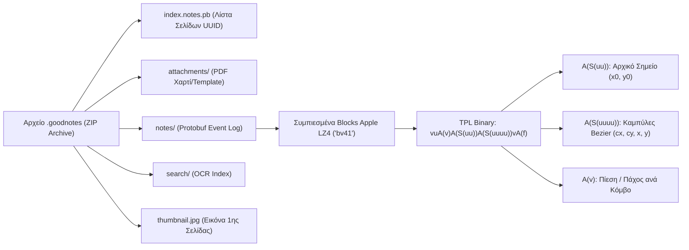
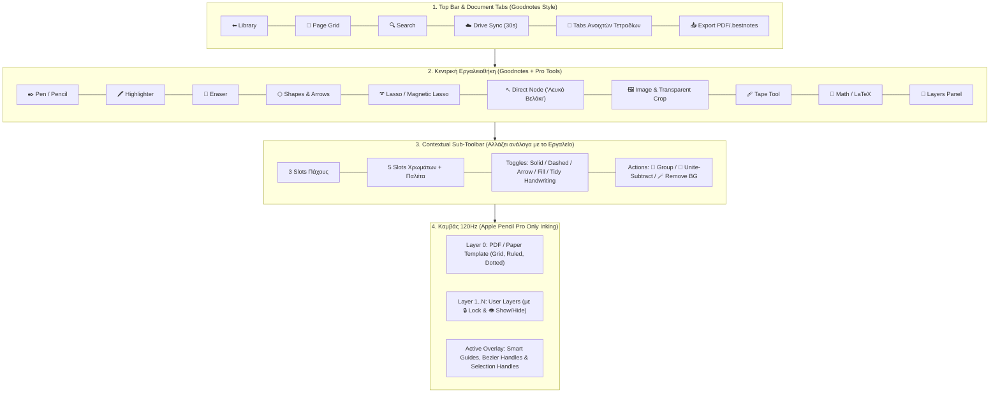
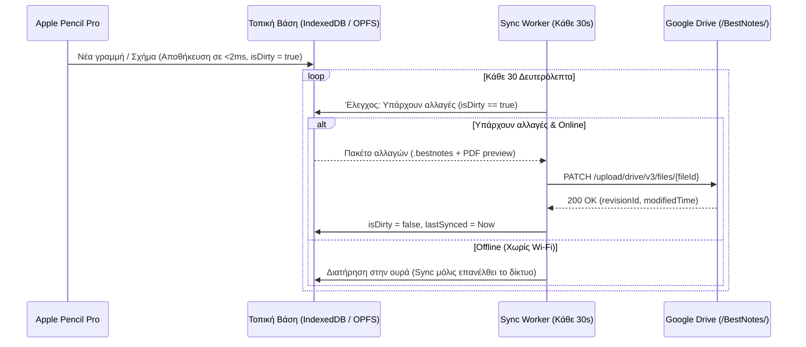

# 📘 BestNotes — Πλήρης Τεχνική Τεκμηρίωση, Αρχιτεκτονική & Roadmap Υλοποίησης

> [!IMPORTANT]
> **Κεντρική Φιλοσοφία του BestNotes:**
> Δημιουργούμε το απόλυτο εργαλείο χειρόγραφων σημειώσεων για **iPad (με Apple Pencil Pro)**, **Android Tablets** και **Web**, κρατώντας **100% το οικείο, γρήγορο UI και την αίσθηση γραφής του Goodnotes 6**, αφαιρώντας τα περιττά (ήχος/βίντεο) και ενσωματώνοντας **εγγενή γραφιστικά εργαλεία από τα Adobe Illustrator & Photoshop** καθώς και **εγγενή μαθηματικά εργαλεία & καλλωπισμό ελληνικού χειρογράφου**, με **αυτόματο συγχρονισμό στο Google Drive κάθε 30 δευτερόλεπτα**.

---

## 📑 Ευρετήριο Τεκμηρίωσης (Master Index)

1. **[1. Συγκριτικός Χάρτης Χαρακτηριστικών (Τι Κρατάμε, Τι Αφαιρούμε, Τι Προσθέτουμε)](#1-συγκριτικός-χάρτης-χαρακτηριστικών)**
   * 1.1 Τι κρατάμε 100% ίδιο με το Goodnotes 6 (UI & Core)
   * 1.2 Τι αφαιρούμε συνειδητά (Out of Scope)
   * 1.3 Τι προσθέτουμε: Γραφιστικές Υπερδυνάμεις (Illustrator + Photoshop)
   * 1.4 Τι προσθέτουμε: Μαθηματικές Υπερδυνάμεις & Καλλωπισμός Ελληνικού Χειρογράφου
2. **[2. Reverse Engineering του Goodnotes 6 (Εσωτερική Αρχιτεκτονική & Δομή Αρχείων)](#2-reverse-engineering-του-goodnotes-6)**
   * 2.1 Ακτινογραφία του Binary Format `.goodnotes`
   * 2.2 Αποκωδικοποίηση των Καμπυλών Bezier (`bv41` LZ4 + `tpl` Binary Structs)
   * 2.3 Δομή του δικού μας Format `.bestnotes` & Native `.goodnotes` Importer
3. **[3. Αρχιτεκτονική UI/UX (1:1 Κλώνος Goodnotes + Επεκτάσεις)](#3-αρχιτεκτονική-uiux)**
   * 3.1 Οθόνη Βιβλιοθήκης (Library & Folders View)
   * 3.2 Οθόνη Καμβά (Document Workspace & Εργαλειοθήκες)
   * 3.3 Τα Νέα Contextual Panels (Layers, Grouping, Bezier Nodes, Math)
4. **[4. Μηχανή Σχεδίασης Apple Pencil Pro & Εγγενείς Αλγόριθμοι (Zero-AI Core)](#4-μηχανή-σχεδίασης-apple-pencil-pro--εγγενείς-αλγόριθμοι)**
   * 4.1 Πλήρης Εκμετάλλευση του Apple Pencil Pro (Pressure, Tilt, Barrel Roll/Twist, Hover, Palm Rejection)
   * 4.2 Αλγόριθμος Μεταξένιων Καμπυλών Bezier & Καλλιγραφικού Στρωσίματος
   * 4.3 Ακαριαία Αναγνώριση & Διόρθωση Σχημάτων (Hold-to-Snap Geometric Engine)
   * 4.4 Αλγόριθμοι Photoshop: Magnetic Lasso (Sobel + Dijkstra), Freehand Alpha Crop & Transparent Background
   * 4.5 Αλγόριθμοι Illustrator: Scene Graph Groups, Direct Bezier Node Editing & Boolean Pathfinder
5. **[5. Μαθηματική Μηχανή, Καλλωπισμός Χειρογράφου & Δωρεάν LaTeX/CAS](#5-μαθηματική-μηχανή--καλλωπισμός-χειρογράφου)**
   * 5.1 Εγγενής Καλλωπισμός Ελληνικού Χειρογράφου & Μαθηματικών Συμβόλων (Χωρίς AI)
   * 5.2 Offline Συμβολική Άλγεβρα (CAS Equation Solver)
   * 5.3 Δωρεάν Μετατροπή σε Τυπωμένο $\LaTeX$ & Ελληνικό Κείμενο
6. **[6. Μηχανισμός Auto-Sync κάθε 30 Δευτερόλεπτα με Google Drive](#6-μηχανισμός-auto-sync-κάθε-30-δευτερόλεπτα-με-google-drive)**
   * 6.1 Local-First Αποθήκευση ($0\text{ms}$ Latency)
   * 6.2 Ο Κύκλος Συγχρονισμού των 30s (Delta Sync & Conflict Resolution)
7. **[7. Στρατηγική Multi-Platform: Από Web App (PWA) σε Native iPadOS & Android](#7-στρατηγική-multi-platform-από-web-app-σε-native-ipados--android)**
   * 7.1 Φάση Web/PWA στο iPad (Χωρίς Apple Developer Account)
   * 7.2 Άμεση Μετάβαση σε Native iPadOS & Android (Capacitor + Native Pencil Pro Plugin)
8. **[8. Αναλυτικό Roadmap Υλοποίησης (Βήμα-Βήμα)](#8-αναλυτικό-roadmap-υλοποίησης)**

---

## 1. Συγκριτικός Χάρτης Χαρακτηριστικών

### 1.1 Τι Κρατάμε 100% Ίδιο με το Goodnotes 6 (UI & Βασική Εμπειρία)
| Κατηγορία | Χαρακτηριστικό Goodnotes που διατηρούμε αυτούσιο |
| :--- | :--- |
| **Διάταξη UI** | **Top Document Tabs** (πολλαπλά ανοιχτά τετράδια), **Main Toolbar** στην κορυφή, **Contextual Sub-Toolbar** ακριβώς από κάτω (3 γρήγορα πάχη + παλέτα χρωμάτων + ρυθμίσεις εργαλείου). |
| **Εργαλεία Γραφής** | **Pen** (Fountain Pen, Ballpoint, Brush Pen), **Pencil** (με υφή), **Highlighter** (μπαίνει αυτόματα *κάτω* από το μελάνι με blend mode `multiply` για να μη θολώνει τα γράμματα). |
| **Εργαλεία Σβησίματος** | **Eraser** (Precision, Standard, **Stroke Eraser** που σβήνει ολόκληρη γραμμή με ένα άγγιγμα, και επιλογή *"Erase Highlighter Only"*). |
| **Gestures** | **Scribble-to-Erase** (μουτζούρωμα για άμεσο σβήσιμο χωρίς αλλαγή εργαλείου), **Hold-to-Snap** (κράτημα 0.3s στο τέλος της γραμμής για μετατροπή σε τέλειο σχήμα/ευθεία), **2-finger tap Undo / 3-finger tap Redo**. |
| **Βοηθήματα Μαθήματος** | **Tape Tool** (ταινία απόκρυψης απαντήσεων που αποκαλύπτεται με tap), **Laser Pointer** (με ουρά ή κουκκίδα για παράδοση μαθήματος), **Ruler (Χάρακας)**. |
| **Χαρτιά & PDF** | Εισαγωγή/Εξαγωγή **PDF**, **Templates Χαρτιού** (Τετραγωνισμένο/Grid, Γραμμές, Τελείες, Cornell, Μαύρο/Σκούρο χαρτί), **Page Thumbnails Grid** για αναδιάταξη/αντιγραφή σελίδων. |

### 1.2 Τι Αφαιρούμε Συνειδητά (Δεν μας ενδιαφέρουν)
* ❌ **Εγγραφή Ήχου (Audio Recording)** & Βίντεο.
* ❌ **Marketplace / Κατάστημα** με πληρωμένα αυτοκόλλητα και planners.
* ❌ **Βαριά Social / Community Feeds** που βαραίνουν το UI.

### 1.3 Τι Προσθέτουμε: Γραφιστικές Υπερδυνάμεις (Illustrator + Photoshop)
| Προέλευση | Νέο Εργαλείο στο BestNotes | Πώς λύνει τα χέρια στο μάθημα |
| :--- | :--- | :--- |
| **Illustrator** | **🔗 Group & Ungroup (Nested Groups)** | Ενώνεις σχήματα, γραμμές και βέλη (π.χ. έναν αγωγό με τα ηλεκτρόνια ή ένα κύκλωμα) σε **ένα αντικείμενο** που μετακινείται, αντιγράφεται και μεγαλώνει ενιαία. |
| **Illustrator** | **✒️ Direct Selection ("Λευκό Βελάκι" - Κόμβοι & Χερούλια Bezier)** | Πατάς πάνω σε οποιοδήποτε σχήμα ή καμπύλη και πειράζεις με το Apple Pencil τις γωνίες (Anchor Points) και τα χερούλια καμπυλότητας (Bezier Handles) χωρίς να το ξαναζωγραφίζεις. |
| **Illustrator** | **🧩 Shape Builder (Unite / Subtract / Intersect)** | Ενώνεις ή αφαιρείς γεωμετρικά σχήματα (π.χ. κύκλος μείον ορθογώνιο = κοίλος φακός ή μαγνήτης). |
| **Illustrator** | **📏 Smart Guides, Align & Distribute + Dashed/Arrow Toggles** | Αυτόματοι οδηγοί ευθυγράμμισης, 1-click **Διακεκομμένη Γραμμή (Dashed)**, 1-click **Διάνυσμα ($\vec{F}$)**, και γεμίσματα **Hatching (`///`)** για έδαφος/τοίχο. |
| **Photoshop** | **✂️ Ελεύθερο Lasso Crop σε Οποιοδήποτε Σχήμα** | Κόβεις μια εικόνα/screenshot σε **οποιοδήποτε κλειστό περίγραμμα** σχεδιάσεις με το Apple Pencil (πραγματική διαφάνεια `alpha = 0` έξω από τη γραμμή, όχι λευκό κουτί). |
| **Photoshop** | **🧲 Magnetic Lasso (Intelligent Scissors)** | Περνάς το Apple Pencil γύρω από ένα σχήμα σε εικόνα και η γραμμή κοπής **μαγνητίζεται αυτόματα πάνω στις ακμές** του αντικειμένου (Sobel + Dijkstra). |
| **Photoshop** | **🪄 1-Click Transparent BG & Magic Wand** | Αφαιρεί ακαριαία (χωρίς AI) το λευκό/γκρι φόντο από screenshots ασκήσεων/σχημάτων ώστε να φαίνονται από πίσω τα τετραγωνάκια του τετραδίου σου. |
| **Photoshop** | **📑 Layers Panel (Επίπεδα με 🔒 Lock & 👁️ Hide) + Απλές Μάσκες** | Κλειδώνεις (🔒) το Layer με το σχήμα της άσκησης για να μη σβήνεται όταν σβήνεις τις πράξεις! Κρύβεις (👁️) το Layer της λύσης και το εμφανίζεις με 1 tap στο μάθημα! |

### 1.4 Τι Προσθέτουμε: Μαθηματικές Υπερδυνάμεις & Καλλωπισμός Ελληνικού Χειρογράφου
* **✨ Εγγενές «Στρώσιμο Χειρογράφου» (Tidy Greek Handwriting — Χωρίς AI):** Κρατάει τα δικά σου ελληνικά χειρόγραφα, αλλά λειαίνει τις καμπύλες Bezier, ισιώνει τη νοητή γραμμή (baseline) ώστε οι λέξεις να μην κατηφορίζουν, και ομορφαίνει το πάχος της πένας.
* **📐 Αυτόματο Ίσιωμα Μαθηματικών Συμβόλων (Χωρίς AI):** Αναγνωρίζει γεωμετρικά τις **γραμμές κλασμάτων**, το **ίσον ($=$)**, το **συνεπάγεται ($\implies$)**, τις **παρενθέσεις** και τα **διανύσματα ($\vec{\upsilon}$)** και τα κάνει αυτόματα συμμετρικά και ευθυγραμμισμένα.
* **🧮 Μετατροπή σε $\LaTeX$ / Ελληνικό Κείμενο & Επίλυση Εξισώσεων (CAS):** Επιλογή με το Lasso για μετατροπή χειρόγραφης εξίσωσης σε τυπωμένο $\LaTeX$ (KaTeX) και άμεση επίλυση εξισώσεων μέσω ενσωματωμένης Offline Μηχανής Άλγεβρας (CAS) + Δωρεάν Gemini API.

---

## 2. Reverse Engineering του Goodnotes 6

Από την εργαστηριακή ανάλυση που κάναμε πάνω στα δικά σου αρχεία (`2026-10-22 Φυσικη Ενταση Ρευματος.goodnotes` και `2026-10-19 Φυσικη.goodnotes`), αποκωδικοποιήσαμε πλήρως την εσωτερική αρχιτεκτονική του Goodnotes:

### 2.1 Πώς Αποθηκεύονται οι Γραμμές (Το Binary Secret)
Κάθε σελίδα στον φάκελο `notes/<UUID>` είναι ένα Event-Sourcing Protobuf log που περιέχει συμπιεσμένα blocks με κεφαλίδα `bv41` (Apple Raw LZ4 compression). Όταν αποσυμπιεστεί ένα block, περιέχει ένα binary αντικείμενο `tpl` με format string:
$$\texttt{vuA(v)A(S(uu))A(S(uuuu))vA(f)}$$
* **`A(S(uu))`**: Περιέχει $2 \times \text{float32}$ — τις συντεταγμένες εκκίνησης $(x_0, y_0)$ της μύτης του Apple Pencil.
* **`A(S(uuuu))`**: Περιέχει τετράδες από $\text{float32}$ $(cx_i, cy_i, x_i, y_i)$, όπου $(cx_i, cy_i)$ είναι το σημείο ελέγχου (Control Point) και $(x_i, y_i)$ το τελικό σημείο μιας **Quadratic Bezier καμπύλης** (`Q cx cy x y`).
* **`A(v)`**: Πίνακας `uint16` με την πίεση/πάχος σε κάθε σημείο της καμπύλης.

### 2.2 Το Δικό μας Format (`.bestnotes`) & Εγγενής Εισαγωγή `.goodnotes`
1. **Native `.goodnotes` Importer:** Ενσωματώνουμε στο BestNotes τον αποκωδικοποιητή `ZIP -> Protobuf -> LZ4 (bv41) -> TPL Bezier` που ήδη κατασκευάσαμε, ώστε να μπορείς να ανοίγεις **όλα τα υπάρχοντα αρχεία `.goodnotes` σου** κατευθείαν μέσα στο BestNotes ως επεξεργάσιμα vectors!
2. **Το Format `.bestnotes`:** Θα είναι επίσης ένα συμπιεσμένο container (ή JSON/Binary bundle) που θα αποθηκεύει:
   * Τα `Pages[]` και το `Background/PDF Template`,
   * Τα `Layers[]` κάθε σελίδας (με `locked`, `visible`, `opacity`, `blendMode`),
   * Το `SceneGraph` κάθε Layer: `Strokes` (Bezier splines), `Shapes` (με παραμέτρους + κόμβους), `Groups` (λίστα παιδιών), `Images` (με `clipPath` Bezier μάσκα και `transparentBg` ρυθμίσεις), και `MathBlocks` ($\LaTeX$).

---

## 3. Αρχιτεκτονική UI/UX (1:1 Κλώνος Goodnotes + Επεκτάσεις)

---

## 4. Μηχανή Σχεδίασης Apple Pencil Pro & Εγγενείς Αλγόριθμοι

### 4.1 Πλήρης Εκμετάλλευση του Apple Pencil Pro
| Δυνατότητα Apple Pencil Pro | Πώς την αξιοποιούμε στο BestNotes |
| :--- | :--- |
| **Pressure (`event.pressure`)** | Δυναμική αυξομείωση πάχους γραμμής (Fountain Pen / Brush) και αδιαφάνειας (Pencil). |
| **Tilt (`tiltX`, `tiltY`, `altitudeAngle`)** | Πλαγίασμα μύτης για φυσική σκίαση με το Μολύβι ή πλατιά γραμμή στον Μαρκαδόρο. |
| **Barrel Roll (`event.twist`)** | Το **Apple Pencil Pro** διαθέτει γυροσκόπιο περιστροφής (`twist` 0°–359°)! Καθώς περιστρέφεις το Pencil γύρω από τον άξονά του, περιστρέφεται η πλατιά μύτη της Καλλιγραφικής Πένας και ο κέρσορας! |
| **Hover (`pointermove` με `pressure = 0`)** | Πριν καν ακουμπήσει η μύτη στην οθόνη (έως 12mm απόσταση), εμφανίζεται **ακριβής προεπισκόπηση του πάχους/χρώματος** ή του μεγέθους της Γόμας! |
| **Squeeze & Haptics** | Στη Native iPadOS έκδοση (μέσω Capacitor plugin), το **ζούληγμα (Squeeze)** του Apple Pencil Pro ανοίγει ακαριαία την κυκλική παλέτα εργαλείων (Pen/Eraser/Lasso/Group) ακριβώς κάτω από τη μύτη με απτική δόνηση (Haptic click). Στη Web έκδοση ενεργοποιούμε εναλλακτικά το **Scribble-to-Erase** + **Floating Quick-Switch**. |
| **Palm Rejection (`pointerType === 'pen'`)** | Όταν γράφεις, η παλάμη αγνοείται 100%. Το 1 δάχτυλο κάνει Pan, τα 2 δάχτυλα Pinch-to-Zoom & Tap-to-Undo. |

### 4.2 Αλγόριθμος Μεταξένιων Καμπυλών Bezier & StreamLine
Για να μην εμφανίζονται ποτέ «σπαστές» γωνίες όταν γράφεις γρήγορα εξισώσεις:
1. Συλλέγουμε όλα τα υπο-γεγονότα στα $120\text{Hz}-240\text{Hz}$ μέσω `event.getCoalescedEvents()`.
2. Εφαρμόζουμε **One-Euro Filter (Adaptive Low-Pass Filter)**: όταν κινείς αργά το Pencil φιλτράρει το τρέμουλο του χεριού, ενώ όταν κινείς γρήγορα μηδενίζει το lag.
3. Μετατρέπουμε τα σημεία $P_0, P_1, \dots, P_n$ σε **Quadratic Bezier Splines** χρησιμοποιώντας τα μέσα των τμημάτων $M_i = \frac{P_i + P_{i+1}}{2}$ ως σημεία σύνδεσης ($C^1$ συνέχεια):
   $$\mathbf{B}_i(t) = (1-t)^2 M_{i-1} + 2(1-t)t P_i + t^2 M_i, \quad t \in [0, 1]$$

### 4.3 Ακαριαία Αναγνώριση & Διόρθωση Σχημάτων (Hold-to-Snap)
Όταν η ταχύτητα της μύτης του Apple Pencil πέσει κοντά στο μηδέν ($v < \epsilon$) για $300\text{ms}$ στο τέλος μιας γραμμής:
1. **Έλεγχος Ευθείας:** Υπολογίζουμε τον λόγο ευθύτητας $R = \frac{\|P_n - P_0\|}{\sum_{i=1}^n \|P_i - P_{i-1}\|}$. Αν $R > 0.91$, η γραμμή αντικαθίσταται από τέλειο ευθύγραμμο τμήμα (και αν η γωνία είναι $\pm 4^\circ$ από $0^\circ, 45^\circ, 90^\circ$, κάνει snap).
2. **Έλεγχος Κλειστού Σχήματος:** Αν $\|P_n - P_0\| < 0.18 \cdot L_{\text{total}}$:
   * Τρέχουμε τον αλγόριθμο **Ramer-Douglas-Peucker (RDP)** + ανίχνευση τοπικών μεγίστων καμπυλότητας για εύρεση κορυφών $V$:
   * **3 Κορυφές $\rightarrow$ Τρίγωνο** (με αυτόματο snap σε ορθογώνιο/ισοσκελές αν είναι κοντά).
   * **4 Κορυφές $\rightarrow$ Ορθογώνιο ή Παραλληλόγραμμο** (έλεγχος παραλληλίας απέναντι πλευρών και γωνιών $\approx 90^\circ$), με επιλογή αυτόματου ημιδιαφανούς γεμίσματος (`Fill`).
   * **0 Γωνίες (Ομαλή κλειστή καμπύλη) $\rightarrow$ Κύκλος ή Έλλειψη** μέσω **Least-Squares Ellipse Fitting (Fitzgibbon)**, που παράγει 4 τέλεια Bezier τόξα.

### 4.4 Αλγόριθμοι Photoshop (100% Εγγενείς — Χωρίς AI)
* **🧲 Magnetic Lasso (Intelligent Scissors / Live-Wire):**
  1. Υπολογισμός **Sobel Gradient** $G = \sqrt{G_x^2 + G_y^2}$ στην περιοχή της εικόνας.
  2. Ορισμός συνάρτησης κόστους ακμής $C(p, q) = \frac{1}{1 + \alpha G(q)}$.
  3. Καθώς σέρνεις το Apple Pencil, ο αλγόριθμος **Dijkstra Shortest Path** σε παράθυρο ακτίνας $20\text{px}$ βρίσκει σε πραγματικό χρόνο το μονοπάτι που «κολλάει» πάνω στο περίγραμμα υψηλής αντίθεσης του σχήματος!
* **✂️ Freehand Lasso Crop:**
  Η κλειστή καμπύλη Bezier που σχεδιάζεις αποθηκεύεται ως `clipPath` της εικόνας. Κατά το rendering εκτελείται `ctx.clip(path2D)` ώστε όλο το εξωτερικό μέρος να είναι **100% διαφανές**.
* **🪄 1-Click Transparent Background & Magic Wand:**
  * **Color-to-Alpha (Luminance Smooth Thresholding):** Για κάθε pixel $(R, G, B)$ υπολογίζεται η χρωματική απόσταση $d = \|C_{\text{pixel}} - C_{\text{bg}}\|$ από το φόντο (λευκό/γκρι) και αποδίδεται ομαλό κανάλι διαφάνειας $\alpha = \text{smoothstep}(T_1, T_2, d)$ ώστε να μην υπάρχουν «λευκά δοντάκια» γύρω από τα γράμματα.
  * **Magic Wand (Flood-Fill BFS):** Αφαιρεί μόνο το εξωτερικό συνεχόμενο φόντο, κρατώντας τα εσωτερικά λευκά γεμίσματα του σχήματος ανέπαφα.

### 4.5 Αλγόριθμοι Illustrator (100% Εγγενείς — Χωρίς AI)
* **🔗 Scene Graph Grouping:** Κάθε αντικείμενο έχει `parentId` / `GroupNode`. Ο πίνακας μετασχηματισμού ενός Group $\mathbf{M}_{\text{group}}$ (μετακίνηση, κλίμακα, περιστροφή) πολλαπλασιάζεται αυτόματα με όλα τα παιδιά του ($\mathbf{M}_{\text{world}} = \mathbf{M}_{\text{group}} \cdot \mathbf{M}_{\text{child}}$).
* **✒️ Direct Node Editing ("Λευκό Βελάκι"):** Επιλέγοντας ένα σχήμα ή καμπύλη, εμφανίζονται στην οθόνη τα σημεία $P_i$ (τετράγωνα κουτάκια) και τα σημεία ελέγχου $C_i$ (κυκλικά χερούλια), επιτρέποντας άμεση μετακίνηση με το Apple Pencil.

---

## 5. Μαθηματική Μηχανή & Καλλωπισμός Χειρογράφου

### 5.1 Εγγενής Καλλωπισμός Ελληνικού Χειρογράφου (Χωρίς AI)
1. **Ομαδοποίηση σε Γραμμές & Λέξεις:** Τα strokes που γράφεις ομαδοποιούνται χωρικά (μέσω προβολής στον άξονα $Y$ και $X$).
2. **Baseline Straightening (Ίσιωμα Γραμμής):** Βρίσκεται η κάτω βάση (lower envelope) κάθε λέξης και μετατοπίζεται κάθετα ($\Delta y$) ώστε όλη η ελληνική πρόταση να πατάει τέλεια πάνω στην οριζόντια γραμμή του χαρτιού.
3. **Laplacian Bezier Smoothing:** Εξομαλύνει τις απότομες ακμές των γραμμάτων διατηρώντας 100% τον δικό σου ελληνικό γραφικό χαρακτήρα.
4. **Γεωμετρική Αναγνώριση Μαθηματικών Συμβόλων:**
   * Δύο παράλληλες μικρές οριζόντιες γραμμές σε απόσταση $\Delta y < 25\text{px} \rightarrow$ **Τέλειο Ίσον ($=$)**.
   * Οριζόντια γραμμή που έχει strokes ακριβώς από πάνω και ακριβώς από κάτω $\rightarrow$ **Τέλεια Οριζόντια Γραμμή Κλάσματος**.

### 5.2 Δωρεάν Μετατροπή σε $\LaTeX$ & Offline Επίλυση Εξισώσεων (CAS)
* **Offline CAS Solver:** Ενσωμάτωση της ανοιχτής μαθηματικής μηχανής **Nerdamer / CortexJS Compute Engine** (100% offline & δωρεάν) για άμεσο υπολογισμό παραστάσεων, απλοποίηση κλασμάτων και επίλυση εξισώσεων (π.χ. $15 \cdot t = 90 \implies t = 6$).
* **Δωρεάν OCR ($\LaTeX$ + Ελληνικά):** Σύνδεση με το **Δωρεάν Gemini API (Google AI Studio Free Tier — 1.500 δωρεάν κλήσεις/ημέρα χωρίς κάρτα)** + απόδοση πάνω στον καμβά μέσω **KaTeX** σε μορφή υψηλής ευκρίνειας (SVG/Vector).

---

## 6. Μηχανισμός Auto-Sync κάθε 30 Δευτερόλεπτα με Google Drive

* **Μηδενική Απώλεια Δεδομένων (Local-First):** Κάθε φορά που σηκώνεις τη μύτη του Apple Pencil από την οθόνη, η αλλαγή γράφεται ακαριαία ($<2\text{ms}$) στην τοπική βάση του iPad (`IndexedDB`).
* **Αυτόματος Συγχρονισμός 30s:** Ένας background timer τρέχει κάθε **30 δευτερόλεπτα**. Αν το τετράδιο έχει αλλάξει (`isDirty === true`), ανεβάζει αθόρυβα τη νέα έκδοση στον φάκελο `/BestNotes/` του **Google Drive** σου (μέσω Google Drive API v3 OAuth2) χωρίς να «παγώνει» καθόλου η γραφή σου!

---

## 7. Στρατηγική Multi-Platform: Από Web App σε Native iPadOS & Android

1. **Στάδιο 1 — Web App / PWA (Τρέχει ΣΗΜΕΡΑ στο iPad σου χωρίς Developer Account):**
   * Τεχνολογία: **React 19 + TypeScript + Vite + HTML5 Low-Latency Canvas (`desynchronized: true`) + Tailwind CSS**.
   * Εγκατάσταση στο iPad: Το ανοίγεις στο Safari $\rightarrow$ *Add to Home Screen* $\rightarrow$ τρέχει σε **100% Full Screen** σαν native app, χωρίς το όριο των 7 ημερών της Apple.
2. **Στάδιο 2 — Native iPadOS & Android Tablet App (Μηδενικό Ξαναγράψιμο Κώδικα):**
   * Ενσωματώνουμε το **Capacitor (Ionic/CapacitorJS)** πάνω στο ίδιο ακριβώς project.
   * Με μία εντολή (`npx cap add ios` & `npx cap add android`) παράγονται έτοιμα native projects για **Xcode (iPadOS)** και **Android Studio (Android Tablets)**.
   * Στο iPadOS προσθέτουμε ένα μικρό native Swift bridge (`PencilProPlugin.swift`) που δίνει στο UI μας πρόσβαση και στο **Squeeze gesture** και στο **Haptic Engine** του Apple Pencil Pro!

---

## 8. Αναλυτικό Roadmap Υλοποίησης (Βήμα-Βήμα)

| Φάση | Τίτλος Φάσης | Τι παραδίδουμε και δοκιμάζεις στο iPad σου |
| :--- | :--- | :--- |
| **Φάση 1** | **Core Canvas, Goodnotes UI & Apple Pencil Pro Inking** | • Πλήρες UI Goodnotes (Top Tabs, Main Toolbar, Contextual Sub-Toolbar, Τετραγωνισμένο/Ruled χαρτί). • Μηχανή Apple Pencil Pro (Pressure, Tilt, Barrel Roll, Hover, Palm Rejection, 120Hz Bezier). • Εργαλεία: Pen (3 τύποι), Pencil, Highlighter (κάτω από το μελάνι), Eraser (Stroke & Precision + Scribble-to-Erase), Tape Tool, Laser, Dashed Lines & Vector Arrows ($\vec{F}$). • **Hold-to-Snap Shapes:** Ακαριαία διόρθωση σε Ευθείες, Ορθογώνια (με Fill), Παραλληλόγραμμα, Κύκλους/Ελλείψεις, Τρίγωνα. |
| **Φάση 2** | **Εργαλεία Illustrator (Groups, Nodes, Layers, Smart Guides)** | • **Lasso Selection** & κουμπί **🔗 Group / Ungroup**. • **Direct Selection Tool ("Λευκό Βελάκι")** για επεξεργασία γωνιών και χερουλιών Bezier. • **Layers Panel** με 🔒 Lock Layer, 👁️ Show/Hide, Opacity. • **Shape Builder** (Unite / Subtract) & Hatching fills (`///`). |
| **Φάση 3** | **Εργαλεία Photoshop (Lasso Crop, Magnetic Lasso, Transparent BG)** | • Εισαγωγή εικόνων/screenshots στον καμβά. • **Ελεύθερο Lasso Crop** σε οποιοδήποτε σχήμα με πραγματική διαφάνεια. • **🧲 Magnetic Lasso** (Sobel Edge Detection + Dijkstra Live-Wire). • **🪄 1-Click Transparent Background** & **Magic Wand** (Flood-Fill). |
| **Φάση 4** | **Καλλωπισμός Ελληνικού Χειρογράφου, Μαθηματικά & $\LaTeX$** | • Εγγενές κουμπί **✨ Στρώσιμο Χειρογράφου** (Baseline straightening + Curve smoothing) & αυτόματο ίσιωμα σε $=$, κλάσματα, $\implies$. • Offline **CAS Equation Solver** + Δωρεάν μετατροπή σε τυπωμένο **$\LaTeX$ (KaTeX) / Ελληνικό Κείμενο** μέσω Google AI Studio Free Tier. |
| **Φάση 5** | **Library, `.goodnotes` / PDF Importer & Google Drive 30s Sync** | • Οθόνη Βιβλιοθήκης (Φάκελοι, Τετράδια, Αναζήτηση). • **Native `.goodnotes` File Importer** (για να ανοίγεις τα υπάρχοντα αρχεία Φυσικής σου!) + PDF Import/Export. • **Google Drive Auto-Sync κάθε 30 δευτερόλεπτα** + Local IndexedDB persistence. |
| **Φάση 6** | **PWA Packaging & Native iPadOS / Android Wrapper** | • Πλήρες Offline PWA manifest για iPad Home Screen. • Ρύθμιση Capacitor για εξαγωγή σε Native iPadOS & Android Tablet apps. |

---

## 9. Κατάσταση Έργου — Έκδοση `v0.8 (electricSimV0.1)`: Τι Κάναμε (`✅`) & Τι Χρωστάμε (`⏳`)

> [!NOTE]
> **Τρέχουσα Έκδοση:** **`v0.8 — electricSimV0.1`** (27 Οκτωβρίου 2026)
> **Live Web App (Primary):** [https://explainboards.web.app](https://explainboards.web.app) & [https://mybestnotes.web.app](https://mybestnotes.web.app) (και [https://bestnotes-2026.web.app](https://bestnotes-2026.web.app))
> **GitHub Repository:** [https://github.com/kfrei/bestNotes](https://github.com/kfrei/bestNotes)

### 9.1 ✅ Τι Έχουμε Ολοκληρώσει Πλήρως έως την `v0.8 (electricSimV0.1)`

#### Α0. Διαδραστική Προσομοίωση Ηλεκτρικών Κυκλωμάτων (`v0.8 — electricSimV0.1`)
* **⚡ Ονοματισμένες Προσομοιώσεις Κυκλωμάτων ανά Τετράδιο (`sim01`, `sim02`, `sim03`, ...):**
  * Αυτόματη αναγνώριση κλειστών κυκλωμάτων σε όλες τις σελίδες του ενεργού τετραδίου ή επιλογή με Λάσο + πάτημα **`Sim`**, με αυτόματη απόκρυψη του πλαισίου επιλογής του Λάσο ώστε να μη δημιουργεί οπτικό θόρυβο.
  * Ενιαία λίστα `sim01`, `sim02`, `sim03` σε διακριτική γκρι απόχρωση (`bg-slate-200`) με ενσωματωμένο μολυβάκι μετονομασίας (`✎`) και διαγραφή (`✕`), όπου **1 προσομοίωση είναι ενεργή κάθε φορά**.
  * Πατώντας σε οποιοδήποτε `sim01` / `sim02`, η σελίδα εκτελεί **ομαλό scroll (`scrollToCircuitSim`, `420ms` cubic ease-out)** κεντράροντας το αντίστοιχο κύκλωμα στην οθόνη.
* **✨ Αυτόματη Ολοκλήρωση Κυκλώματος (`✨ Ολοκλήρωση`) με 4 Κόμβους Ολίσθησης (`tl`, `tr`, `br`, `bl`):**
  * Αυτόματη ευθυγράμμιση των στοιχείων στον πάνω/κάτω κλάδο και πρόταση ολοκλήρωσης του βρόχου με **μαύρη διακεκομμένη γραμμή (`#111827`)** και **Διακόπτη** στον αριστερό κατακόρυφο κλάδο.
  * Με το πάτημα του **`✓ Αποδοχή`** πάνω στο σχήμα, αν υπήρχαν μόνο στοιχεία χωρίς γραμμές δημιουργείται **μαύρη συνεχής γραμμή**, ενώ αν υπήρχε ήδη σχεδιασμένο τμήμα κυκλώματος **κληρονομείται αυτόματα ο τύπος γραμμής (`lineStyle`), το χρώμα, το πάχος, το `penType` και η διαφάνεια** των υπαρχόντων καλωδίων, και καταχωρείται αυτόματα ως νέο `sim02` / `sim03`.
  * Οι **4 γωνιακοί κόμβοι (`tl`, `tr`, `br`, `bl`)** επιτρέπουν οριζόντια ολίσθηση των κατακόρυφων καλωδίων (`↔`) χωρίς παραμόρφωση των στοιχείων, και κατακόρυφη μετακίνηση (`↕`) της οριζόντιας γραμμής **μαζί με όλα τα ηλεκτρικά στοιχεία που ανήκουν στον κλάδο αυτόν** (`topCompStrokeIds` / `botCompStrokeIds`).
* **🔵 Ζωντανή Φυσική Κυκλωμάτων $60\text{fps}$ (`analyzeCircuitForSimulation`):**
  * Κίνηση ηλεκτρονίων (`Μπλε Ηλεκτρόνια` ή `Πράσινη Ενέργεια`, `Πραγματική` vs `Συμβατική Φορά`, ρυθμιστικό ταχύτητας, προαιρετικός `Σκούρος Σωλήνας Καλωδίων`) σε σειρά και παράλληλους κλάδους, ακολουθώντας πιστά τα ζιγκ-ζαγκ δόντια των αντιστατών (`resistor`).
  * Διαδραστικός **Διακόπτης (`Switch`)** πάνω στον καμβά και στο αριστερό panel (`🟢 Διακόπτης: Κλειστός` / `🔴 Διακόπτης: Ανοιχτός`), φωτοβολία Λαμπτήρα (`bulb`) και περιστροφή Φτερωτής (`fan`).
  * **1-Click Μετατροπή `Σχήματα ↔ Σύμβολα`:** Εναλλαγή Μπαταρίας ↔ Πηγής Τάσης και Λαμπτήρα/Φτερωτής ↔ Αντιστάτη με σταθερό `circuitBox` και αυτόματη γεφύρωση καλωδίων.
  * **Στιγμιαία Αναλαμπή Αγωγών (`0.56s`):** Ηλεκτρική κυανή αναλαμπή στις γραμμές του κυκλώματος όταν πατιέται η ευθυγράμμιση αγωγών ή η αποδοχή ολοκλήρωσης.
  * **Υποστήριξη `Sim Group` & Φτερωτής (`Fan`):** Διατήρηση αναγνώρισης όλων των στοιχείων (`bulb`, `fan`, `battery`, `switch`, `resistor`) ακόμα κι όταν ολόκληρο το κύκλωμα γίνει `Group`, επιλεκτικό γέμισμα/χρώμα μόνο στα πτερύγια και το περίγραμμα της Φτερωτής, και προεπιλογή του **Ορθογώνιου Πλαισίου Επιλογής (`rect`)** κατά την είσοδο στο Select/Lasso.

#### Α. Μηχανή Γραφής 120Hz Apple Pencil, Εργονομία Μύτης & Απόδοση Καμβά
* **Dual-Canvas 2x Retina HiDPI (`1840×2520`, `desynchronized: true`):** Ανεξάρτητο wet-ink overlay canvas για $0\text{ms}$ απόκριση στην πρώτη επαφή του Apple Pencil, ακόμα και σε μικροσκοπικά σημεία, τόνους και εκθέτες.
* **100% Αναλλοίωτο Χειρόγραφο Μετά το Σήκωμα της Μύτης (`commit 890a614`):** Απενεργοποιήθηκε πλήρως η μετα-εξομάλυνση (post-stroke relaxation) στο `smoothStrokeToBezier`, ώστε ό,τι γράφεις με το μολύβι να παραμένει **100% ίδιο** χωρίς καμία αλλοίωση.
* **Αυτόματη Επιλογή Λεπτότερης Μύτης (`2.0px`, `commit f91549f`):** Κάθε φορά που επιστρέφεις στο Μολύβι / Πένα, επιλέγεται αυτόματα το 1ο (πιο λεπτό) από τα 3 αποθηκευμένα πάχη γραμμής.
* **Βελτιστοποιημένο `Hold-to-Snap` (`0.56s` & ελάχιστη διαγώνιος `28px`, `commit 100a5fa`):** Αυξήθηκε ο χρόνος κρατήματος στα $560\text{ms}$ με ελάχιστη διαγώνιο $28\text{px}$ ώστε κατά τη γρήγορη χειρόγραφη γραφή τα γράμματα να μη μετατρέπονται ποτέ κατά λάθος σε κύκλους ή τετράγωνα.
* **Apple Pencil Double-Tap & Barrel Roll (`commit cf31f63`) + Καθαρό iPadOS Touch (`commit e29a599`):** Υποστήριξη διπλού tap πάνω στο Apple Pencil και αφαίρεση του πειραματικού κρατήματος 1 δαχτύλου + μολυβιού που ακύρωνε το stylus στο iPadOS.

#### Β. Νέα Σχήματα Φυσικής, Ηλεκτρισμού, Κυκλωμάτων & Ταλαντώσεων (`v0.7`)
* **📈 Διάγραμμα Ταλάντωσης / Κύματος (`wave-axes`, `commits f37071e, c5ab017`):**
  * Κατακόρυφος και κεντρικός οριζόντιος άξονας με βέλη + **2 απολύτως παράλληλες οριζόντιες διακεκομμένες γραμμές πλάτους ($+A$ / $-A$)**.
  * Χερούλια πάνω στον καμβά για ανεξάρτητη μετακίνηση (`↕`) ή συμμετρική ρύθμιση πλάτους (`⇕ ±A`) χωρίς να μεταβάλλονται οι άξονες, καθώς και επιλογή χρώματος αποκλειστικά για τις διακεκομμένες γραμμές.
* **💡 Λαμπτήρας (`bulb`, `commit 85692c4`):** Γυάλινος θόλος που στενεύει ομαλά σε βιδωτή βάση με σπείρες.
* **🔋 Μπαταρία (`battery`, `commit 85692c4`):** Οριζόντιο σώμα μπαταρίας με προεξέχοντα θετικό πόλο και σύμβολα `+` (αριστερά) και `-` (δεξιά).
* **⚡ Πηγή Τάσης (`voltage-source`, `commit 85692c4`):** Ηλεκτρικό σύμβολο συνεχούς πηγής τάσης με οριζόντιους ακροδέκτες, μακριά θετική πλάκα (`+`) και κοντή/παχύτερη αρνητική πλάκα (`-`).
* **📐 Κεκλιμένο Επίπεδο με Σώμα (`inclined-plane`, `commit 85692c4`):**
  * Ορθογώνιο τρίγωνο κεκλιμένου επιπέδου (με απαλό γκρι γέμισμα) και μπλε ορθογώνιο σώμα που εφάπτεται στην υποτείνουσα.
  * Μέσω του `computeInclinedPlaneBlockPoints`, ακόμα κι αν στενέψεις ή ψηλώσεις το κεκλιμένο επίπεδο με τα πορτοκαλί χερούλια (`scale-x` / `scale-y`), το σώμα **παραμένει πάντα αληθινό ορθογώνιο $90^\circ$** πάνω στη νέα γωνία κλίσης!
* **🎯 Αυτόματη Επιλογή & Άμεση Μετάβαση σε Λάσο (`commit bcd0a9c`):** Μόλις σχεδιάσεις οποιοδήποτε σχήμα από το εργαλείο Σχημάτων και σηκώσεις το μολύβι, το σχήμα **επιλέγεται αυτόματα** και το ενεργό εργαλείο **γυρνάει κατευθείαν στο Λάσο (`lasso`)** για άμεσο resize, stretch, περιστροφή, Mirror ή μετακίνηση.

#### Γ. Μαγνητική Συγκόλληση Σχημάτων (`1s Weld`), 5-Κόμβων Ημίτονα & Υπο-Pixel Ακρίβεια
* **🧲 Μαγνητική Συγκόλληση Ακρών (`1s Hold Welding`, `commits 3f92067, 81d7f54`):** Πλησιάζοντας την άκρη μιας ανοιχτής γραμμής/καμπύλης/ημιτόνου στην άκρη μιας άλλης (είτε με **Λάσο** είτε με **Κόμβους**), οι άκρες μαγνητίζονται και μετά από $1\text{s}$ ενώνονται σε ενιαίο διανυσματικό αντικείμενο (ή κλειστό σχήμα που παίρνει `Fill`).
* **⬠ 1-Click Μετατροπή Γραμμών σε Πολύγωνο (`commit 60032d6`):** Κουμπί `Πολύγωνο` στο Λάσο που ενώνει ξεχωριστές ευθείες γραμμές στο πλησιέστερο κλειστό πολύγωνο.
* **〰️ Ημίτονο & Συνημίτονο 5 Κόμβων (`commit 3e321be`):** Κόμβοι αρχής, μέσου και τέλους + 2 κόμβοι πλάτους, και μαγνητική ένωση κυμάτων στο Λάσο.
* **🔬 Υπο-Pixel Ακρίβεια σε Stretch & Μετακίνηση (`commit ca54514`):** Μηδενισμός του $10\text{px}$ offset στα πορτοκαλί χερούλια (`scale-x`/`scale-y`), μείωση του βήματος μαγνητισμού στα $2.2\text{px}$ και υπο-pixel κίνηση (`0.58x`–`0.65x`) σε αργό σύρσιμο ώστε το ημίτονο να κουμπώνει τέλεια στους άξονες.
* **📏 Μαγνητικοί Οδηγοί Παραλληλίας (`//`), Συμμετρίας & Κλείδωμα `1:1` (`commits 4c0679a, 8d48eb7, d838e02`).**
* **🪞 Καθρεφτισμός (`Mirror ↔ / ↕`) & Ορθογώνια Επιλογή (`Rectangular Marquee`, `commits 4a0aefb, 8a8279f`).**

#### Δ. Text OCR, MathOCR ($\LaTeX$ / `KaTeX`) & Cloud Sync (Firestore 30s + Google Drive PDF 2m)
* **🔤 Text OCR & Ελληνικές Χειρόγραφες Γραμματοσειρές (`ExplainBoardsHand.otf` & `ExplainBoardsPen.otf`, `commits 33878da, da6dc3b, 287159b`):** Μετατροπή χειρογράφου σε κείμενο με επιλογή γραμματοσειράς (**Καλλιγραφική**, **Πένα**, **Τυπογραφική**) και αυτόματο reflow / προσαρμογή μεγέθους από 8 χερούλια.
* **🧮 MathOCR ($\LaTeX$ / `KaTeX`, `commits ae90301, 42af240, d7c7263`):** Μετατροπή χειρόγραφων εξισώσεων, κλασμάτων, διανυσμάτων και μονάδων σε τυπωμένο $\LaTeX$ πολλαπλών σειρών.
* **☁️ Cloud Firestore Sync (30s), Google Drive PDF Auto-Sync (2m), Κάδος Ανακύκλωσης Cloud & Άμεσο PDF Share σε Viber (`commits 4904d6d, a9e4cea, eb5106a, 61cda23`).**

---

### 9.2 ⏳ Τι Χρωστάμε Ακόμα από τα Αρχικά Ζητούμενα (Backlog)

| Προτεραιότητα | Εκκρεμότητα από τα Αρχικά Ζητούμενα | Τι Έχει Γίνει & Τι Απομένει |
| :---: | :--- | :--- |
| **1** | **🔗 Κοινή Χρήση με Ζωντανό Link (`Viewers` & `Collaborators`)** | Το Firestore Sync και η εξαγωγή PDF είναι έτοιμα. Απομένει το κουμπί **«Share Link (`?doc=...`)»** για Read-Only (`Viewer`) προβολή από μαθητές ή ταυτόχρονη συνεργατική γραφή (`Collaborator`). |
| **2** | **🧩 Boolean Shape Builder (`Unite` / `Subtract` / `Intersect`)** | Έχουμε ήδη τη συγκόλληση ανοιχτών γραμμών (`1s Weld`) και το κουμπί `Πολύγωνο`. Απομένει η πράξη **Ένωσης (`Unite`)** και **Αφαίρεσης (`Subtract`)** μεταξύ δύο επικαλυπτόμενων κλειστών σχημάτων (π.χ. κύκλος μείον ορθογώνιο = φακός). |
| **3** | **✨ Προαιρετικό Κουμπί «Στρώσιμο Χειρογράφου» (`Tidy Greek Handwriting`) στο Λάσο** | Επαναφορά του `beautifyHandwritingStrokes` αποκλειστικά ως προαιρετικό κουμπί στο Λάσο για ευθυγράμμιση της νοητής γραμμής (baseline) επιλεγμένων προτάσεων χωρίς καμία αλλοίωση κατά τη γραφή. |
| **4** | **📱 Πλήρες Offline PWA Service Worker & Native iPadOS Wrapper (Capacitor)** | Προσθήκη Service Worker για 100% offline άνοιγμα χωρίς Wi-Fi και Capacitor native bridge για το **Apple Pencil Pro Squeeze gesture**. |

---

## 10. 🔥 ΝΕΟ ROADMAP (`v0.8 – v1.0`): Ζωντανά Physics Micro-Animations (`▶️ Play / ⏹️ Stop`)

Στην έκδοση **`v0.8 — Living Physics Canvas`**, τα σχήματα Φυσικής και Ηλεκτρισμού αποκτούν **διαδραστική κίνηση (`60fps / 120fps`)** απευθείας πάνω στη σελίδα σημειώσεων με ένα διακριτικό αιωρούμενο κουμπί **`▶️ Play / ⏸️ Pause / ⏹️ Stop`**!

| Ενότητα Animation | Αντικείμενα / Σχήματα | Πώς Λειτουργεί το Micro-Animation πάνω στο Χαρτί |
| :--- | :--- | :--- |
| **1. 🎛️ Κουμπί Ελέγχου `▶️ Play / ⏹️ Stop` πάνω στο Αντικείμενο** | Όλα τα δυναμικά σχήματα Φυσικής (`inclined-plane`, `spring`, `bulb`, `battery`, `voltage-source`, `wave-axes`) | • Όταν επιλέγεις ή ακουμπάς ένα δυναμικό σχήμα, εμφανίζεται στη γωνία του ένα κομψό pill **`▶️ Play`** (και επιλογή ταχύτητας `0.5x / 1x / 2x`). • Πατώντας **`▶️ Play`**, το animation εκτελείται ζωντανά ενώ εσύ συνεχίζεις να γράφεις εξισώσεις ή να δείχνεις με το Laser! • Πατώντας **`⏹️ Stop`**, το σώμα/ελατήριο/λαμπτήρας επιστρέφει ακαριαία στην αρχική του θέση. |
| **2. 🛝 Κίνηση Σώματος σε Κεκλιμένο Επίπεδο ή Οριζόντια Ευθεία** | `inclined-plane` & Σώμα πάνω σε Ευθεία (`line`) | • **Σε Κεκλιμένο Επίπεδο:** Το μπλε σώμα (`incline-block`) γλιστράει ομαλά κατά μήκος της υποτείνουσας με επιτάχυνση $a = g(\sin\theta - \mu\cos\theta)$ (ή ανεβαίνει με αρχική ταχύτητα $\upsilon_0$, σταματάει στιγμιαία και κατεβαίνει!). • **Δυναμικά Διανύσματα:** Προαιρετική εμφάνιση διανυσμάτων $\vec{W}, \vec{N}, \vec{T}$ και διανύσματος ταχύτητας $\vec{\upsilon}(t)$ που **μεγαλώνει σε πραγματικό χρόνο** καθώς το σώμα επιταχύνει! • **Σε Οριζόντια Ευθεία:** Ευθύγραμμη Ομαλή (ΕΟΚ) ή Ομαλά Επιταχυνόμενη Κίνηση (ΕΟΕΚ) με προαιρετικές **στροβοσκοπικές κουκκίδες θέσης ανά $\Delta t$**. |
| **3. 🌀 Απλή Αρμονική Ταλάντωση Ελατηρίου & Μάζας** | `spring` (+ προαιρετικό Σώμα + `wave-axes`) | • Το ένα άκρο του ελατηρίου μένει σταθερό (στήριγμα) και οι σπείρες του **συσπειρώνονται και εκτείνονται αρμονικά** κατά $x(t) = A\cos(\omega t + \varphi_0)$ μέσω δυναμικού επαναϋπολογισμού του `computeResistorOrSpringPoints`. • Αν στο ελεύθερο άκρο του ελατηρίου υπάρχει σώμα, **ταλαντώνεται συγχρονισμένα** μαζί με το ελατήριο. • **Live Sync με `wave-axes`:** Φωτεινή κουκκίδα φάσης διαγράφει ζωντανά το ημίτονο στους άξονες ταλάντωσης σε συγχρονισμό με το ελατήριο! |
| **4. 💡 Λαμπτήρας που Φωτοβολεί & Ροή Ηλεκτρικού Ρεύματος** | `bulb`, `battery`, `voltage-source`, `resistor`, `cylinder` | • **Φωτοβολία Λαμπτήρα (`bulb`):** Πατώντας `▶️ Play`, ο γυάλινος θόλος φωτοβολεί με ζεστή χρυσή άλω (`radialGradient` + δυναμικές ακτίνες φωτός) σε **3 επίπεδα φωτεινότητας (Χαμηλή / Κανονική / Έντονη — $P = I^2 R$)**. • **Ροή Φορτίων / Ρεύματος:** Κινούμενα φωτεινά σωματίδια (συμβατική φορά ρεύματος $I$ από $+$ σε $-$ ή ηλεκτρόνια $e^-$) ρέουν κατά μήκος του κυκλώματος και μέσα στον κυλινδρικό αγωγό (`cylinder`)! |
| **5. 🌊 Διαδιδόμενο & Στάσιμο Κύμα** | `sine`, `cosine` πάνω σε `wave-axes` | • Η φάση $\varphi(t) = \omega t$ εξελίσσεται σε πραγματικό χρόνο ώστε το ημίτονο να **διαδίδεται οριζόντια ($y(x,t) = A\sin(\omega t - kx)$)** ή να πάλλεται ως **στάσιμο κύμα** ανάμεσα στις δύο διακεκομμένες γραμμές $+A$ και $-A$! |

