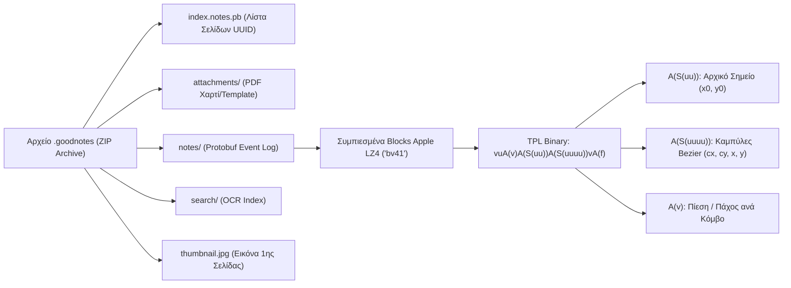
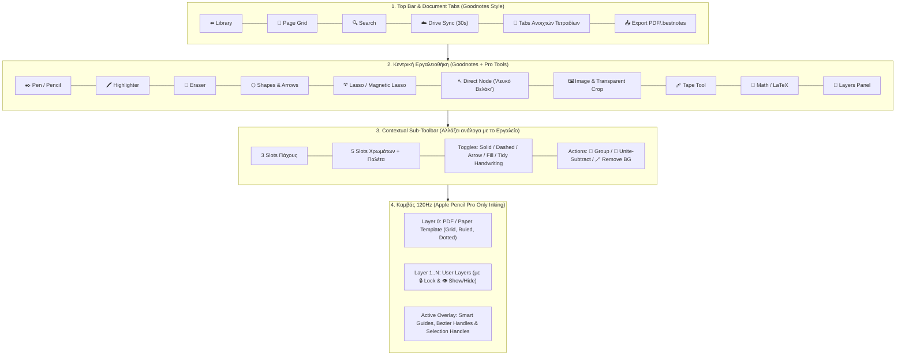
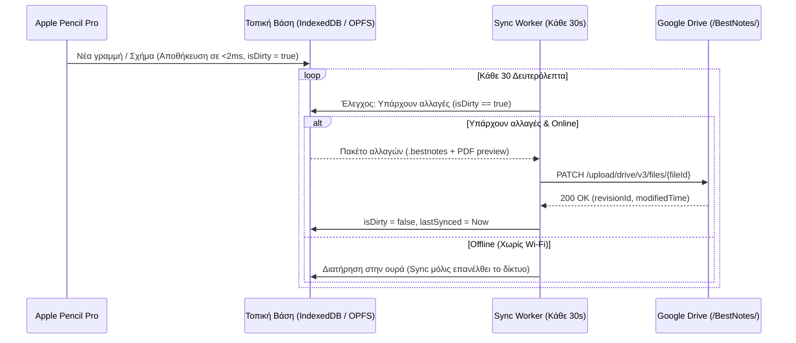

# 📘 BestNotes — Πλήρης Τεχνική Τεκμηρίωση, Αρχιτεκτονική & Roadmap Υλοποίησης

> [!IMPORTANT]
> **Κεντρική Φιλοσοφία του BestNotes:**
> Δημιουργούμε το απόλυτο εργαλείο χειρόγραφων σημειώσεων για **iPad (με Apple Pencil Pro)**, **Android Tablets** και **Web**, κρατώντας **100% το οικείο, γρήγορο UI και την αίσθηση γραφής του Goodnotes 6**, αφαιρώντας τα περιττά (ήχος/βίντεο) και ενσωματώνοντας **εγγενή γραφιστικά εργαλεία από τα Adobe Illustrator & Photoshop** καθώς και **εγγενή μαθηματικά εργαλεία & καλλωπισμό ελληνικού χειρογράφου**, με **αυτόματο συγχρονισμό στο Google Drive κάθε 30 δευτερόλεπτα**.

---

## 📑 Ευρετήριο Τεκμηρίωσης (Master Index)

1. **[1. Συγκριτικός Χάρτης Χαρακτηριστικών (Τι Κρατάμε, Τι Αφαιρούμε, Τι Προσθέτουμε)](#1-συγκριτικός-χάρτης-χαρακτηριστικών)**
   * 1.1 Τι κρατάμε 100% ίδιο με το Goodnotes 6 (UI & Core)
   * 1.2 Τι αφαιρούμε συνειδητά (Out of Scope)
   * 1.3 Τι προσθέτουμε: Γραφιστικές Υπερδυνάμεις (Illustrator + Photoshop)
   * 1.4 Τι προσθέτουμε: Μαθηματικές Υπερδυνάμεις & Καλλωπισμός Ελληνικού Χειρογράφου
2. **[2. Reverse Engineering του Goodnotes 6 (Εσωτερική Αρχιτεκτονική & Δομή Αρχείων)](#2-reverse-engineering-του-goodnotes-6)**
   * 2.1 Ακτινογραφία του Binary Format `.goodnotes`
   * 2.2 Αποκωδικοποίηση των Καμπυλών Bezier (`bv41` LZ4 + `tpl` Binary Structs)
   * 2.3 Δομή του δικού μας Format `.bestnotes` & Native `.goodnotes` Importer
3. **[3. Αρχιτεκτονική UI/UX (1:1 Κλώνος Goodnotes + Επεκτάσεις)](#3-αρχιτεκτονική-uiux)**
   * 3.1 Οθόνη Βιβλιοθήκης (Library & Folders View)
   * 3.2 Οθόνη Καμβά (Document Workspace & Εργαλειοθήκες)
   * 3.3 Τα Νέα Contextual Panels (Layers, Grouping, Bezier Nodes, Math)
4. **[4. Μηχανή Σχεδίασης Apple Pencil Pro & Εγγενείς Αλγόριθμοι (Zero-AI Core)](#4-μηχανή-σχεδίασης-apple-pencil-pro--εγγενείς-αλγόριθμοι)**
   * 4.1 Πλήρης Εκμετάλλευση του Apple Pencil Pro (Pressure, Tilt, Barrel Roll/Twist, Hover, Palm Rejection)
   * 4.2 Αλγόριθμος Μεταξένιων Καμπυλών Bezier & Καλλιγραφικού Στρωσίματος
   * 4.3 Ακαριαία Αναγνώριση & Διόρθωση Σχημάτων (Hold-to-Snap Geometric Engine)
   * 4.4 Αλγόριθμοι Photoshop: Magnetic Lasso (Sobel + Dijkstra), Freehand Alpha Crop & Transparent Background
   * 4.5 Αλγόριθμοι Illustrator: Scene Graph Groups, Direct Bezier Node Editing & Boolean Pathfinder
5. **[5. Μαθηματική Μηχανή, Καλλωπισμός Χειρογράφου & Δωρεάν LaTeX/CAS](#5-μαθηματική-μηχανή--καλλωπισμός-χειρογράφου)**
   * 5.1 Εγγενής Καλλωπισμός Ελληνικού Χειρογράφου & Μαθηματικών Συμβόλων (Χωρίς AI)
   * 5.2 Offline Συμβολική Άλγεβρα (CAS Equation Solver)
   * 5.3 Δωρεάν Μετατροπή σε Τυπωμένο $\LaTeX$ & Ελληνικό Κείμενο
6. **[6. Μηχανισμός Auto-Sync κάθε 30 Δευτερόλεπτα με Google Drive](#6-μηχανισμός-auto-sync-κάθε-30-δευτερόλεπτα-με-google-drive)**
   * 6.1 Local-First Αποθήκευση ($0\text{ms}$ Latency)
   * 6.2 Ο Κύκλος Συγχρονισμού των 30s (Delta Sync & Conflict Resolution)
7. **[7. Στρατηγική Multi-Platform: Από Web App (PWA) σε Native iPadOS & Android](#7-στρατηγική-multi-platform-από-web-app-σε-native-ipados--android)**
   * 7.1 Φάση Web/PWA στο iPad (Χωρίς Apple Developer Account)
   * 7.2 Άμεση Μετάβαση σε Native iPadOS & Android (Capacitor + Native Pencil Pro Plugin)
8. **[8. Αναλυτικό Roadmap Υλοποίησης (Βήμα-Βήμα)](#8-αναλυτικό-roadmap-υλοποίησης)**

---

## 1. Συγκριτικός Χάρτης Χαρακτηριστικών

### 1.1 Τι Κρατάμε 100% Ίδιο με το Goodnotes 6 (UI & Βασική Εμπειρία)
| Κατηγορία | Χαρακτηριστικό Goodnotes που διατηρούμε αυτούσιο |
| :--- | :--- |
| **Διάταξη UI** | **Top Document Tabs** (πολλαπλά ανοιχτά τετράδια), **Main Toolbar** στην κορυφή, **Contextual Sub-Toolbar** ακριβώς από κάτω (3 γρήγορα πάχη + παλέτα χρωμάτων + ρυθμίσεις εργαλείου). |
| **Εργαλεία Γραφής** | **Pen** (Fountain Pen, Ballpoint, Brush Pen), **Pencil** (με υφή), **Highlighter** (μπαίνει αυτόματα *κάτω* από το μελάνι με blend mode `multiply` για να μη θολώνει τα γράμματα). |
| **Εργαλεία Σβησίματος** | **Eraser** (Precision, Standard, **Stroke Eraser** που σβήνει ολόκληρη γραμμή με ένα άγγιγμα, και επιλογή *"Erase Highlighter Only"*). |
| **Gestures** | **Scribble-to-Erase** (μουτζούρωμα για άμεσο σβήσιμο χωρίς αλλαγή εργαλείου), **Hold-to-Snap** (κράτημα 0.3s στο τέλος της γραμμής για μετατροπή σε τέλειο σχήμα/ευθεία), **2-finger tap Undo / 3-finger tap Redo**. |
| **Βοηθήματα Μαθήματος** | **Tape Tool** (ταινία απόκρυψης απαντήσεων που αποκαλύπτεται με tap), **Laser Pointer** (με ουρά ή κουκκίδα για παράδοση μαθήματος), **Ruler (Χάρακας)**. |
| **Χαρτιά & PDF** | Εισαγωγή/Εξαγωγή **PDF**, **Templates Χαρτιού** (Τετραγωνισμένο/Grid, Γραμμές, Τελείες, Cornell, Μαύρο/Σκούρο χαρτί), **Page Thumbnails Grid** για αναδιάταξη/αντιγραφή σελίδων. |

### 1.2 Τι Αφαιρούμε Συνειδητά (Δεν μας ενδιαφέρουν)
* ❌ **Εγγραφή Ήχου (Audio Recording)** & Βίντεο.
* ❌ **Marketplace / Κατάστημα** με πληρωμένα αυτοκόλλητα και planners.
* ❌ **Βαριά Social / Community Feeds** που βαραίνουν το UI.

### 1.3 Τι Προσθέτουμε: Γραφιστικές Υπερδυνάμεις (Illustrator + Photoshop)
| Προέλευση | Νέο Εργαλείο στο BestNotes | Πώς λύνει τα χέρια στο μάθημα |
| :--- | :--- | :--- |
| **Illustrator** | **🔗 Group & Ungroup (Nested Groups)** | Ενώνεις σχήματα, γραμμές και βέλη (π.χ. έναν αγωγό με τα ηλεκτρόνια ή ένα κύκλωμα) σε **ένα αντικείμενο** που μετακινείται, αντιγράφεται και μεγαλώνει ενιαία. |
| **Illustrator** | **✒️ Direct Selection ("Λευκό Βελάκι" - Κόμβοι & Χερούλια Bezier)** | Πατάς πάνω σε οποιοδήποτε σχήμα ή καμπύλη και πειράζεις με το Apple Pencil τις γωνίες (Anchor Points) και τα χερούλια καμπυλότητας (Bezier Handles) χωρίς να το ξαναζωγραφίζεις. |
| **Illustrator** | **🧩 Shape Builder (Unite / Subtract / Intersect)** | Ενώνεις ή αφαιρείς γεωμετρικά σχήματα (π.χ. κύκλος μείον ορθογώνιο = κοίλος φακός ή μαγνήτης). |
| **Illustrator** | **📏 Smart Guides, Align & Distribute + Dashed/Arrow Toggles** | Αυτόματοι οδηγοί ευθυγράμμισης, 1-click **Διακεκομμένη Γραμμή (Dashed)**, 1-click **Διάνυσμα ($\vec{F}$)**, και γεμίσματα **Hatching (`///`)** για έδαφος/τοίχο. |
| **Photoshop** | **✂️ Ελεύθερο Lasso Crop σε Οποιοδήποτε Σχήμα** | Κόβεις μια εικόνα/screenshot σε **οποιοδήποτε κλειστό περίγραμμα** σχεδιάσεις με το Apple Pencil (πραγματική διαφάνεια `alpha = 0` έξω από τη γραμμή, όχι λευκό κουτί). |
| **Photoshop** | **🧲 Magnetic Lasso (Intelligent Scissors)** | Περνάς το Apple Pencil γύρω από ένα σχήμα σε εικόνα και η γραμμή κοπής **μαγνητίζεται αυτόματα πάνω στις ακμές** του αντικειμένου (Sobel + Dijkstra). |
| **Photoshop** | **🪄 1-Click Transparent BG & Magic Wand** | Αφαιρεί ακαριαία (χωρίς AI) το λευκό/γκρι φόντο από screenshots ασκήσεων/σχημάτων ώστε να φαίνονται από πίσω τα τετραγωνάκια του τετραδίου σου. |
| **Photoshop** | **📑 Layers Panel (Επίπεδα με 🔒 Lock & 👁️ Hide) + Απλές Μάσκες** | Κλειδώνεις (🔒) το Layer με το σχήμα της άσκησης για να μη σβήνεται όταν σβήνεις τις πράξεις! Κρύβεις (👁️) το Layer της λύσης και το εμφανίζεις με 1 tap στο μάθημα! |

### 1.4 Τι Προσθέτουμε: Μαθηματικές Υπερδυνάμεις & Καλλωπισμός Ελληνικού Χειρογράφου
* **✨ Εγγενές «Στρώσιμο Χειρογράφου» (Tidy Greek Handwriting — Χωρίς AI):** Κρατάει τα δικά σου ελληνικά χειρόγραφα, αλλά λειαίνει τις καμπύλες Bezier, ισιώνει τη νοητή γραμμή (baseline) ώστε οι λέξεις να μην κατηφορίζουν, και ομορφαίνει το πάχος της πένας.
* **📐 Αυτόματο Ίσιωμα Μαθηματικών Συμβόλων (Χωρίς AI):** Αναγνωρίζει γεωμετρικά τις **γραμμές κλασμάτων**, το **ίσον ($=$)**, το **συνεπάγεται ($\implies$)**, τις **παρενθέσεις** και τα **διανύσματα ($\vec{\upsilon}$)** και τα κάνει αυτόματα συμμετρικά και ευθυγραμμισμένα.
* **🧮 Μετατροπή σε $\LaTeX$ / Ελληνικό Κείμενο & Επίλυση Εξισώσεων (CAS):** Επιλογή με το Lasso για μετατροπή χειρόγραφης εξίσωσης σε τυπωμένο $\LaTeX$ (KaTeX) και άμεση επίλυση εξισώσεων μέσω ενσωματωμένης Offline Μηχανής Άλγεβρας (CAS) + Δωρεάν Gemini API.

---

## 2. Reverse Engineering του Goodnotes 6

Από την εργαστηριακή ανάλυση που κάναμε πάνω στα δικά σου αρχεία (`2026-10-22 Φυσικη Ενταση Ρευματος.goodnotes` και `2026-10-19 Φυσικη.goodnotes`), αποκωδικοποιήσαμε πλήρως την εσωτερική αρχιτεκτονική του Goodnotes:

### 2.1 Πώς Αποθηκεύονται οι Γραμμές (Το Binary Secret)
Κάθε σελίδα στον φάκελο `notes/<UUID>` είναι ένα Event-Sourcing Protobuf log που περιέχει συμπιεσμένα blocks με κεφαλίδα `bv41` (Apple Raw LZ4 compression). Όταν αποσυμπιεστεί ένα block, περιέχει ένα binary αντικείμενο `tpl` με format string:
$$\texttt{vuA(v)A(S(uu))A(S(uuuu))vA(f)}$$
* **`A(S(uu))`**: Περιέχει $2 \times \text{float32}$ — τις συντεταγμένες εκκίνησης $(x_0, y_0)$ της μύτης του Apple Pencil.
* **`A(S(uuuu))`**: Περιέχει τετράδες από $\text{float32}$ $(cx_i, cy_i, x_i, y_i)$, όπου $(cx_i, cy_i)$ είναι το σημείο ελέγχου (Control Point) και $(x_i, y_i)$ το τελικό σημείο μιας **Quadratic Bezier καμπύλης** (`Q cx cy x y`).
* **`A(v)`**: Πίνακας `uint16` με την πίεση/πάχος σε κάθε σημείο της καμπύλης.

### 2.2 Το Δικό μας Format (`.bestnotes`) & Εγγενής Εισαγωγή `.goodnotes`
1. **Native `.goodnotes` Importer:** Ενσωματώνουμε στο BestNotes τον αποκωδικοποιητή `ZIP -> Protobuf -> LZ4 (bv41) -> TPL Bezier` που ήδη κατασκευάσαμε, ώστε να μπορείς να ανοίγεις **όλα τα υπάρχοντα αρχεία `.goodnotes` σου** κατευθείαν μέσα στο BestNotes ως επεξεργάσιμα vectors!
2. **Το Format `.bestnotes`:** Θα είναι επίσης ένα συμπιεσμένο container (ή JSON/Binary bundle) που θα αποθηκεύει:
   * Τα `Pages[]` και το `Background/PDF Template`,
   * Τα `Layers[]` κάθε σελίδας (με `locked`, `visible`, `opacity`, `blendMode`),
   * Το `SceneGraph` κάθε Layer: `Strokes` (Bezier splines), `Shapes` (με παραμέτρους + κόμβους), `Groups` (λίστα παιδιών), `Images` (με `clipPath` Bezier μάσκα και `transparentBg` ρυθμίσεις), και `MathBlocks` ($\LaTeX$).

---

## 3. Αρχιτεκτονική UI/UX (1:1 Κλώνος Goodnotes + Επεκτάσεις)

---

## 4. Μηχανή Σχεδίασης Apple Pencil Pro & Εγγενείς Αλγόριθμοι

### 4.1 Πλήρης Εκμετάλλευση του Apple Pencil Pro
| Δυνατότητα Apple Pencil Pro | Πώς την αξιοποιούμε στο BestNotes |
| :--- | :--- |
| **Pressure (`event.pressure`)** | Δυναμική αυξομείωση πάχους γραμμής (Fountain Pen / Brush) και αδιαφάνειας (Pencil). |
| **Tilt (`tiltX`, `tiltY`, `altitudeAngle`)** | Πλαγίασμα μύτης για φυσική σκίαση με το Μολύβι ή πλατιά γραμμή στον Μαρκαδόρο. |
| **Barrel Roll (`event.twist`)** | Το **Apple Pencil Pro** διαθέτει γυροσκόπιο περιστροφής (`twist` 0°–359°)! Καθώς περιστρέφεις το Pencil γύρω από τον άξονά του, περιστρέφεται η πλατιά μύτη της Καλλιγραφικής Πένας και ο κέρσορας! |
| **Hover (`pointermove` με `pressure = 0`)** | Πριν καν ακουμπήσει η μύτη στην οθόνη (έως 12mm απόσταση), εμφανίζεται **ακριβής προεπισκόπηση του πάχους/χρώματος** ή του μεγέθους της Γόμας! |
| **Squeeze & Haptics** | Στη Native iPadOS έκδοση (μέσω Capacitor plugin), το **ζούληγμα (Squeeze)** του Apple Pencil Pro ανοίγει ακαριαία την κυκλική παλέτα εργαλείων (Pen/Eraser/Lasso/Group) ακριβώς κάτω από τη μύτη με απτική δόνηση (Haptic click). Στη Web έκδοση ενεργοποιούμε εναλλακτικά το **Scribble-to-Erase** + **Floating Quick-Switch**. |
| **Palm Rejection (`pointerType === 'pen'`)** | Όταν γράφεις, η παλάμη αγνοείται 100%. Το 1 δάχτυλο κάνει Pan, τα 2 δάχτυλα Pinch-to-Zoom & Tap-to-Undo. |

### 4.2 Αλγόριθμος Μεταξένιων Καμπυλών Bezier & StreamLine
Για να μην εμφανίζονται ποτέ «σπαστές» γωνίες όταν γράφεις γρήγορα εξισώσεις:
1. Συλλέγουμε όλα τα υπο-γεγονότα στα $120\text{Hz}-240\text{Hz}$ μέσω `event.getCoalescedEvents()`.
2. Εφαρμόζουμε **One-Euro Filter (Adaptive Low-Pass Filter)**: όταν κινείς αργά το Pencil φιλτράρει το τρέμουλο του χεριού, ενώ όταν κινείς γρήγορα μηδενίζει το lag.
3. Μετατρέπουμε τα σημεία $P_0, P_1, \dots, P_n$ σε **Quadratic Bezier Splines** χρησιμοποιώντας τα μέσα των τμημάτων $M_i = \frac{P_i + P_{i+1}}{2}$ ως σημεία σύνδεσης ($C^1$ συνέχεια):
   $$\mathbf{B}_i(t) = (1-t)^2 M_{i-1} + 2(1-t)t P_i + t^2 M_i, \quad t \in [0, 1]$$

### 4.3 Ακαριαία Αναγνώριση & Διόρθωση Σχημάτων (Hold-to-Snap)
Όταν η ταχύτητα της μύτης του Apple Pencil πέσει κοντά στο μηδέν ($v < \epsilon$) για $300\text{ms}$ στο τέλος μιας γραμμής:
1. **Έλεγχος Ευθείας:** Υπολογίζουμε τον λόγο ευθύτητας $R = \frac{\|P_n - P_0\|}{\sum_{i=1}^n \|P_i - P_{i-1}\|}$. Αν $R > 0.91$, η γραμμή αντικαθίσταται από τέλειο ευθύγραμμο τμήμα (και αν η γωνία είναι $\pm 4^\circ$ από $0^\circ, 45^\circ, 90^\circ$, κάνει snap).
2. **Έλεγχος Κλειστού Σχήματος:** Αν $\|P_n - P_0\| < 0.18 \cdot L_{\text{total}}$:
   * Τρέχουμε τον αλγόριθμο **Ramer-Douglas-Peucker (RDP)** + ανίχνευση τοπικών μεγίστων καμπυλότητας για εύρεση κορυφών $V$:
   * **3 Κορυφές $\rightarrow$ Τρίγωνο** (με αυτόματο snap σε ορθογώνιο/ισοσκελές αν είναι κοντά).
   * **4 Κορυφές $\rightarrow$ Ορθογώνιο ή Παραλληλόγραμμο** (έλεγχος παραλληλίας απέναντι πλευρών και γωνιών $\approx 90^\circ$), με επιλογή αυτόματου ημιδιαφανούς γεμίσματος (`Fill`).
   * **0 Γωνίες (Ομαλή κλειστή καμπύλη) $\rightarrow$ Κύκλος ή Έλλειψη** μέσω **Least-Squares Ellipse Fitting (Fitzgibbon)**, που παράγει 4 τέλεια Bezier τόξα.

### 4.4 Αλγόριθμοι Photoshop (100% Εγγενείς — Χωρίς AI)
* **🧲 Magnetic Lasso (Intelligent Scissors / Live-Wire):**
  1. Υπολογισμός **Sobel Gradient** $G = \sqrt{G_x^2 + G_y^2}$ στην περιοχή της εικόνας.
  2. Ορισμός συνάρτησης κόστους ακμής $C(p, q) = \frac{1}{1 + \alpha G(q)}$.
  3. Καθώς σέρνεις το Apple Pencil, ο αλγόριθμος **Dijkstra Shortest Path** σε παράθυρο ακτίνας $20\text{px}$ βρίσκει σε πραγματικό χρόνο το μονοπάτι που «κολλάει» πάνω στο περίγραμμα υψηλής αντίθεσης του σχήματος!
* **✂️ Freehand Lasso Crop:**
  Η κλειστή καμπύλη Bezier που σχεδιάζεις αποθηκεύεται ως `clipPath` της εικόνας. Κατά το rendering εκτελείται `ctx.clip(path2D)` ώστε όλο το εξωτερικό μέρος να είναι **100% διαφανές**.
* **🪄 1-Click Transparent Background & Magic Wand:**
  * **Color-to-Alpha (Luminance Smooth Thresholding):** Για κάθε pixel $(R, G, B)$ υπολογίζεται η χρωματική απόσταση $d = \|C_{\text{pixel}} - C_{\text{bg}}\|$ από το φόντο (λευκό/γκρι) και αποδίδεται ομαλό κανάλι διαφάνειας $\alpha = \text{smoothstep}(T_1, T_2, d)$ ώστε να μην υπάρχουν «λευκά δοντάκια» γύρω από τα γράμματα.
  * **Magic Wand (Flood-Fill BFS):** Αφαιρεί μόνο το εξωτερικό συνεχόμενο φόντο, κρατώντας τα εσωτερικά λευκά γεμίσματα του σχήματος ανέπαφα.

### 4.5 Αλγόριθμοι Illustrator (100% Εγγενείς — Χωρίς AI)
* **🔗 Scene Graph Grouping:** Κάθε αντικείμενο έχει `parentId` / `GroupNode`. Ο πίνακας μετασχηματισμού ενός Group $\mathbf{M}_{\text{group}}$ (μετακίνηση, κλίμακα, περιστροφή) πολλαπλασιάζεται αυτόματα με όλα τα παιδιά του ($\mathbf{M}_{\text{world}} = \mathbf{M}_{\text{group}} \cdot \mathbf{M}_{\text{child}}$).
* **✒️ Direct Node Editing ("Λευκό Βελάκι"):** Επιλέγοντας ένα σχήμα ή καμπύλη, εμφανίζονται στην οθόνη τα σημεία $P_i$ (τετράγωνα κουτάκια) και τα σημεία ελέγχου $C_i$ (κυκλικά χερούλια), επιτρέποντας άμεση μετακίνηση με το Apple Pencil.

---

## 5. Μαθηματική Μηχανή & Καλλωπισμός Χειρογράφου

### 5.1 Εγγενής Καλλωπισμός Ελληνικού Χειρογράφου (Χωρίς AI)
1. **Ομαδοποίηση σε Γραμμές & Λέξεις:** Τα strokes που γράφεις ομαδοποιούνται χωρικά (μέσω προβολής στον άξονα $Y$ και $X$).
2. **Baseline Straightening (Ίσιωμα Γραμμής):** Βρίσκεται η κάτω βάση (lower envelope) κάθε λέξης και μετατοπίζεται κάθετα ($\Delta y$) ώστε όλη η ελληνική πρόταση να πατάει τέλεια πάνω στην οριζόντια γραμμή του χαρτιού.
3. **Laplacian Bezier Smoothing:** Εξομαλύνει τις απότομες ακμές των γραμμάτων διατηρώντας 100% τον δικό σου ελληνικό γραφικό χαρακτήρα.
4. **Γεωμετρική Αναγνώριση Μαθηματικών Συμβόλων:**
   * Δύο παράλληλες μικρές οριζόντιες γραμμές σε απόσταση $\Delta y < 25\text{px} \rightarrow$ **Τέλειο Ίσον ($=$)**.
   * Οριζόντια γραμμή που έχει strokes ακριβώς από πάνω και ακριβώς από κάτω $\rightarrow$ **Τέλεια Οριζόντια Γραμμή Κλάσματος**.

### 5.2 Δωρεάν Μετατροπή σε $\LaTeX$ & Offline Επίλυση Εξισώσεων (CAS)
* **Offline CAS Solver:** Ενσωμάτωση της ανοιχτής μαθηματικής μηχανής **Nerdamer / CortexJS Compute Engine** (100% offline & δωρεάν) για άμεσο υπολογισμό παραστάσεων, απλοποίηση κλασμάτων και επίλυση εξισώσεων (π.χ. $15 \cdot t = 90 \implies t = 6$).
* **Δωρεάν OCR ($\LaTeX$ + Ελληνικά):** Σύνδεση με το **Δωρεάν Gemini API (Google AI Studio Free Tier — 1.500 δωρεάν κλήσεις/ημέρα χωρίς κάρτα)** + απόδοση πάνω στον καμβά μέσω **KaTeX** σε μορφή υψηλής ευκρίνειας (SVG/Vector).

---

## 6. Μηχανισμός Auto-Sync κάθε 30 Δευτερόλεπτα με Google Drive

* **Μηδενική Απώλεια Δεδομένων (Local-First):** Κάθε φορά που σηκώνεις τη μύτη του Apple Pencil από την οθόνη, η αλλαγή γράφεται ακαριαία ($<2\text{ms}$) στην τοπική βάση του iPad (`IndexedDB`).
* **Αυτόματος Συγχρονισμός 30s:** Ένας background timer τρέχει κάθε **30 δευτερόλεπτα**. Αν το τετράδιο έχει αλλάξει (`isDirty === true`), ανεβάζει αθόρυβα τη νέα έκδοση στον φάκελο `/BestNotes/` του **Google Drive** σου (μέσω Google Drive API v3 OAuth2) χωρίς να «παγώνει» καθόλου η γραφή σου!

---

## 7. Στρατηγική Multi-Platform: Από Web App σε Native iPadOS & Android

1. **Στάδιο 1 — Web App / PWA (Τρέχει ΣΗΜΕΡΑ στο iPad σου χωρίς Developer Account):**
   * Τεχνολογία: **React 19 + TypeScript + Vite + HTML5 Low-Latency Canvas (`desynchronized: true`) + Tailwind CSS**.
   * Εγκατάσταση στο iPad: Το ανοίγεις στο Safari $\rightarrow$ *Add to Home Screen* $\rightarrow$ τρέχει σε **100% Full Screen** σαν native app, χωρίς το όριο των 7 ημερών της Apple.
2. **Στάδιο 2 — Native iPadOS & Android Tablet App (Μηδενικό Ξαναγράψιμο Κώδικα):**
   * Ενσωματώνουμε το **Capacitor (Ionic/CapacitorJS)** πάνω στο ίδιο ακριβώς project.
   * Με μία εντολή (`npx cap add ios` & `npx cap add android`) παράγονται έτοιμα native projects για **Xcode (iPadOS)** και **Android Studio (Android Tablets)**.
   * Στο iPadOS προσθέτουμε ένα μικρό native Swift bridge (`PencilProPlugin.swift`) που δίνει στο UI μας πρόσβαση και στο **Squeeze gesture** και στο **Haptic Engine** του Apple Pencil Pro!

---

## 8. Αναλυτικό Roadmap Υλοποίησης (Βήμα-Βήμα)

| Φάση | Τίτλος Φάσης | Τι παραδίδουμε και δοκιμάζεις στο iPad σου |
| :--- | :--- | :--- |
| **Φάση 1** | **Core Canvas, Goodnotes UI & Apple Pencil Pro Inking** | • Πλήρες UI Goodnotes (Top Tabs, Main Toolbar, Contextual Sub-Toolbar, Τετραγωνισμένο/Ruled χαρτί). • Μηχανή Apple Pencil Pro (Pressure, Tilt, Barrel Roll, Hover, Palm Rejection, 120Hz Bezier). • Εργαλεία: Pen (3 τύποι), Pencil, Highlighter (κάτω από το μελάνι), Eraser (Stroke & Precision + Scribble-to-Erase), Tape Tool, Laser, Dashed Lines & Vector Arrows ($\vec{F}$). • **Hold-to-Snap Shapes:** Ακαριαία διόρθωση σε Ευθείες, Ορθογώνια (με Fill), Παραλληλόγραμμα, Κύκλους/Ελλείψεις, Τρίγωνα. |
| **Φάση 2** | **Εργαλεία Illustrator (Groups, Nodes, Layers, Smart Guides)** | • **Lasso Selection** & κουμπί **🔗 Group / Ungroup**. • **Direct Selection Tool ("Λευκό Βελάκι")** για επεξεργασία γωνιών και χερουλιών Bezier. • **Layers Panel** με 🔒 Lock Layer, 👁️ Show/Hide, Opacity. • **Shape Builder** (Unite / Subtract) & Hatching fills (`///`). |
| **Φάση 3** | **Εργαλεία Photoshop (Lasso Crop, Magnetic Lasso, Transparent BG)** | • Εισαγωγή εικόνων/screenshots στον καμβά. • **Ελεύθερο Lasso Crop** σε οποιοδήποτε σχήμα με πραγματική διαφάνεια. • **🧲 Magnetic Lasso** (Sobel Edge Detection + Dijkstra Live-Wire). • **🪄 1-Click Transparent Background** & **Magic Wand** (Flood-Fill). |
| **Φάση 4** | **Καλλωπισμός Ελληνικού Χειρογράφου, Μαθηματικά & $\LaTeX$** | • Εγγενές κουμπί **✨ Στρώσιμο Χειρογράφου** (Baseline straightening + Curve smoothing) & αυτόματο ίσιωμα σε $=$, κλάσματα, $\implies$. • Offline **CAS Equation Solver** + Δωρεάν μετατροπή σε τυπωμένο **$\LaTeX$ (KaTeX) / Ελληνικό Κείμενο** μέσω Google AI Studio Free Tier. |
| **Φάση 5** | **Library, `.goodnotes` / PDF Importer & Google Drive 30s Sync** | • Οθόνη Βιβλιοθήκης (Φάκελοι, Τετράδια, Αναζήτηση). • **Native `.goodnotes` File Importer** (για να ανοίγεις τα υπάρχοντα αρχεία Φυσικής σου!) + PDF Import/Export. • **Google Drive Auto-Sync κάθε 30 δευτερόλεπτα** + Local IndexedDB persistence. |
| **Φάση 6** | **PWA Packaging & Native iPadOS / Android Wrapper** | • Πλήρες Offline PWA manifest για iPad Home Screen. • Ρύθμιση Capacitor για εξαγωγή σε Native iPadOS & Android Tablet apps. |

---

## 9. Κατάσταση Έργου — Έκδοση `v0.4 (sketchingToolsSmooth)`: Τι Κάναμε (`✅`) & Τι Χρωστάμε (`⏳`)

> [!NOTE]
> **Τρέχουσα Έκδοση:** **`v0.4 — sketchingToolsSmooth`** (24 Οκτωβρίου 2026)
> **Live Web App (Primary):** [https://mybestnotes.web.app](https://mybestnotes.web.app) (και [https://bestnotes-2026.web.app](https://bestnotes-2026.web.app))
> **GitHub Repository:** [https://github.com/kfrei/bestNotes](https://github.com/kfrei/bestNotes)

### 9.1 ✅ Τι Έχουμε Ολοκληρώσει Πλήρως έως την `v0.4 (sketchingToolsSmooth)`

#### Α. Μηχανή Γραφής 120Hz Apple Pencil, Πιστότητα Χειρογράφου & Απόδοση Καμβά
* **Dual-Canvas 2x Retina HiDPI (`1840×2520`, `desynchronized: true`):** Ανεξάρτητο wet-ink overlay canvas για $0\text{ms}$ απόκριση στην πρώτη επαφή του Apple Pencil, ακόμα και σε μικροσκοπικά σημεία, τόνους και εκθέτες.
* **100% Αναλλοίωτο Χειρόγραφο Μετά το Σήκωμα της Μύτης (`commit 890a614`):** Απενεργοποιήθηκε πλήρως η μετα-εξομάλυνση (post-stroke relaxation) στο `smoothStrokeToBezier`, ώστε ό,τι γράφεις με το μολύβι να παραμένει **100% ίδιο** χωρίς καμία αλλοίωση.
* **Μηδενική Καθυστέρηση Λευκής Σελίδας (`commit 1d734c2`):** Χρήση `useLayoutEffect` κατά το άνοιγμα εγγράφου ή την εναλλαγή καρτέλας ώστε το περιεχόμενο της σελίδας να ζωγραφίζεται σύγχρονα πριν το πρώτο paint του browser (χωρίς στιγμιαίο άσπρο φλας).
* **Συνεχής Κάθετη Κύλιση Πολλών Σελίδων (Word-Style):** Κάθε σελίδα έχει το δικό της Retina canvas, κλειδωμένο οριζόντια στο κέντρο (`panX = 0`), με 120Hz κινητική αδράνεια (momentum scrolling) και gesture **Pull-to-Add-Page** (κράτημα 1.2s στην κορυφή ή στο τέλος).

#### Β. Έξυπνος Διαχωρισμός Αφής (Δάχτυλο vs Apple Pencil)
* **Λειτουργία `Pencil Only` (Προεπιλογή — `commit 4a162cf`):**
  * Το Apple Pencil γράφει αποκλειστικά, ενώ η παλάμη αγνοείται.
  * Το **1 δάχτυλο απευθείας πάνω στη σελίδα** (ή στο γκρι περιθώριο) κάνει **ομαλό scroll της σελίδας**.
  * Αν υπάρχει ήδη επιλεγμένο σχήμα/εικόνα με το Λάσο, το 1 δάχτυλο πάνω του μπορεί να το μετακινήσει, να το περιστρέψει ή να του αλλάξει μέγεθος.
* **Λειτουργία Γραφής και με Δάχτυλο (`!pencilOnlyMode` — `commit caf5e27`):**
  * Όταν είναι επιλεγμένο το **Μολύβι / Στυλό / Μαρκαδόρος**, το δάχτυλο **γράφει κανονικά** πάνω στη σελίδα και **δεν επιλέγει ούτε σέρνει** υποκείμενα σχήματα.
  * Η επιλογή και το σύρσιμο (drag) αντικειμένων με το δάχτυλο επιτρέπονται **μόνο** όταν έχεις επιλεγμένο το **Λάσο (`lasso`)** ή τους **Κόμβους (`direct-node`)**.
* **Αυτόματη Αποεπιλογή & Κλείσιμο Παραθύρων με Tap Έξω (`commits 94071a0, 7ae1a7b`):**
  * Tap με το δάχτυλο σε κενό σημείο της σελίδας όταν βρίσκεσαι σε Λάσο/Κόμβους αποεπιλέγει το αντικείμενο και γυρνάει αυτόματα στο Μολύβι.
  * Tap έξω από οποιοδήποτε ανοιχτό μενού/popover (Χρώματα, Πάχος, Layers, Βιβλιοθήκη, Μικρογραφίες Σελίδων, Ρυθμίσεις) το κλείνει διατηρώντας την τελευταία επιλογή.
* **Gestures 2 & 3 Δαχτύλων:** 2-finger Pinch-to-Zoom, 2-finger Tap = `Undo`, 3-finger Tap = `Redo`.

#### Γ. Καμπύλες, 2D/3D Σχήματα, Φυσική & Hold-to-Snap
* **Ζωντανό `Hold-to-Snap` (~0.42s χωρίς να σηκώσεις το Apple Pencil — `commit d465aae`):** Στο εργαλείο Μολύβι/Στυλό μετατρέπει αυτόματα τη γραμμή σου σε τέλεια **Ευθεία**, **Κύκλο/Έλλειψη**, **Τετράγωνο**, **Ορθογώνιο** ή **Τρίγωνο**.
* **Εργαλειοθήκη Ειδικών Σχημάτων (`Shapes`):**
  * **Μαθηματικές Καμπύλες:**
    * **Ημίτονο ($\sin$)** & **Συνημίτονο ($\cos$)** με 2 συμμετρικούς κόμβους ελέγχου πλάτους/φάσης.
    * **Παραβολή ($x^2$)** & **Τόξο ($\frown$)** με 3 κόμβους καμπυλότητας.
    * **Ορθογώνια Υπερβολή ($y = c/x$ — `commit 2239dce`):** Σχεδιάζεται ως ασυμπτωτικός κλάδος Rational Quadratic Bézier ($w = 1.85$) που ακολουθεί 100% τα άκρα και τη φορά σχεδίασης του χρήστη (**κοίλα πάνω ή κοίλα κάτω**).
  * **3D Στερεά Σχήματα (`commits ba51fcd, 7cdb671`):**
    * **Κύβος (`cube`)**, **Παραλληλεπίπεδο (`cuboid` σε προσανατολισμό $-90^\circ$ με Μπροστινή, Πάνω και Δεξιά έδρα)**, **Κύλινδρος (`cylinder`)**, **Κώνος (`cone`)**, **Σφαίρα (`sphere`)** και **Πυραμίδα (`pyramid`)**.
    * Αυτόματη απόδοση των εσωτερικών/πίσω ακμών με **διακεκομμένη γραμμή (`dashed`)** και των εξωτερικών ακμών με **συνεχή γραμμή (`solid`)**, καθώς και πλήρης υποστήριξη γεμίσματος (`Fill`).
  * **Φυσική & Διανύσματα:** **Διάνυσμα ($\vec{F}$)**, **Διπλό Βέλος ($\leftrightarrow$)**, **Αντίσταση (`resistor` με 9 αιχμές)**, **Ελατήριο (`spring` με 7 σπείρες)** και **Καρτεσιανοί Άξονες $x,y$ (`axes`)**.
* **Γέμισμα Σχημάτων & Κλειστών Γραμμών (`F / Φ`):** Κουμπί 1-κλικ στην πάνω δεξιά μπάρα για ημιδιαφανές solid γέμισμα στο χρώμα του περιγράμματος (τόσο σε έτοιμα σχήματα όσο και σε κλειστές ελεύθερες γραμμές).

#### Δ. Γόμα Ακριβείας (`Pixel`) & Γόμα Γραμμής (`Stroke`) με Προστασία 3D Σχημάτων
* **3 Μεγέθη Γόμας (Μικρή / Μεσαία / Μεγάλη) & 3 Λειτουργίες (`Pixel`, `Stroke`, `Μόνο Μαρκαδόρος`).**
* **Αληθινή Κοπή Γραμμών (`Pixel Eraser` — `commit 995d683`):** Χωρίζει ευθείες, καμπύλες και σχήματα ακριβώς στον κύκλο επαφής της γόμας.
* **Ανεξάρτητο Hit-Testing στα 3D Σχήματα (`commit 294d5ef`):** Η γόμα ελέγχει αποκλειστικά τις πραγματικές σχεδιασμένες γραμμές (`get3DShapeSubPaths`) κάθε 3D στερεού και **ποτέ** το κενό εσωτερικό του — ώστε αν σβήσεις π.χ. ένα ημίτονο μέσα σε μια σφαίρα, να σβήνεται **μόνο το ημίτονο** και ποτέ η εξωτερική σφαίρα.

#### Ε. Εργαλεία Illustrator, Photoshop, Κείμενο, Χάρακας & Laser
* **Επιλογή Λάσο (`Lasso`):** Λεπτή φωτεινή πράσινη διακεκομμένη γραμμή (`#22c55e`), πλαίσιο επιλογής που περιστρέφεται μαζί με το σχήμα, **ημικυκλικό βέλος περιστροφής (`↻`)**, **4 μπλε γωνιακά χερούλια** (αναλογικό resize) και **4 πορτοκαλί πλευρικά χερούλια** (stretch πλάτους/ύψους).
* **Ενέργειες Επιλογής:** `Copy`, `Paste`, **`Duplicate` (`+28px, +28px`)**, `Group / Ungroup`, αλλαγή χρώματος/πάχους/στυλ γραμμής εκ των υστέρων, και **ενοποιημένο Z-Order (`-1`, `+1`, `Πίσω`, `Μπροστά`)** ανάμεσα σε εικόνες και σχήματα.
* **Επεξεργασία Κόμβων (`direct-node` — Λευκό Βελάκι):** Εξειδικευμένοι κόμβοι για όλα τα σχήματα + εξαγωγή ~5–7 βασικών κόμβων (`computeFreehandKeyNodeIndices`) με ομαλή παραμόρφωση **Cosine-Hermite** για ελεύθερες καμπύλες.
* **Layers Panel (`Επίπεδα`):** Drag-and-drop αναδιάταξη επιπέδων, κουμπιά `▲/▼`, `🔒 Lock`, `👁️ Show/Hide`, `🗑️ Διαγραφή`.
* **Βιβλιοθήκη Σχημάτων (`+ Βιβλιοθήκη`):** Αποθήκευση οποιουδήποτε επιλεγμένου σχήματος, ομάδας ή εικόνας με αυτόματη Retina μικρογραφία και εισαγωγή στη σελίδα με 1 tap.
* **Εργαλείο Κειμένου (`Text`):** Σύρσιμο πλαισίου κειμένου με δάχτυλο ή Apple Pencil, επιλογή μεγέθους, `Bold`, και χρώματος από την πάνω δεξιά παλέτα.
* **Χάρακας (`Ruler` — `commit 6a8e79e`) & Κόκκινο Laser (`commit c80424c`):** Χάρακας 80% πλάτους A4 με υποδιαιρέσεις `cm`/`mm` και κεντρικό χερούλι περιστροφής· Laser παρουσίασης που μένει ορατό όσο σχεδιάζεις και σβήνει στα $1000\text{ms}$ μετά το σήκωμα της μύτης.
* **Εικόνες, PDF & Σελίδες:** Εισαγωγή πολυσέλιδων PDF & JPG/PNG, Grid View μικρογραφιών σελίδων (3 ή 4 στήλες), προσθήκη/διαγραφή/περιστροφή σελίδας, **1-Click Transparent BG**, **Freehand Lasso Crop** & **Magnetic Lasso**.

#### ΣΤ. Καρτέλες Εγγράφων, Landing Page & Firebase Authentication
* **Chrome-Style Elastic Document Tabs (`commit 85a0bc5`):** Κουμπί `X` ακόμα και στο τελευταίο ανοιχτό tab (επιστρέφει στη Βιβλιοθήκη Εγγράφων) και δυναμικό πλάτος καρτελών όταν έχεις 1–4 ανοιχτά αρχεία.
* **Καθαρό Workspace (`commit 699a5ce`):** Αφαίρεση μπλε περιγράμματος ενεργής σελίδας και φωτεινό γκρι φόντο (`#f1f3f6`).
* **Goodnotes-Style Animated Landing Page & Firebase Auth (`commit ccd7ad4`):**
  * Δημοσίευση στο **`https://mybestnotes.web.app`** (και `https://bestnotes-2026.web.app`).
  * Landing Page με 6 αυτόματα εναλλασσόμενα animated tabs (`Whiteboard`, `PDF Annotation`, `Documents`, `Notebooks`, `Ημίτονα & 3D Σχήματα [PRO]`, `Layers & Groups [PRO]`).
  * Πλήρης **Σύνδεση / Εγγραφή με Email & Κωδικό** και **1-Click Google Sign-In** μέσω Firebase Authentication.

---

### 9.2 ⏳ Τι Χρωστάμε / Εκκρεμεί να Κάνουμε στις Επόμενες Εκδόσεις (`v0.5+ Roadmap`)

| Προτεραιότητα | Εκκρεμότητα / Feature προς Υλοποίηση | Αναλυτική Περιγραφή |
| :---: | :--- | :--- |
| **1 (Βήμα 5.1)** | **📄 Αυτόματη Παραγωγή Πολυσέλιδου PDF (`.pdf` Generator) & `.bestnotes`** | Μηχανή εξαγωγής που μετατρέπει όλες τις σελίδες του τετραδίου (χαρτί/PDF + χειρόγραφα + 2D/3D σχήματα + εικόνες) σε πραγματικό πολυσέλιδο αρχείο `.pdf` υψηλής ανάλυσης. |
| **2 (Βήμα 5.2)** | **☁️ Google Drive Login & Auto-Sync Ενημερωμένου PDF κάθε φορά που αλλάζει** | Σύνδεση με Google Drive API v3 (`drive.file` scope) ώστε κάθε φορά που γράφεις/αλλάζεις κάτι σε ένα τετράδιο, να ενημερώνεται αυτόματα (`PATCH`) το αντίστοιχο αρχείο **`.pdf`** (και `.bestnotes`) μέσα στον φάκελο `/BestNotes/` του Google Drive σου. |
| **3 (Βήμα 5.3)** | **🔗 Κοινή Χρήση Αρχείου: Public Link, `Viewers` (Μόνο Προβολή) & `Collaborators` (Συνεργάτες)** | Κουμπί **«Share / Κοινή Χρήση»** σε κάθε έγγραφο μέσω Cloud Firestore: • **Public Link (`?doc=...`):** Άνοιγμα από μαθητές/τρίτους σε Read-Only (`Viewer`) mode με ζωντανή ενημέρωση και λήψη PDF. • **Πρόσκληση Collaborators / Viewers με Email:** Δικαίωμα `Viewer` (προβολή) ή `Collaborator` (ταυτόχρονη συνεργατική γραφή σε πραγματικό χρόνο). |
| **4 (Φάση 4)** | **🧮 Ζωντανό Handwritten OCR $\rightarrow \LaTeX$ (Gemini Flash Free API)** | Απευθείας μετατροπή χειρόγραφων μαθηματικών εξισώσεων που επιλέγεις με το Λάσο σε τυπωμένο $\LaTeX$ (`KaTeX`) πάνω στη σελίδα, συνδυαστικά με τον ενσωματωμένο Offline CAS Solver. |
| **5 (Φάση 4)** | **✨ Επανεργοποίηση & Εξέλιξη του «Στρωσίματος Χειρογράφου» (Tidy Greek Handwriting)** | Επαναφορά στο τέλος ως **προαιρετική ενέργεια πάνω σε επιλογή Λάσο**, που θα ευθυγραμμίζει τη νοητή γραμμή (baseline) και τα μαθηματικά σύμβολα ($=$, γραμμές κλασμάτων, $\implies$) διατηρώντας 100% τον γραφικό χαρακτήρα. |
| **6 (Φάση 6)** | **📱 Πλήρες Offline PWA & Native iPadOS / Android App (Capacitor + Pencil Pro Squeeze)** | Προσθήκη Service Worker / PWA Manifest για 100% offline λειτουργία από την Αρχική Οθόνη του iPad και δημιουργία Native iPadOS/Android πακέτου μέσω Capacitor. |

