# 🗺️ BestNotes Master Codebase Index & Domain Architecture Guide

> **Σκοπός:** Αυτό το έγγραφο αποτελεί τον κεντρικό χάρτη πλοήγησης (Code Index) του BestNotes. Εδώ καταγράφεται αναλυτικά πού βρίσκεται κάθε λειτουργία, πώς οργανώνονται τα domains και πώς αποσυντίθεται το `src/App.tsx` ώστε οποιοσδήποτε προγραμματιστής ή AI agent να εντοπίζει ακαριαία τον κώδικα χωρίς αναζητήσεις σε δεκάδες χιλιάδες γραμμές.

---

## 🏛️ Οι 4 Βασικοί Πυλώνες (Domain-Driven Architecture)

```mermaid
graph TD
    App["src/App.tsx<br/>(Master Orchestrator & State)"]
    
    subgraph D1["1. src/simulations/ (Προσομοιώσεις & Physics)"]
        SimIndex["index.ts (Facade)"]
        SimRegistry["registry/SimulationRegistry.ts"]
        SimCore["core/ (PhysicsMath, UniversalStopwatchBridge, VirtualPencilAnimator)"]
        SimModules["modules/mechanics/pendulum/..."]
        SimUI["ui/ (StopwatchWidget, FullscreenLaserCanvas)"]
    end
    
    subgraph D2["2. src/stem-engines/ (STEM & OCR)"]
        StemIndex["index.ts (Facade)"]
        StemOCR["ocr/OcrPrompts.ts"]
        StemChem["chemistry/periodicTableData.ts"]
        StemMath["math/physicsEquationsLibrary.ts"]
        StemUI["ui/LassoOcrButtons.tsx"]
    end

    subgraph D3["3. src/canvas-tools/ (Εργαλεία Σχεδίασης & Χρώματα)"]
        CanvasIndex["index.ts (Facade)"]
        CanvasTypes["types.ts (ToolType, PenSubType, EraserSubType)"]
        CanvasPalette["palette/colorPresets.ts (PRESET_COLORS, DEFAULT_COLOR_SLOTS, APP_NAVY)"]
        CanvasCatalog["tools/toolCatalog.ts (TOOL_DESCRIPTORS, shortcuts)"]
        CanvasGeom["geometry/ (Bezier Splines, Smoothing, Graph Strokes)"]
    end

    subgraph D4["4. src/features/library/ (Βιβλιοθήκη & Φάκελοι)"]
        LibIndex["index.ts (Facade)"]
        LibTypes["types.ts (CustomFolderMeta, EditingFolderModalState)"]
        LibPresets["constants/folderPresets.tsx (Colors, 30 Icons, renderFolderCustomIcon)"]
        LibRecent["components/RecentlyOpenedStrip.tsx"]
        LibDelModal["components/LibraryDeleteModal.tsx"]
        LibFolderModal["components/FolderEditModal.tsx"]
    end

    subgraph D5["5. src/services/storage/ (Αποθήκευση, IndexedDB & Firestore)"]
        StorIndex["index.ts (Facade)"]
        StorIDB["indexedDb.ts (openBestNotesIdb, saveNotebooksToIndexedDB)"]
        StorClean["storageCleaners.ts (cleanNotebookForStorage, serializeNotebookForFirestore)"]
        StorSync["firestoreSync.ts (saveNotebookToFirestoreChunked)"]
        StorKeys["storageKeys.ts (STORAGE_KEY, UI_SESSION_STORAGE_KEY)"]
    end

    App --> SimIndex
    App --> StemIndex
    App --> CanvasIndex
    App --> LibIndex
    App --> StorIndex
```

---

## 📦 Αναλυτικός Πίνακας Ευρετηρίου Αρχείων (File & Symbol Index)

| Domain | Αρχείο | Ρόλος & Βασικές Εξαγωγές | Τι Αντικατέστησε στο `App.tsx` |
| :--- | :--- | :--- | :--- |
| **Simulations** | `src/simulations/index.ts` | Master Facade export για όλο το simulation domain | Ενοποιημένο import |
| | `src/simulations/types.ts` | `ISimulationModule`, `SimulationCategory`, `Vector2D`, `StopwatchAction` | Τύποι προσομοιώσεων |
| | `src/simulations/core/PhysicsMath.ts` | Καθαρά 2D διανυσματικά μαθηματικά (`add`, `sub`, `scale`, `dot`, `cross`, `norm`, `lerp`, `clamp`) | Επαναχρησιμοποιήσιμη μηχανή διανυσμάτων |
| | `src/simulations/core/UniversalStopwatchBridge.ts` | Pub/Sub bridge για επικοινωνία χρονομέτρου με οποιαδήποτε προσομοίωση (`dispatchAction`, `subscribe`) | Απευθείας σύζευξη UI με προσομοιώσεις |
| | `src/simulations/core/VirtualPencilAnimator.ts` | Step-by-step μολύβι που σχεδιάζει μόρια και κυκλώματα στον καμβά | Μηχανή αυτόματης σχεδίασης |
| | `src/simulations/registry/SimulationRegistry.ts` | Plug-and-play Registry (`register`, `get`, `listByCategory`) | Κεντρική καταγραφή προσομοιώσεων |
| | `src/simulations/modules/mechanics/pendulum/` | `PendulumModule.ts` & `pendulumPhysics.ts` ($T = 2\pi\sqrt{L/g}$, τάση νήματος, συντεταγμένες) | Φυσική και παραμετροποίηση εκκρεμούς |
| | `src/simulations/ui/StopwatchWidget.tsx` | Αυτόνομο widget χρονομέτρου με αμφίπλευρη αλλαγή μεγέθους, WarmStudio look & persistence | ~280 γραμμές inline JSX |
| | `src/simulations/ui/FullscreenLaserCanvas.tsx` | Ανεξάρτητος καμβάς laser pointer (`z-[100000]`) με presentation lock | ~50 γραμμές inline JSX |
| **STEM & OCR** | `src/stem-engines/index.ts` | Master Facade export για STEM, Χημεία, Φυσική & OCR | Ενοποιημένο import |
| | `src/stem-engines/types.ts` | `StemDomain`, `OcrTaskKind`, `OcrResult`, `ChemicalReactionAnalysis` | Τύποι STEM & OCR |
| | `src/stem-engines/ocr/OcrPrompts.ts` | System prompts για Ελληνικό χειρόγραφο, LaTeX, Χημικές Εξισώσεις, 3D Μόρια | Inline prompts |
| | `src/stem-engines/chemistry/periodicTableData.ts` | Περιοδικός πίνακας, Bohr models, χημικές εξισώσεις | Δεδομένα χημείας |
| | `src/stem-engines/math/physicsEquationsLibrary.ts` | Κατάλογος εξισώσεων φυσικής ελληνικού αναλυτικού προγράμματος | Εξισώσεις φυσικής |
| | `src/stem-engines/ui/LassoOcrButtons.tsx` | Κορδέλα 3 κουμπιών OCR (`Text OCR`, `Σ Math ▾`, `⚗ Chem ▾`) με WarmStudio dropdowns | ~170 γραμμές inline JSX |
| **Canvas Tools** | `src/canvas-tools/index.ts` | Master Facade export για όλα τα εργαλεία σχεδίασης και παλέτες | Ενοποιημένο import |
| | `src/canvas-tools/types.ts` | `ToolType`, `PenSubType`, `EraserSubType`, `ShapePresetType`, `ToolCategory` | Τύποι εργαλείων |
| | `src/canvas-tools/palette/colorPresets.ts` | `PRESET_COLORS`, `DEFAULT_COLOR_SLOTS`, `THICKNESS_PRESETS`, `APP_NAVY`, `parseHexColor`, `areColorsSimilar` | ~60 γραμμές constants & color math |
| | `src/canvas-tools/tools/toolCatalog.ts` | `TOOL_DESCRIPTORS` (Στυλό, Μολύβι, Υπογραμμιστής, Γόμα, Λάσο, Σχήματα, Χάρακας, Laser) & helper queries | Μεταδεδομένα εργαλείων |
| | `src/canvas-tools/geometry/index.ts` | Bezier Splines, smoothing handles, math graph stroke animation, snapshot generation | Απομονωμένες εξαγωγές γεωμετρίας |
| **Library** | `src/features/library/index.ts` | Master Facade export για τη βιβλιοθήκη και τους φακέλους | Ενοποιημένο import |
| | `src/features/library/types.ts` | `CustomFolderMeta`, `EditingFolderModalState`, `FolderPresetColor`, `FolderPresetIcon` | Τύποι βιβλιοθήκης & φακέλων |
| | `src/features/library/constants/folderPresets.tsx` | `FOLDER_PRESET_COLORS` (12 χρώματα), `FOLDER_PRESET_ICONS` (30 εικονίδια), `renderFolderCustomIcon` | ~110 γραμμές constants & icon renderers |
| | `src/features/library/components/RecentlyOpenedStrip.tsx` | Κάρτες προσφάτως ανοιγμένων σημειώσεων με μικρογραφία, μέγεθος αρχείου & σχετικό χρόνο | ~65 γραμμές inline JSX |
| | `src/features/library/components/LibraryDeleteModal.tsx` | Liquid Frosted Glass διάλογος επιβεβαίωσης διαγραφής σημείωσης | ~45 γραμμές inline JSX |
| | `src/features/library/components/FolderEditModal.tsx` | Πλήρες modal επεξεργασίας φακέλου (όνομα, 12 χρώματα, 30 icons, δέντρο μετακίνησης, αγαπημένο) | ~400 γραμμές inline JSX |
| **Storage & Sync** | `src/services/storage/index.ts` | Master Facade export για Local-First αποθήκευση, IndexedDB και Firestore συγχρονισμό | Ενοποιημένο import |
| | `src/services/storage/storageKeys.ts` | `STORAGE_KEY`, `ACTIVE_NOTEBOOK_STORAGE_KEY`, `CUSTOM_FOLDERS_STORAGE_KEY`, `UI_SESSION_STORAGE_KEY` | Κλειδιά localStorage & sessionStorage |
| | `src/services/storage/storageCleaners.ts` | `cleanNotebookForStorage`, `serializeNotebookForFirestore`, `cleanNotebookForLibraryCache` | Καθαρισμός και συμπίεση σημειωματάριων |
| | `src/services/storage/indexedDb.ts` | `openBestNotesIdb`, `saveNotebooksToIndexedDB`, `loadNotebooksFromIndexedDB`, `saveCustomFoldersToIndexedDB` | High-capacity offline database |
| | `src/services/storage/localAndIdbSync.ts` | `saveCustomFoldersToLocalAndIdb`, `saveNotebooksToLocalAndIdb`, `saveLibraryShelfCache` | Local-First συγχρονισμός IndexedDB + localStorage |
| | `src/services/storage/firestoreSync.ts` | `saveNotebookToFirestoreChunked`, `getMonotonicIsoTimestamp` | Atomic multi-chunk συγχρονισμός στο Cloud Firestore |
| **Seeds & Catalogs** | `src/data/seeds/index.ts` | Master Facade export για όλα τα έτοιμα εκπαιδευτικά τετράδια (Φυσική, Χημεία, Βιολογία, Ηλεκτρισμός) | Τακτοποίηση του `src/utils/` |
| | `src/data/seeds/*.ts` | 11 θεματικά τετράδια (`einstein`, `davinci`, `electricCircuit`, `volcano`, `scienceNotes` κλπ) | Απομόνωση 1.5 MB δεδομένων |
| **Editor Modals** | `src/components/modals/index.ts` | Master Facade export για τα contextual παράθυρα διαλόγου του Editor | Αποσύνθεση του τέλους του `App.tsx` |
| | `src/components/modals/NativeShareSheetModal.tsx` | Παράθυρο 1-Tap κοινοποίησης PDF στο iPadOS (AirDrop, Viber, Goodnotes) | ~60 γραμμές inline JSX |
| | `src/components/modals/WaveDiagramChoiceModal.tsx` | Παράθυρο επιλογής διαγράμματος Κύματος $f(x)$ (στιγμιότυπο) ή $f(t)$ (ταλάντωση σημείου) | ~135 γραμμές inline JSX |
| **Performance & Bundling** | `vite.config.ts` | Intelligent Code Splitting (`manualChunks`: React, Firebase, Lucide) | Αποφυγή μονολιθικού bundle 6.2 MB & ακαριαία φόρτωση στο iPad |

---

## 🔍 Πού Βρίσκεται τι στο `src/App.tsx` (App.tsx Navigation Roadmap)

Το `src/App.tsx` διατηρεί τον ρόλο του Master Coordinator. Η εσωτερική του δομή κατανέμεται ως εξής:

1. **Γραμμές 1 – 350:** Εισαγωγές βιβλιοθηκών, Lucide icons, Firebase και των 4 domains (`./simulations`, `./stem-engines`, `./canvas-tools`, `./features/library`).
2. **Γραμμές 351 – 1,814:** Βοηθητικές συναρτήσεις διαχείρισης αποθήκευσης (IndexedDB, Firestore serialization, WeakMap caches, Folder hierarchies).
3. **Γραμμές 1,815 – 22,000:** `export default function App()` — State hooks (σημειωματάρια, ενεργό εργαλείο, παλέτες χρωμάτων, undo/redo stacks, zoom/pan).
4. **Γραμμές 22,001 – 52,360:** Handlers & Callbacks (Pointer events, Apple Pencil pressure/tilt, shape recognition, lasso bounds, OCR callbacks, file exports).
5. **Γραμμές 52,361 – 68,000+:** JSX Tree:
   - **Βιβλιοθήκη (Library View):** Header, Search bar, Category chips, `<RecentlyOpenedStrip />`, Folder cards, Note cards, `<FolderEditModal />`, `<LibraryDeleteModal />`.
   - **Editor Canvas:** Sticky Top Toolbar, Sub-toolbar (χρώματα & πάχη από `canvas-tools`), Infinite continuous canvas, `<FullscreenLaserCanvas />`, `<StopwatchWidget />`, `<LassoOcrButtons />`, Contextual modals.
